# Neural Chart: thermodynamically consistent learned master equations

The Neural Chart is a learned master equation on graphs and hypergraphs that is thermodynamically consistent by construction.
Every reaction or transport step $h$ has forward and backward rates $a_h, b_h = k_h\,e^{\pm f_h/2}$, each with the mass-action factor of the species it consumes.
The thermodynamic force $f_h$ is fixed by physics: chemical potentials, chemostat levels, the external drive and the temperature.
Only the mobility $k_h$ is learned, as $\log k_h = \log\omega_{c(h)} + g_\theta(\xi_h) + s\,m(\log s_h)$, with one constant $\omega_c$ per class of hyperedges, an MLP $g_\theta$ of local material descriptors $\xi_h$ and a monotone state term $m$.
Local detailed balance, non-negative entropy production $\sigma\ge0$, conservation of every moiety and positivity therefore hold for every parameter value.
The conditions enter only through $f$, and $k$ never reads them.
This is why the model extrapolates in temperature, drive and chemostat levels.

The fit has four steps. Physics fixes $f$. The mobility takes the form that the task supports. In porous media $\omega$ has one class (transport), $\xi_h$ holds 12 local porosity and connectivity descriptors, and $s_h$ is the mean density of the two cells of the edge. In the Brusselator and the other reaction networks $\omega$ has one class per reaction type and per diffusing species, and there are no descriptors and no state term. $\omega$ starts at its closed-form non-negative least-squares estimate, and all parameters are then refined on rollouts. A positivity-preserving adaptive SSP-RK2 integrates the model.
[docs/method.md](docs/method.md) gives the details and the protocol.
[docs/theory.md](docs/theory.md) gives the theory.

**Contents**

- [Benchmarks](#benchmarks): porous media, porous media with crowding, Brusselator, Schlögl, non-ideal Schlögl, phosphorylation cycle, MAPK cascade
- [Ablations](#ablations)
- [Reproduce](#reproduce)
- [Repository layout](#repository-layout)
- [Theory](#theory)

## Benchmarks

Every model is trained once, with one seed, under the training conditions.
It is then evaluated without retraining on every test set.
The main tables give the relative L2 error of the state at 10T (200 sampling steps), median over the test trajectories.
"Diverged" marks a non-finite rollout or an error above 1e3, and N/A a model that cannot run on that discretisation.
The physics tables give, for every model, the largest value over the test sets of three quantities.
The first is the fraction of edges whose flux runs against the physical force, $J_hf_h<-10^{-6}(a_h+b_h)|f_h|$.
The second is the fraction of samples with $\sigma<0$, and the third is the fraction of negative state values.
The first two need the model's own edge flux, so they are N/A for models that return only a state update.
The oracle is the Neural Chart class with the true rates, so its error is the discretisation and integration floor.
Full tables, including training times, are in `results/<benchmark>/`.

In the animations negative values are magenta, and the panel title counts the negative cells.

### Driven transport through porous media

A density moves by diffusion and a divergence-free drive through random porous media.
The true mobility comes from an effective-medium rule on a 128×128 pore map that the models never see.
The models see 12 local porosity and connectivity descriptors per edge.
They are trained on 64 media at temperature 1 and drive amplitude 1 on a 32×32 grid.
The tests use 16 unseen media, other temperatures and drives, unseen low-porosity media (porosity 0.15–0.3, training 0.3–0.7), a 64×64 grid and a point cloud of 1024 Voronoi cells.

| Drive ×8 on an unseen medium | Point cloud (training conditions) |
|---|---|
| 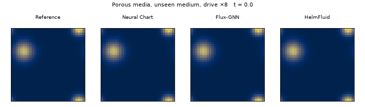 | 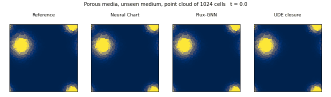 |

| Method | training conditions | temperature ×0.25 | temperature ×4 | drive ×4 | drive ×8 | unseen low-porosity media | 64×64 grid | point cloud | parameters |
|---|---|---|---|---|---|---|---|---|---|
| **Neural Chart** | **0.064** | **0.084** | **0.090** | **0.195** | **0.407** | **0.081** | **0.071** | **0.090** | 5,381 |
| Oracle (true rates in the Neural Chart class) | 0.046 | 0.107 | 0.032 | 0.143 | 0.231 | 0.037 | 0.034 | 0.083 | 0 (true rates) |
| UDE closure | 0.077 | 0.700 | 1.023 | 0.588 | 0.811 | 0.104 | 0.093 | 0.255 | 5,441 |
| Flux-GNN | 0.078 | 0.797 | 2.138 | 1.046 | 1.091 | 0.116 | 0.515 | 0.458 | 151,234 |
| BSMS-GNN | 0.736 | 0.911 | 2.430 | 2.945 | 3.050 | 0.737 | 1.079 | 0.915 | 1,724,417 |
| FNO | 0.510 | 0.894 | 2.256 | 2.544 | 7.262 | 0.460 | 0.516 | N/A | 1,188,609 |
| GENERIC-FNO | 1.852 | 1.210 | 2.562 | 1.272 | 1.146 | 1.021 | 1.428 | N/A | 1,002,388 |
| HelmFluid | 0.846 | 1.154 | 0.472 | 0.930 | 0.976 | 0.946 | N/A | N/A | 9,930,381 |
| Persistence (u(t) = u(0)) | 1.603 | 1.118 | 2.256 | 1.238 | 1.115 | 0.696 | 1.607 | 1.616 | 0 |

| Method | edges violating local detailed balance | samples with σ < 0 | negative values |
|---|---|---|---|
| Neural Chart | 0 | 0 | 0 |
| Oracle | 0 | 0 | 0 |
| UDE closure | 0.688 | 0.882 | 0.236 |
| Flux-GNN | 0.311 | 0 | 0 |
| BSMS-GNN | N/A | N/A | 0.518 |
| FNO | N/A | N/A | 0.512 |
| GENERIC-FNO | N/A | N/A | 0.335 |
| HelmFluid | N/A | N/A | 0.033 |

Under the training conditions the UDE closure and Flux-GNN are close to the Neural Chart (0.077 and 0.078 against 0.064).
Under changed temperature and drive their errors grow to 0.6–2.1, while the Neural Chart stays between 0.08 and 0.41, within a factor of 3 of the oracle.
No edge of the Neural Chart carries flux against the physical force, and no density becomes negative, on any test set.
The UDE closure produces negative densities on all 64 test trajectories.

#### What the flows look like

The animations below follow one test trajectory in an unseen medium.
Tracer particles move with the probability velocity $v=J/\rho$ of each model's own edge flux, so only models with an edge flux appear.
A particle turns magenta in a cell where the local entropy production is negative or where an edge carries flux against the physical force.

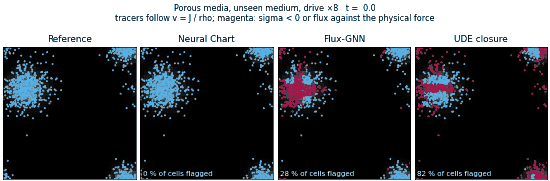

Under drive ×8 the tracers of the Neural Chart follow the reference, and no cell is flagged.
Flux-GNN flags about a third of the cells and the UDE closure about two thirds.

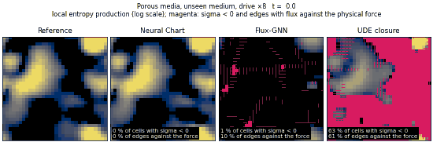

The same scene shows the local entropy production.
It stays non-negative everywhere for the Neural Chart, while the UDE closure has negative entropy production in about half of the cells.

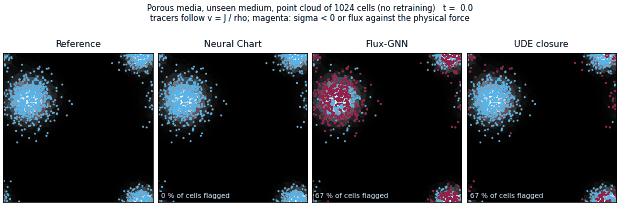

On a random point cloud of 1024 cells, with the parameters trained on the 32×32 grid, the Neural Chart's flow again follows the reference.

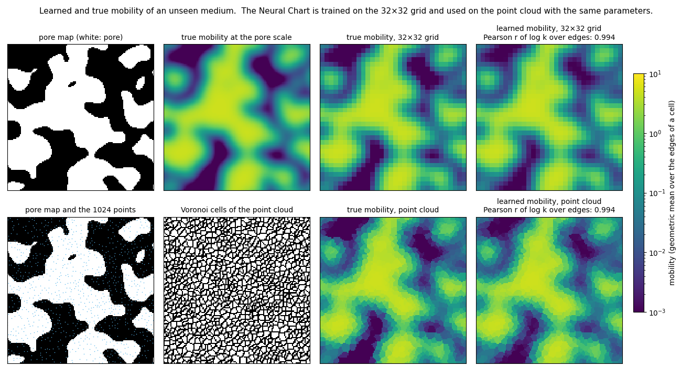

The learned mobility, mapped back to space, matches the true mobility of an unseen medium on the training grid and on the point cloud (Pearson r of log k over edges 0.994 on both).
More animations, including the variant with crowding, are in the [gallery](results/porous_media/gallery/).

### Driven transport through porous media with crowding

The same task with a crowded mobility $M(x)/(1+\bar\rho_e/2)$, where $\bar\rho_e$ is the mean density of the two cells of the edge.
The crowding form is not given to the model.
The Neural Chart reads $\bar\rho_e$ through its monotone state term.

| Drive ×8 on an unseen medium | Point cloud (training conditions) |
|---|---|
| 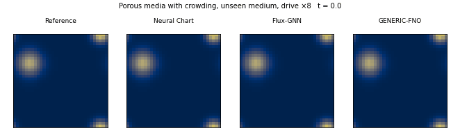 | 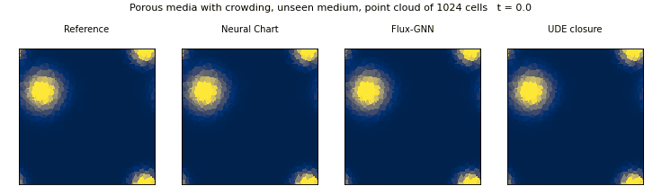 |

| Method | training conditions | temperature ×0.25 | temperature ×4 | drive ×4 | drive ×8 | unseen low-porosity media | 64×64 grid | point cloud | parameters |
|---|---|---|---|---|---|---|---|---|---|
| **Neural Chart** | 0.067 | **0.114** | **0.101** | **0.168** | **0.376** | 0.062 | **0.077** | **0.091** | 5,381 |
| Oracle (true rates in the Neural Chart class) | 0.049 | 0.069 | 0.033 | 0.103 | 0.197 | 0.028 | 0.031 | 0.079 | 0 (true rates) |
| UDE closure | 0.066 | 0.679 | 1.916 | 0.601 | 0.917 | 0.075 | 0.756 | 0.485 | 5,441 |
| Flux-GNN | **0.057** | 0.808 | 2.053 | 0.856 | 1.049 | **0.057** | 0.573 | 0.473 | 151,234 |
| BSMS-GNN | 0.592 | 0.837 | 2.739 | 1.386 | 1.355 | 0.435 | 1.008 | 0.713 | 1,724,417 |
| FNO | 0.464 | 0.898 | 2.370 | 1.897 | 3.316 | 0.386 | 0.469 | N/A | 1,188,609 |
| GENERIC-FNO | 1.158 | 0.924 | 1.768 | 1.098 | 1.054 | 0.371 | 1.206 | N/A | 1,002,388 |
| HelmFluid | 14.957 | 7.914 | 284.284 | 199.367 | 149.037 | 14.371 | N/A | N/A | 9,930,381 |
| Persistence (u(t) = u(0)) | 1.363 | 0.989 | 2.161 | 1.156 | 1.083 | 0.447 | 1.360 | 1.392 | 0 |

| Method | edges violating local detailed balance | samples with σ < 0 | negative values |
|---|---|---|---|
| Neural Chart | 0 | 0 | 0 |
| Oracle | 0 | 0 | 0 |
| UDE closure | 0.808 | 0.999 | 0.194 |
| Flux-GNN | 0.304 | 0 | 0 |
| BSMS-GNN | N/A | N/A | 0.704 |
| FNO | N/A | N/A | 0.560 |
| GENERIC-FNO | N/A | N/A | 0.279 |
| HelmFluid | N/A | N/A | 0.038 |

Under the training conditions and on the unseen low-porosity media Flux-GNN is as accurate as the Neural Chart or slightly better (0.057 against 0.067 and 0.062).
Under changed temperature, drive and discretisation the Neural Chart is 2.4 to 17.5 times more accurate than the best baseline of each column (UDE closure at drive ×8, GENERIC-FNO at temperature ×4).
Without the state input the Neural Chart reaches 0.241 under the training conditions, the same as the oracle without the crowding factor, so the state term is what captures the crowding.
The learned mobility matches the true crowded mobility with a flux-weighted relative error of 0.11 on unseen media (`results/porous_media_crowding/law.md`).

### Brusselator: oscillations and Turing patterns

The Brusselator $A\to X$, $2X+Y\to3X$, $B+X\to Y+D$, $X\to E$ with chemostats $A$, $B$, $D$, $E$ on a 32×32 periodic grid, with diffusing $X$ and $Y$.
Depending on the chemostat levels it shows a limit cycle or Turing patterns.

| Turing pattern formation (a = 1.90, b = 3.90) | Oscillation, both chemostats outside the training range (a = 1.39, b = 4.30) |
|---|---|
| 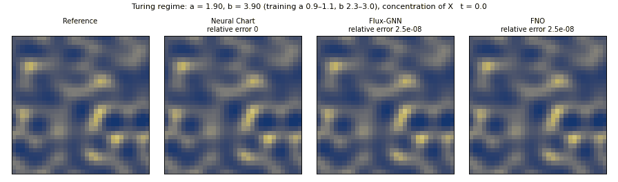 | 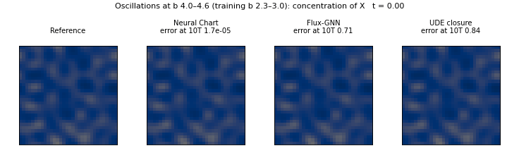 |

In the Turing regime the Neural Chart grows the same stationary pattern as the reference from a random initial field.
Flux-GNN relaxes to a uniform state, and FNO forms a pattern with a different arrangement.
With both chemostat levels outside the training range the Neural Chart follows the oscillating pattern of the reference to t = 40, while Flux-GNN again relaxes to a uniform state and FNO drifts away from the reference.
On these two trajectories Flux-GNN does worse than its median over the test set (0.56 against 0.29 in the Turing regime).
`python -m benchmarks.brusselator.run gifs` renders both animations again.

| Method | training conditions | b 3.2–3.7 | b 4.0–4.6 | a 1.3–1.5 (a and b outside training) | Turing regime (below the Hopf line) | 64×64 grid | parameters |
|---|---|---|---|---|---|---|---|
| **Neural Chart** | **1.6e-04** | **4.7e-05** | **3.7e-05** | **1.3e-04** | **3.8e-05** | **1.7e-04** | 6 |
| Oracle (true rates in the Neural Chart class) | 1.4e-04 | 5.6e-05 | 2.6e-05 | 1.2e-04 | 6.4e-06 | 7.1e-05 | 0 (true rates) |
| CRNN (mass action) | 2.4e-03 | 3.0e-03 | 3.4e-03 | 4.1e-03 | 0.026 | 0.013 | 12 |
| CRNN (condition features) | 0.724 | 0.755 | 0.771 | 0.802 | 0.698 | 0.749 | 4,866 |
| UDE closure | 0.550 | 0.622 | 0.689 | 1.004 | 1.408 | 0.573 | 4,929 |
| Flux-GNN | 0.075 | 0.499 | 0.639 | 0.638 | 0.292 | 0.201 | 151,170 |
| BSMS-GNN | 0.729 | 0.805 | 0.687 | 0.858 | 1.849 | 0.761 | 1,723,522 |
| FNO | 0.297 | 0.370 | 0.678 | 0.639 | 0.321 | 0.697 | 1,188,514 |
| GENERIC-FNO | 0.780 | 0.835 | 1.016 | 0.762 | 0.580 | 0.825 | 1,003,588 |
| Persistence (u(t) = u(0)) | 0.780 | 0.835 | 1.016 | 0.762 | 0.580 | 0.825 | 0 |

In the Turing regime half of the test trajectories start from a uniform state, which is unstable to spatial perturbations. In FP32 integration rounding noise can break the symmetry and grow into a pattern, so the error of these trajectories depends on rounding. This is the source of the 0.026 of CRNN (mass action) in that column. `results/brusselator/NOTES.md` gives the errors on the 16 uniform starts and the 16 spatial starts separately.

| Method | edges violating local detailed balance | samples with σ < 0 | negative values |
|---|---|---|---|
| Neural Chart | 0 | 0 | 0 |
| Oracle | 0 | 0 | 0 |
| CRNN (mass action) | 0.067 | 0 | 0 |
| CRNN (condition features) | 0.311 | 0 | 0 |
| UDE closure | 0.627 | 1.000 | 0.498 |
| Flux-GNN | 0.139 | 0 | 0 |
| BSMS-GNN | N/A | N/A | 0.940 |
| FNO | N/A | N/A | 3.2e-03 |
| GENERIC-FNO | N/A | N/A | 0 |

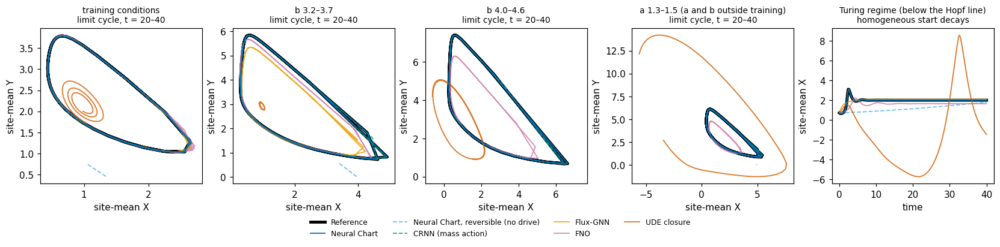

The Neural Chart stays within a factor of 6 of the oracle on every test set.
Outside the Turing regime it is 15 to 92 times more accurate than CRNN (mass action), and the black boxes are at least 470 times less accurate.
Flux-GNN reaches 0.075 under the training conditions, but it loses the limit cycle and the Turing pattern when the conditions change (0.29 to 0.64).
The reversible variant cannot sustain the oscillation, and the variant without convex initialisation stays at a wrong set of rates (errors 0.28 to 0.84, `results/brusselator/ablations.md`).
From its own rates the Neural Chart reads out the entropy production with a relative error of 3–4e-5, while CRNN (mass action) overestimates it by 20 to 27 % and Flux-GNN errs by 0.57 to 1.5 (`results/brusselator/entropy_readout.md`).
GENERIC-FNO coincides with persistence on this task.

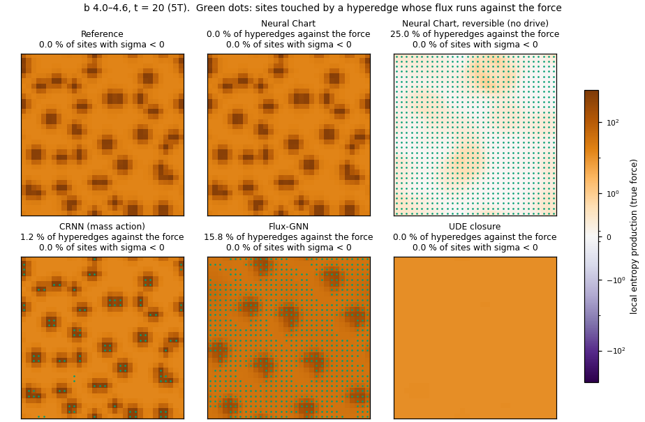

The local entropy production of one trajectory at b 4.0–4.6 and t = 5T, computed with the true force on each model's own state.
Green marks sites touched by a hyperedge with flux against the force.
This is one snapshot, and the fractions over the whole test set are in the physics table above.

### Schlögl model: bistability and travelling fronts

The Schlögl model $A+2X\rightleftharpoons3X$, $X\rightleftharpoons B$ with chemostats $A$, $B$ on an 8×8 periodic grid, with diffusing $X$.
It is bistable, and a planar front between the two states travels with a speed whose sign changes at the Maxwell point.

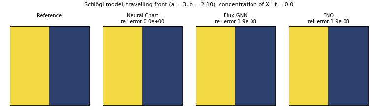

| Method | training conditions | a 3.15–3.35, b 0.3–1.0 | planar fronts, a = 3, b 1.7–2.3 | 16×16 grid | parameters |
|---|---|---|---|---|---|
| **Neural Chart** | **2.2e-06** | **1.7e-06** | **2.0e-06** | **2.1e-06** | 3 |
| Oracle (true rates in the Neural Chart class) | 2.0e-06 | 1.7e-06 | 2.0e-06 | 2.1e-06 | 0 (true rates) |
| CRNN (mass action) | 4.1e-06 | 3.7e-06 | 5.8e-06 | 3.5e-06 | 6 |
| CRNN (condition features) | 0.059 | 1.405 | 0.073 | 0.010 | 4,674 |
| UDE closure | 0.123 | 0.923 | 0.057 | 0.172 | 4,737 |
| Flux-GNN | 0.018 | 0.943 | 6.4e-03 | 1.4e-03 | 150,850 |
| FNO | 0.025 | 0.952 | 8.6e-03 | 0.014 | 172,545 |
| BSMS-GNN | 0.022 | 1.037 | 0.011 | 0.056 | 1,392,001 |
| GENERIC-FNO | 2.246 | 4.569 | 0.581 | 0.659 | 1,002,004 |
| Persistence (u(t) = u(0)) | 2.246 | 4.569 | 0.581 | 0.659 | 0 |

| Method | hyperedges violating local detailed balance | samples with σ < 0 | negative values |
|---|---|---|---|
| Neural Chart | 0 | 0 | 0 |
| Oracle | 0 | 0 | 0 |
| CRNN (mass action) | 0 | 0 | 0 |
| CRNN (condition features) | 0.164 | 0 | 0 |
| UDE closure | 0.456 | 0.835 | 0.043 |
| Flux-GNN | 0.241 | 0.235 | 0 |
| FNO | N/A | N/A | 7.2e-03 |
| BSMS-GNN | N/A | N/A | 0.240 |
| GENERIC-FNO | N/A | N/A | 0 |

The Neural Chart and CRNN (mass action) are both at the floor of the integrator, which the oracle shows at about 2e-6.
Here the truth is ideal mass action, which lies inside both model classes.
The black boxes reach 1e-3 to 1e-2 in the training ranges and fail at the new chemostat levels (errors near 1).
GENERIC-FNO equals persistence on this task: its instance normalisation removes the spatial mean of every update, and the update collapses to zero.

### Schlögl model with non-ideal (crowded) activities

The same network with mass action in the activity $y=x\gamma(x)$, $\ln\gamma(x)=\Phi x/(1-\Phi x)$, $\Phi=0.25$.
The Neural Chart learns $\ln\gamma$ as a monotone correction of the chemical potential, with variable projection in the closed-form step.

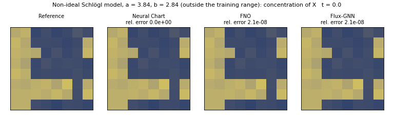

| Method | training conditions | a 3.5–4.0, b 2.0–3.5 | 16×16 grid | parameters |
|---|---|---|---|---|
| **Neural Chart** | **5.3e-04** | **0.012** | **4.0e-04** | 52 |
| Oracle (true rates in the Neural Chart class) | 1.4e-06 | 1.1e-07 | 1.9e-06 | 0 (true rates) |
| CRNN (mass action) | 0.060 | 0.726 | 0.062 | 6 |
| CRNN (condition features) | 0.026 | 0.340 | 0.035 | 4,674 |
| UDE closure | 0.046 | 0.645 | 0.046 | 4,737 |
| Flux-GNN | 1.8e-03 | 0.265 | 2.7e-03 | 150,850 |
| FNO | 2.6e-03 | 0.033 | 2.4e-03 | 172,545 |
| BSMS-GNN | 0.011 | 0.411 | 0.054 | 1,392,001 |
| GENERIC-FNO | 1.117 | 0.565 | 1.060 | 1,002,004 |
| Persistence (u(t) = u(0)) | 1.117 | 0.565 | 1.060 | 0 |

| Method | hyperedges violating local detailed balance | samples with σ < 0 | negative values |
|---|---|---|---|
| Neural Chart | 8.2e-06 | 0 | 0 |
| Oracle | 0 | 0 | 0 |
| CRNN (mass action) | 0.253 | 0 | 0 |
| CRNN (condition features) | 0.395 | 0.604 | 0 |
| UDE closure | 0.195 | 0.292 | 0 |
| Flux-GNN | 0.517 | 0.890 | 0 |
| FNO | N/A | N/A | 9.5e-05 |
| BSMS-GNN | N/A | N/A | 0 |
| GENERIC-FNO | N/A | N/A | 0 |

FNO is close to the Neural Chart here: 0.033 against 0.012 at the higher concentrations, and within a factor of 6 elsewhere.
It produces negative concentrations on two trajectories.
CRNN (mass action) cannot represent the non-ideal activity and reaches 0.73 at the higher concentrations.
The learned $\ln\gamma$ has slope 0.997 against the truth over the training range (`results/schlogl_nonideal/activity_coefficient.md`).
The few edges of the Neural Chart counted against the true force (8e-6) are edges where that force is close to zero and the learned $\ln\gamma$ differs slightly from the truth.

### Driven phosphorylation cycle

A substrate $X$ is phosphorylated by an immobile enzyme, $X+E+\mathrm{ATP}\rightleftharpoons X_p+E+\mathrm{ADP}$, and dephosphorylated, $X_p\rightleftharpoons X$, on an 8×8 periodic grid.
$X$ and $X_p$ diffuse in a smooth potential $U$.
The free energy of ATP hydrolysis $\Delta G$ drives a net current around the cycle.

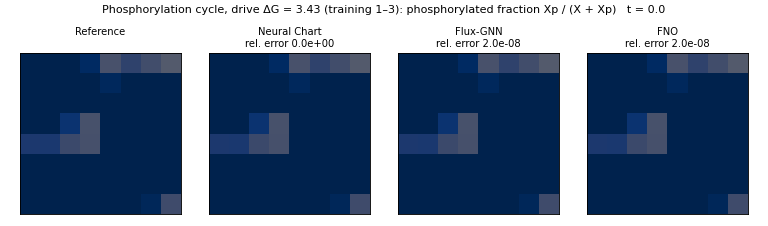

The animation shows the phosphorylated fraction $X_p/(X+X_p)$.

| Method | training conditions (ΔG 1–3) | drive ΔG 3–4 | stronger, finer potential U | 16×16 grid | parameters |
|---|---|---|---|---|---|
| **Neural Chart** | **3.3e-06** | **2.3e-06** | **2.6e-06** | **3.4e-06** | 4 |
| Oracle (true rates in the Neural Chart class) | 2.0e-06 | 1.7e-06 | 1.4e-06 | 1.9e-06 | 0 (true rates) |
| CRNN (mass action) | 0.017 | 0.018 | 0.021 | 0.025 | 10 |
| CRNN (condition features) | 5.2e-03 | 0.045 | 0.011 | 7.6e-03 | 4,866 |
| UDE closure | 0.018 | 0.057 | 0.130 | 0.026 | 5,121 |
| Flux-GNN | 2.1e-03 | 0.038 | 0.113 | 4.1e-03 | 151,170 |
| FNO | 0.022 | 0.050 | 0.600 | 0.534 | 172,867 |
| BSMS-GNN | 0.180 | 0.189 | 0.449 | 0.350 | 1,392,515 |
| GENERIC-FNO | 1.049 | 0.967 | 1.034 | 0.904 | 1,005,172 |
| Persistence (u(t) = u(0)) | 0.836 | 0.909 | 0.917 | 0.795 | 0 |

| Method | hyperedges violating local detailed balance | samples with σ < 0 | negative values |
|---|---|---|---|
| Neural Chart | 0 | 0 | 0 |
| Oracle | 0 | 0 | 0 |
| CRNN (mass action) | 0.068 | 0 | 0 |
| CRNN (condition features) | 0.222 | 0 | 0 |
| UDE closure | 0.405 | 0 | 0.032 |
| Flux-GNN | 0.140 | 0 | 0 |
| FNO | N/A | N/A | 0.037 |
| BSMS-GNN | N/A | N/A | 0.191 |
| GENERIC-FNO | N/A | N/A | 0.109 |

The Neural Chart reaches the floor of the integrator on every test set, including the stronger drive and the new potential.
The best baseline, Flux-GNN, is at 2e-3 under the training conditions and at 0.11 in the new potential.
CRNN (mass action) stays near 0.02 on every test set.

### MAPK cascade

The Huang–Ferrell MAPK cascade with 22 species and 20 reactions (binding and catalysis of every enzymatic step) on a 4×4 grid.
ATP, ADP and $P_i$ are chemostatted, and the kinase MAPK diffuses.
The test sets change the ATP level and the initial state.

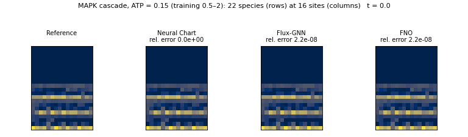

The animation shows all 22 species at the 16 sites.

| Method | training conditions (ATP 0.5–2) | ATP 3–5 | ATP 0.15–0.3 | phosphorylated initial states | parameters |
|---|---|---|---|---|---|
| **Neural Chart** | **6.0e-03** | **4.2e-03** | **9.9e-04** | **6.1e-03** | 23 |
| Oracle (true rates in the Neural Chart class) | 7.1e-06 | 5.8e-06 | 7.3e-06 | 6.0e-06 | 0 (true rates) |
| CRNN (mass action) | 8.5e-03 | 0.027 | 0.020 | 8.7e-03 | 46 |
| CRNN (condition features) | 8.1e-03 | 0.032 | 0.099 | 8.3e-03 | 5,890 |
| UDE closure | 0.090 | 0.745 | 0.390 | 0.084 | 8,641 |
| Flux-GNN | 6.3e-03 | 0.115 | 0.409 | 6.1e-03 | 153,410 |
| FNO | 0.469 | 0.819 | 0.675 | 0.472 | 61,206 |
| BSMS-GNN | 2.307 | 8.783 | 4.501 | 10.463 | 1,066,006 |
| GENERIC-FNO | 1.682 | 1.734 | 1.563 | 1.818 | 1,035,220 |
| Persistence (u(t) = u(0)) | 0.649 | 0.755 | 0.407 | 1.181 | 0 |

| Method | hyperedges violating local detailed balance | samples with σ < 0 | negative values |
|---|---|---|---|
| Neural Chart | 0 | 0 | 0 |
| Oracle | 0 | 0 | 0 |
| CRNN (mass action) | 0.054 | 0 | 0 |
| CRNN (condition features) | 0.232 | 0 | 0 |
| UDE closure | 0.837 | 1.000 | 0.354 |
| Flux-GNN | 0.133 | 0 | 0 |
| FNO | N/A | N/A | 0.421 |
| BSMS-GNN | N/A | N/A | 0.495 |
| GENERIC-FNO | N/A | N/A | 0.362 |

Flux-GNN ties the Neural Chart in distribution: 6.3e-3 against 6.0e-3 under the training conditions, and 6.1e-3 for both from phosphorylated initial states.
At new ATP levels the Neural Chart keeps its error (4.2e-3 and 9.9e-4), while Flux-GNN reaches 0.12 and 0.41 and CRNN (mass action) 0.027 and 0.020.
ATP enters the Neural Chart only through the force and the chemostat factor, so a new ATP level changes no learned parameter.

## Ablations

Every ablation is the Neural Chart with one change (`neuralchart/chart.py`, `CONFIGS`).
The tables are in `results/<benchmark>/ablations.md`.

| Variant | What it removes | Tested on | Effect (10T error) |
|---|---|---|---|
| Neural Chart, no state input | the state term $s\,m(\log s_h)$ of the mobility | porous media (both) | with crowding 0.067 → 0.241 under the training conditions (the level of the oracle without crowding), without crowding 0.064 → 0.070 |
| Neural Chart, constant mobility | the material network $g_\theta$: one $\omega$ for all edges | porous media | 0.064 → 1.18 |
| Neural Chart, learned drive scale | the fixed drive scale: a global factor on $A$ is learned | porous media | no change in accuracy (it converges to 0.996), but the force no longer matches the physical one exactly: 0.1 % of edges violate local detailed balance |
| Neural Chart, learned standard potentials | the given $\mu^0$: they are learned with $k$ | reaction networks | similar error in the training ranges. On the MAPK cascade 5 to 11 times worse at new ATP levels, and up to 2 % of hyperedges violate local detailed balance against the true force |
| Neural Chart, no convex initialisation | the closed-form NNLS start: $\omega$ starts at 1 | reaction networks | Schlögl 2e-6 → 1e-3, phosphorylation cycle 3e-6 → 0.08, MAPK 6e-3 → 0.15, non-ideal Schlögl 5e-4 → 0.09 |
| Neural Chart, reversible (no drive) | the drive: $A=0$, so the model has a detailed-balanced equilibrium | reaction networks | errors of 0.4 to 3.4: the non-equilibrium steady states cannot be represented |
| Neural Chart, ideal activities | the activity correction: $\ln\gamma=0$ | non-ideal Schlögl | 5.3e-4 → 0.084, and 0.012 → 1.73 at the higher concentrations |
| Neural Chart, ideal-fit initialisation | the variable projection: ideal NNLS start, then rollout refinement | non-ideal Schlögl | 5.3e-4 → 0.021, and 0.012 → 1.31 at the higher concentrations. $\ln\gamma$ is not recovered (slope 0.08) |

## Reproduce

**Environment.** Python 3.10 or later, PyTorch 2.4 or later, NumPy and SciPy.
The reported runs used PyTorch 2.14 with CUDA 13.0.

```bash
pip install -e ".[bench]"
pytest                      # unit tests, under a minute on a CPU
pytest -m slow              # regression tests on the benchmark data (needs data/, see below)
```

**Data.** Every benchmark generates its reference data.
The data go to `data/<benchmark>/`, or to `$NEURALCHART_DATA/<benchmark>` when that variable is set.

```bash
python -m benchmarks.porous_media.run generate --variant porous_media --device cuda           # finite volumes on 128×128 in FP64, about 3 h
python -m benchmarks.porous_media.run generate --variant porous_media_crowding --device cuda  # about 3 h
python -m benchmarks.brusselator.run generate                  # CPU processes, about a minute
python -m benchmarks.schlogl.run generate                      # CPU, seconds
python -m benchmarks.schlogl_nonideal.run generate
python -m benchmarks.phosphorylation_cycle.run generate
python -m benchmarks.mapk_cascade.run generate                 # CPU, about a minute
```

**Evaluate the shipped checkpoints.** The Neural Chart checkpoints of every benchmark are in `checkpoints/`.

```bash
python -m scripts.evaluate --benchmark porous_media --model chart --settings
python -m scripts.evaluate --benchmark schlogl_nonideal --model chart
```

**Train.** One command per model and benchmark.
Results go to `runs/<benchmark>/`.
The fast integrator (`--fast`, error control in FP32) is the setting of every reported number.

```bash
python -m scripts.train --benchmark porous_media --model chart --device cuda --fast
python -m scripts.train --benchmark porous_media_crowding --model chart --device cuda --fast
python -m scripts.train --benchmark brusselator --model chart --device cuda --fast
python -m scripts.train --benchmark schlogl --model chart --device cuda
python -m scripts.train --benchmark schlogl_nonideal --model chart --device cuda
python -m scripts.train --benchmark phosphorylation_cycle --model chart --device cuda
python -m scripts.train --benchmark mapk_cascade --model chart --device cuda
```

Model keys: `chart` and its variants (`chart-no-state`, `chart-const-k`, `chart-learned-drive`, `chart-learned-mu0`, `chart-zero-init`, `chart-reversible`, `chart-ideal`, `chart-no-varpro`), `oracle`, and the baselines `ude`, `flux_gnn`, `crnn_mass_action`, `crnn_features`, `fno`, `bsms`, `generic_fno`, `helmfluid` (porous media only) and `persistence`.
HelmFluid needs its upstream code (see [THIRD_PARTY.md](THIRD_PARTY.md)).

**Tables and animations.**

```bash
python -m scripts.make_tables --benchmark all                        # results/<benchmark>/*.md and *.csv
python -m scripts.make_tables --benchmark schlogl --runs runs/schlogl # tables from your own runs
python -m scripts.make_gifs --benchmark porous_media --device cuda    # assets/*.gif (baseline weights from runs/)
```

**Training times.** Projected times for 4000 training steps on one NVIDIA L40 with the recommended flags.
The Neural Chart needs `--fast` only.
The UDE closure uses `--fast --control err_only --compile_rates`, and Flux-GNN `--fast --compile_rates --fuse_net`.
On the Brusselator both also use `--compact`.
≈ marks a time taken from a measurement on other hardware or without these flags.
The sources are in `results/<benchmark>/NOTES.md`.

| Benchmark | Neural Chart | UDE closure | Flux-GNN | FNO, BSMS-GNN, GENERIC-FNO, HelmFluid |
|---|---|---|---|---|
| porous media (each variant) | ≈ 15 to 25 min | 7 min | 1.1 h | 3 to 30 min |
| Brusselator | ≈ 20 min | 35 min | 6.6 h | ≈ 3 to 8 min |
| Schlögl, non-ideal Schlögl, phosphorylation cycle | ≈ 5 to 15 min | 4 min | ≈ 15 to 30 min | ≈ 1 to 3 min |
| MAPK cascade | ≈ 30 min | 6 min | ≈ 35 min | 1 to 5 min |

The Neural Chart numbers of the reaction networks were produced on a CPU.
A run on a GPU differs from them at FP32 rounding level.

**Speed options** of the fast integrator, all off by default and with the same scheme:
`--compact` lets finished trajectories leave the batch,
`--compile_rates` compiles the rate evaluation with `torch.compile` (needs the CPython headers),
and `--fuse_net` merges the gathers of Flux-GNN.
They change results only at FP32 rounding level.

## Repository layout

```
neuralchart/            the library
  model.py              master equation: free energy, mobility, drive, rates
  chart.py              Neural Chart configurations (CONFIGS) and ablations
  fit.py                closed-form NNLS, variable projection, rollout training
  integrators.py        positive SSP-RK2
  fast.py               fast integrator with error control (GPU and CPU)
  diagnostics.py        local detailed balance rule
  graphs.py             hypergraphs of reaction and transport networks
  baselines/            Flux-GNN, CRNN, BSMS-GNN, GENERIC-FNO, HelmFluid wrapper
benchmarks/<name>/      data generation, test sets, models, evaluation, tables, animations, entry point run.py
scripts/                train, evaluate, make_tables, make_gifs, physics_summary
results/<name>/         tables (markdown and csv) and the run files they are built from
checkpoints/<name>/     trained Neural Chart checkpoints
assets/                 animations of this page
docs/                   method and protocol, theory
tests/                  unit and regression tests
```

## Theory

[docs/theory.md](docs/theory.md) states the results behind the design.
Theorem 0 shows that fixing the force and learning only the mobility gives the second law, exact transfer across conditions, a convex closed-form fit and a clear identifiability criterion for every parameter value.
It also shows that gray-box models whose learned part sees the conditions, or that learn the force, lose these properties.
The other results cover minimal observables, a Cramér–Rao bound for near-irreversible steps, closed-form coarse graining, and the information geometry of the chart.

## Licence

MIT (see [LICENSE](LICENSE)). Third-party code and methods are listed in [THIRD_PARTY.md](THIRD_PARTY.md).
