# Fisher–Hodge operators

Neural operators for density dynamics on graphs and meshes, written in the geometry the densities live in.

A density field on a graph evolves by moving mass along edges. We write the learned dynamics as a discrete Wasserstein gradient flow of a learned free energy, plus a learned circulation term and a learned reaction term:

```
dρ/dt = − dᵀ Θ(ρ) d μ_θ(ρ)   −   dᵀ ( Θ(ρ) c_θ )   −   ρ ⊙ r_θ(ρ)
          gradient flow            circulation           reaction
```

Here `d` is the fixed incidence matrix of the graph (node to edge), `Θ(ρ)` is the edge mobility given by the logarithmic mean of the two endpoint densities times a learned edge coefficient, and `μ_θ = ∂F_θ/∂ρ` is the chemical potential of a learned free energy `F_θ`. The first term is the Maas metric form of a Fokker–Planck equation. The second term lives in the cycle space of the graph and carries non-equilibrium circulation. The third term is a Fisher–Rao reaction written as an Otto flux to a reservoir node, which reduces to logistic growth when `F` is the entropy.

Three properties hold for every parameter value, so training never has to learn them:

- Total mass is conserved, because `1ᵀ dᵀ = 0`.
- Densities stay positive, because the logarithmic-mean mobility vanishes at zero density.
- The free energy decreases along the flow, `dF/dt = −‖d μ‖²_Θ ≤ 0`.

The operator `dᵀ Θ d` is the Hodge block of Riemannian Hodge Message Passing (RHMP) with the cochain metric set to the Otto metric of the current density. This repository contains the mechanism experiments, the Markov-chain analysis and the scripts that make the figures below.

## What the figures show

All rollouts train on one time unit (`T = 1`, 20 steps) and are tested out to `10 T`. The green frame marks the training window. Cyan and magenta cells are negative densities. The two numbers in each panel are the total mass and the minimum density.

### Fokker–Planck with circulation (S2): potential plus divergence-free drift

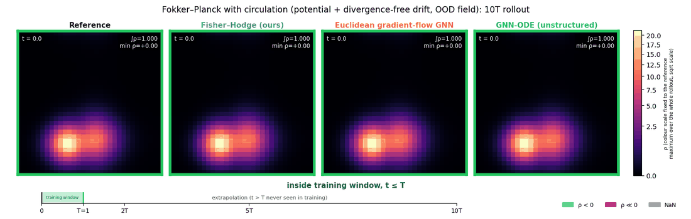

The Fisher–Hodge operator stays on top of the reference solution for the whole rollout, with total mass equal to one and no negative cells. The Euclidean gradient-flow GNN produces negative densities inside the training window. The unstructured GNN-ODE roughly doubles the total mass by `10 T`.

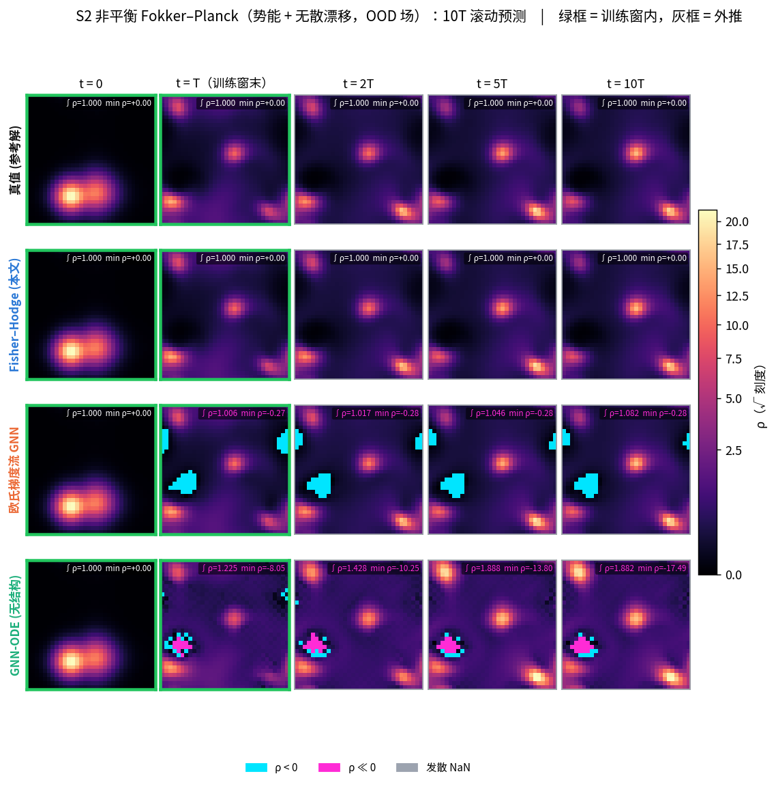

### Steady-state circulation (S2)

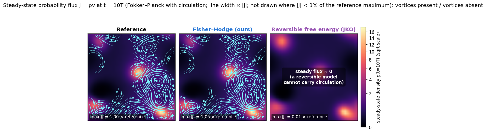

At `10 T` the density no longer changes, but probability still flows around closed loops. The streamlines of the probability flux `J = ρ v` show these loops in the reference solution and in the Fisher–Hodge operator (peak flux 1.05 times the reference). A free-energy model that assumes reversible dynamics, trained in the style of Rancati, Maas and Locatello (2026), has a steady flux of one percent of the reference, so its panel is empty.

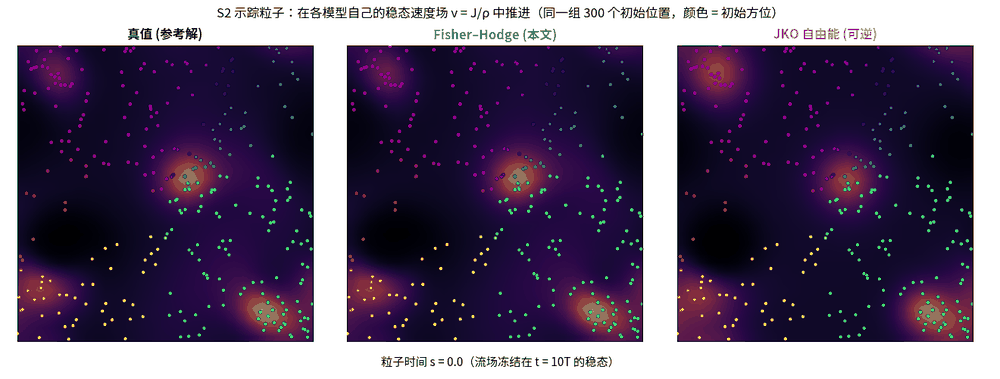

The same point, seen through tracer particles advected by each model's own steady velocity field `v = J/ρ`. Particles in the reference and in the Fisher–Hodge field orbit the same loops. Particles in the reversible model barely move.

### Fisher–KPP reaction–diffusion (S3)

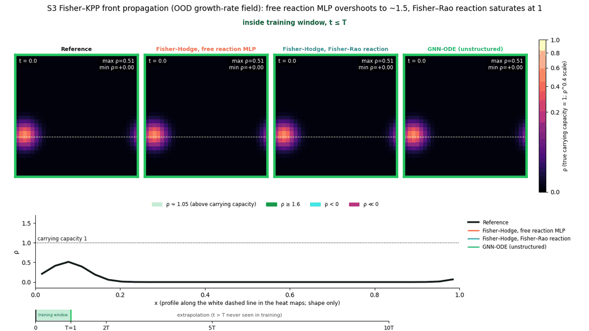

Green marks densities above the true carrying capacity of one. A free reaction network overshoots to 1.5, because the training trajectories never reach saturation and the carrying capacity is not identifiable from them. The Fisher–Rao reaction term saturates at 1.00 and recovers the carrying capacity and the growth rate from the same data. The GNN-ODE never grows and develops a negative pocket.

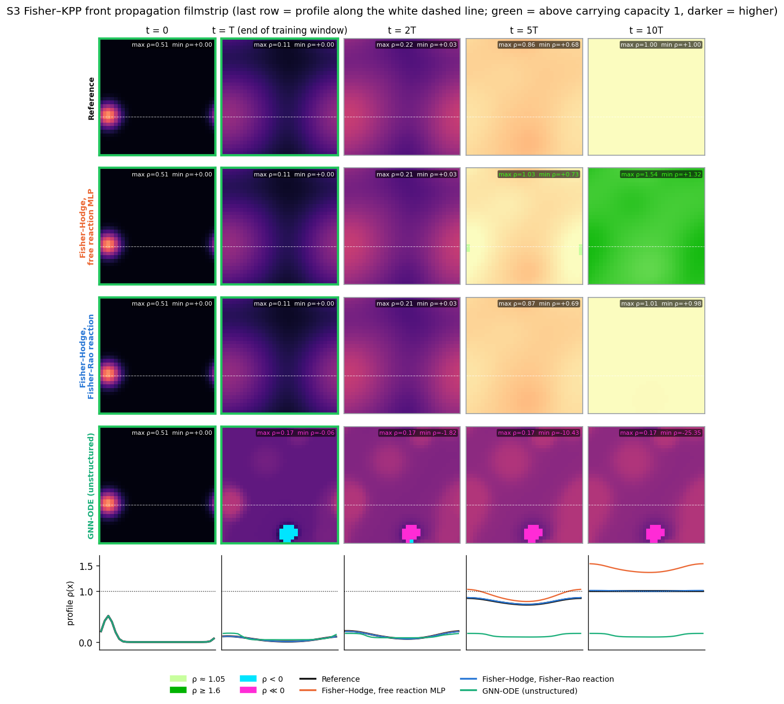

### Crowding mobility, outside the model class (S5)

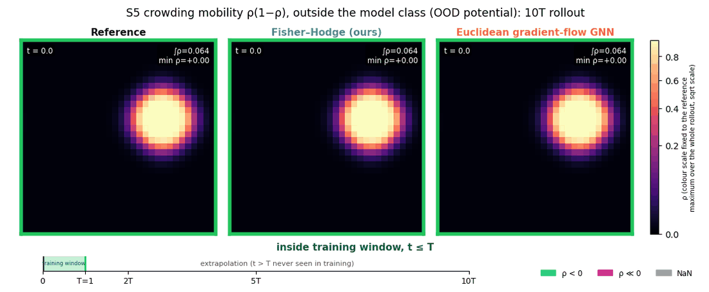

The reference solver here uses a crowding mobility `ρ(1 − ρ)`, which the operator cannot represent exactly. Its error grows from 0.003 to 0.02, and mass conservation and positivity still hold. The Euclidean gradient-flow model drifts in mass and goes negative as before.

### Hodge decomposition of a non-equilibrium Markov chain

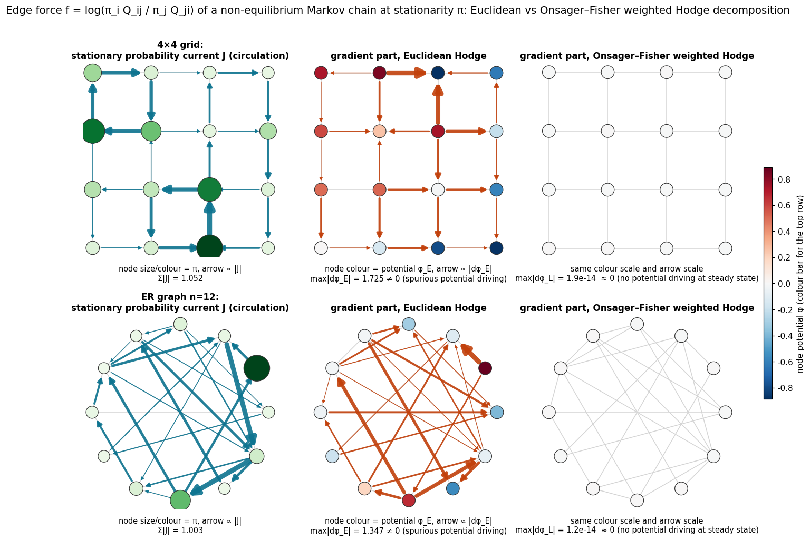

At a non-equilibrium steady state the edge force `f = log(π_i Q_ij / π_j Q_ji)` should contain no gradient part, because the density no longer moves downhill. The Euclidean Hodge decomposition still reports a potential and a set of gradient arrows (maximum 1.7). The decomposition weighted by the Onsager–Fisher coefficients `ℓ = J/f` reports zero (maximum 1e-14). The weighted decomposition also splits the entropy production exactly into an excess part and a housekeeping part. The Euclidean one misassigns 10 to 28 percent of the entropy production, and this bias does not shrink with more data.

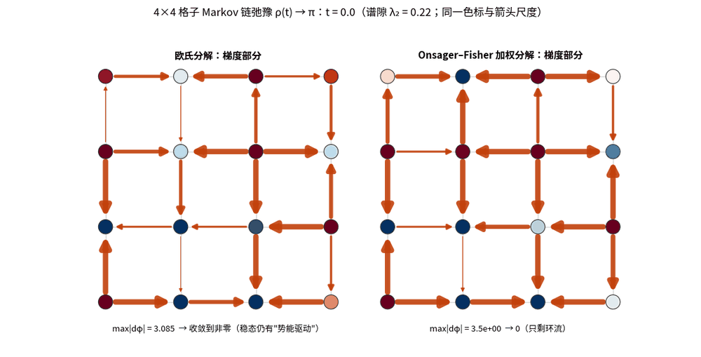

## Numbers

Relative L2 error at `10 T`, median over 16 test trajectories, mean over three seeds. The three columns are the in-distribution test set, a test set with potentials from a different distribution, and a test set with initial conditions from a different distribution.

| System | Fisher–Hodge | Euclidean gradient-flow GNN | GNN-ODE | Reversible free energy (JKO) |
|---|---|---|---|---|
| Fokker–Planck (S1) | 0.0034 / 0.017 / 0.0026 | 0.25 / 0.27 / 0.15 | 0.29 / 1.48 / 0.32 | 0.0086 / 0.017 / 0.0093 |
| Fokker–Planck with circulation (S2) | 0.0033 / 0.014 / 0.0032 | 0.030 / 0.069 / 0.031 | 0.26 / 0.96 / 0.30 | 0.25 / 0.46 / 0.25 |
| Fisher–KPP reaction–diffusion (S3) | 0.017 / 0.016 / 0.013 | 3.6 / 3.8 / 3.7 | 0.90 / 2.4 / 0.90 | – |
| Crowding mobility, outside the model class (S5, one seed) | 0.020 / 0.022 / 0.016 | 0.096 / 0.195 / 0.162 | – | – |

Mass drift of the Fisher–Hodge operator is below 4e-7 in every run, and no test trajectory contains a negative cell. Full tables are in `results/`.

Two caveats. The GNN-ODE baseline was trained for 4000 steps and its loss was still falling. A longer run was interrupted at 7000 steps with a loss three times lower, so the GNN-ODE column overstates the gap. The reference solvers for the three main systems (S1 to S3) lie inside the operator's model class. The nonlinear-mobility systems (S4, S5) are the first tests outside it, and the non-local system (S6) has not been run.

## What the Hodge structure contributes, and where the gaps come from

The Hodge part of the method fixes the form of the operator. Every model in this repository that moves mass does so through

```
K = dᵀ H d
```

`d` takes differences between neighbouring nodes. `H` decides how much flow each difference produces. `dᵀ` collects the flows on the edges into the change of density at each node. The project sets `H` to a weight that depends on the density itself,

```
H_e(ρ) = κ_e · Λ(ρ_i, ρ_j),      Λ(a, b) = (a − b) / (log a − log b),
```

where `Λ` is the logarithmic mean of the two endpoint densities and `κ_e > 0` is learned. The same difference in potential therefore drives different amounts of flow at different densities. This choice of `H` is the Otto metric of discrete Wasserstein transport (Maas 2011). The circulation term adds a second driving field on the edges. For Fokker–Planck with circulation (S2) the model reads

```
dρ/dt = − dᵀ [ κ Λ(ρ) d μ   +   Λ(ρ) c_θ ].
            gradient transport    extra drive
```

A reversible JKO model has only the first term, so its net flow vanishes at a true steady state. The reference system with circulation (S2) keeps a non-zero probability current at steady state, and the second term is what lets the Fisher–Hodge operator represent it. Against the reversible baseline, the first thing the method settles is therefore whether the true dynamics can be expressed at all.

Three points keep this comparison honest.

First, the JKO baseline uses the same logarithmic-mean mobility. Both model classes carry the same transport geometry, so the large gap on Fokker–Planck with circulation (S2) cannot be read as "Fisher–Hodge has information geometry and JKO does not". That gap comes from the circulation term. On plain Fokker–Planck (S1), where no circulation exists, the two models are within a factor of three of each other.

Second, the diffusion law is written into the structure, which makes the learning problem easier. The chemical potential contains `log ρ`, and the logarithmic mean satisfies `Λ(ρ_i, ρ_j) (log ρ_j − log ρ_i) = ρ_j − ρ_i`. This term alone produces the standard discrete diffusion operator. The network learns the coefficients `κ`, a correction to the potential, and how the drive acts. The inputs also include the true potential `U` and the two fields `dpsi` and `psin` that generate the drive, so the task is to learn the evolution given these fields. The baselines receive the same inputs.

Third, conservation and positivity help long rollouts. Because the flows are assembled through `dᵀ`, the total mass is conserved exactly. The integrator uses adaptive substeps to keep the density positive. Both mechanisms reduce mass drift and numerical blow-up far beyond the training window. The GNN and Euclidean baselines integrate differently, and the GNN was not trained to convergence, so the gap to them mixes model structure, numerics and optimisation.

The evidence supports the following attribution.

| Comparison | Cause best supported by the evidence |
|---|---|
| Against the reversible JKO model | The operator can represent non-equilibrium drive and steady circulation. |
| Against the plain GNN and the Euclidean gradient-flow GNN | A structure close to the governing equation, exact mass conservation and positivity-preserving integration act together. Their separate contributions have not been isolated. |

Separating these contributions, with a converged GNN and a mass-conserving positive GNN baseline, is the next step before the method's own contribution can be stated cleanly.

## Where the geometry lives

The whole model rests on one relation between flux and force on each hyperedge, `J = Λ(a, b) · f` with `Λ(a, b) = (a − b) / (log a − log b)`.

On the node side, the geometry depends on how mass moves. A transport edge moves mass from one node to a neighbour and keeps the total fixed. This is the discrete Wasserstein geometry of Maas (2011). A reaction hyperedge converts mass in place according to its stoichiometry. This is the Hessian geometry of chemical reaction networks (Mielke 2011), which is of Fisher–Rao type. The code treats both with the same `Λ`, so the two geometries combine into one Wasserstein–Fisher–Rao structure.

On the edge side, the information geometry is present even for pure transport. The forward and backward rates form an exponential family in the chemical potential `μ` and the drive `A`. The concentrations are the mixture coordinates and the potentials are the natural coordinates of a dually flat structure, whose Bregman divergence is the relative entropy and serves as the Lyapunov function. The coefficient `Λ(a, b)` equals `∫₀¹ a^{1−s} b^{s} ds`, the Fisher information of the jump count with respect to its log rate, averaged along the exponential geodesic from the forward rate to the backward rate. At equilibrium it reduces to the Fisher information itself. The Hodge decomposition weighted by `Λ`, which splits the dissipation into relaxation and steady circulation, is the Pythagorean theorem of this Fisher metric. The identifiability statement below is a statement about the dual spaces: forces live in the natural coordinates, currents in the mixture coordinates, and `ker S` is orthogonal to `im Sᵀ` in the `Λ` metric. The closed-form coarse-graining rule follows from the closure of exponential families under state merging.

## Second round: a learned master equation on hypergraphs

The first round left a gap. The neural operator uses the logarithmic mean of the two endpoint densities, while the Markov-chain analysis uses the logarithmic mean of the forward and backward jump rates. The two agree only when the potential is the same at both ends of an edge. The second round closes the gap by learning the rates themselves.

For a hypergraph with hyperedges `h`, each with reactant and product stoichiometry `ν_h⁺` and `ν_h⁻`, the model is

```
a_h = k_h · exp(⟨ν_h⁺, μ⟩ + A_h/2),   b_h = k_h · exp(⟨ν_h⁻, μ⟩ − A_h/2),   dc/dt = S (a − b)
```

with `S = ν⁻ − ν⁺` the stoichiometric matrix. A transport edge is the hyperedge `X at i → X at j`, so transport and reactions share one formula. The learned objects are the chemical potential `μ = ∂F_θ/∂c`, a symmetric kinetic prefactor `k_h > 0`, and a drive `A` in the cycle space `ker S`. When `μ = log c + U`, the rate `a_h` is the mass-action law. Every conserved moiety in `ker Sᵀ` is conserved exactly, concentrations stay positive, the free energy decreases when `A = 0`, and the entropy production `σ = Σ_h (a_h − b_h) log(a_h / b_h)` is non-negative. On transport edges the logarithmic mean of `(a_h, b_h)` is the Maas transport metric, and on reaction hyperedges it is the Hessian metric of chemical reaction networks. Code: `fisher_hodge/models_tcme.py` (graphs) and `hyper/hyperme.py` (hypergraphs). Tables: `results/tcme_summary.md`, `results/crn_summary.md`.

Four things came out of this round.

**The learned rates give correct thermodynamic readouts.** On Fokker–Planck with circulation (S2), the learned master equation matches the Fisher–Hodge operator in accuracy (10T error 0.003 in distribution, 0.016 on new potentials). Its stationary flux is within 0.9 percent of the reference, the curl of the flux within 1.2 percent, and the entropy production within 1 percent of the exact 64×64 steady state. The weighted Hodge split of the learned force gives an excess part of 1e-16 at the steady state. The same split with Euclidean weights misassigns 8 to 18 percent of the entropy production.

**Density data cannot see dissipation, and the blind spot has a dimension.** Because `dc/dt = S J`, any current in `ker S` leaves the densities unchanged. Entropy production and cycle affinities live exactly there. On a chemostatted phosphorylation cycle on an 8×8 grid (`hyper/`), `ker S` has dimension 257. A reversible model fits the trajectories as well as the full model but reports an entropy production that decays to zero, against a true value near 300. Adding one global observable, the ATP turnover rate, makes exactly one more direction identifiable. Adding four local currents makes four. When a reversible model is forced to fit the current observable, its trajectory error jumps from 2 to 30 percent. A CRNN-style baseline given the same observable fits the current but its affinities and entropy production do not improve.

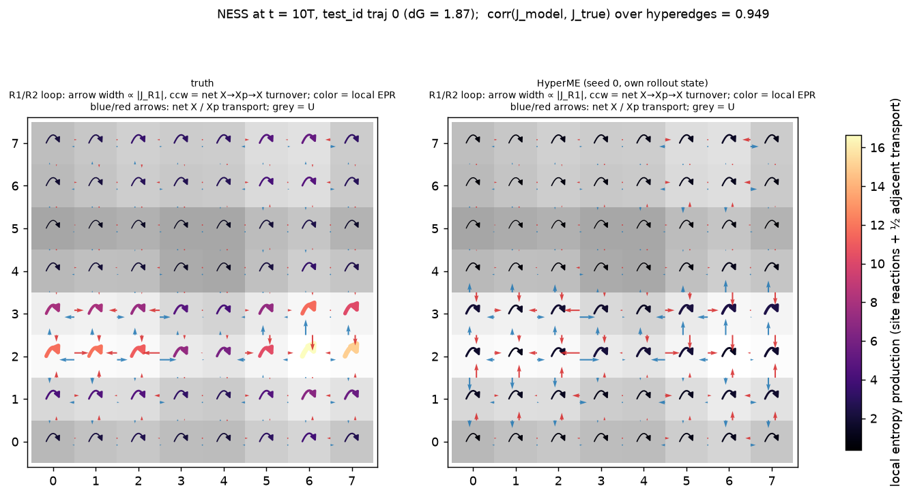

Steady state of the phosphorylation cycle: reaction loops at each site, transport arrows between sites, colour is the local entropy production. The learned model recovers the currents (correlation 0.95 to 0.98) and underestimates the local dissipation, for the reason just given.

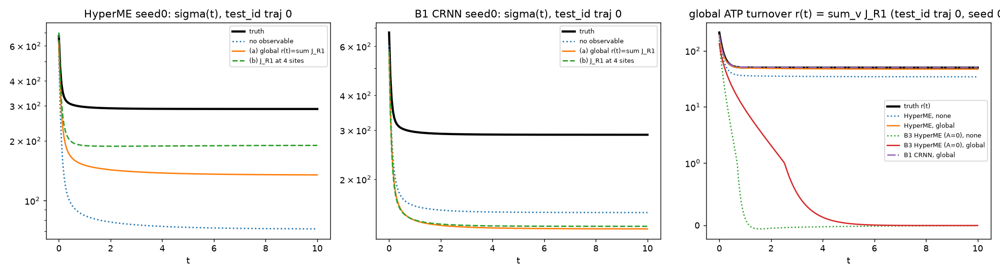

Entropy production over time without observables (dotted), with one global current (orange) and with four local currents (green). The right panel shows that the reversible model (red, green dotted) cannot hold a non-zero turnover.

**The learned model can be coarse-grained in closed form.** Merging states is a Markov morphism. The family of rates above is closed under the stationary-weighted projection `Q̄_ab = Σ_{i∈a} (π_i/π_a) Σ_{j∈b} Q_ij`, which is the standard coarse-graining of stochastic thermodynamics. The coarse free energy is the log-sum-exp of the fine one, the coarse kinetics is the stationary-weighted average, and the coarse affinities are the log ratios of block currents. Starting from a model trained on 32×32, the 16×16 model obtained this way, with no coarse data, has a stationary distribution and stationary flux equal to the block sums of the fine ones to machine precision, and its entropy production decreases monotonically along 32 → 16 → 8 for every trajectory. Models trained from scratch on 16×16 data miss the fine stationary flux by 3 to 4 percent, and their entropy production is not ordered across scales.

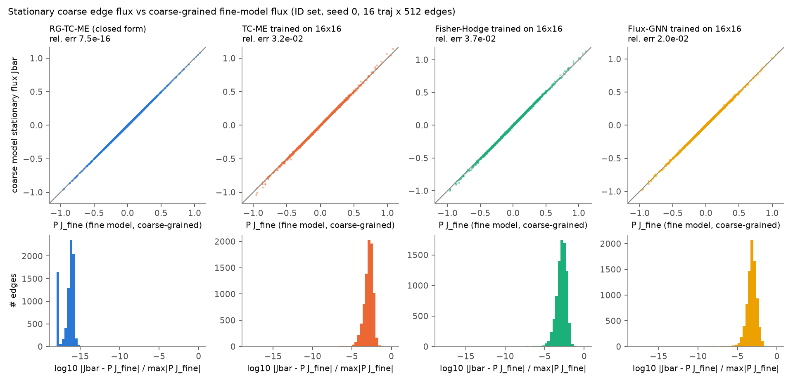

The closed-form coarse model is not good at transients. The 2×2 blocks are not lumpable, so the projected generator relaxes about twice too fast, and the error at the end of the training window is 0.30 against 0.014 for a model trained on coarse data. Coarse-graining the propagator at a lag `τ` instead of the generator, the usual Markov-state-model construction, brings the transient error down to 0.028 at `τ = 0.2` while keeping the stationary readouts exact. The coarse object is then a Markov chain at lag `τ`, and it cannot be written back as a generator of the same family. Every Markov coarse-graining also lowers the entropy production, so coarse values are lower bounds.

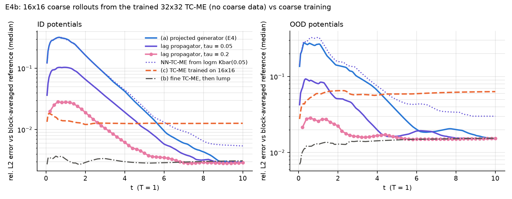

**With eight training trajectories instead of 64**, the learned master equation reaches an error of 0.027 on new potentials, against 0.051 for the Fisher–Hodge operator and 0.053 for the mass-conserving flux GNN. Part of this comes from the physical initialisation of the rates.

Two limitations stand. Near-irreversible reactions have affinities that no density or current observable resolves well, because the affinity is the logarithm of a ratio near zero. In this benchmark the reverse phosphatase rate is one percent of the forward rate, and the learned affinity recovers only 0.6 to 1.5 of the true 3.9. And on plain accuracy the mass-conserving positive flux GNN is as good as the structured models, so accuracy is not the argument. The argument is the readouts, the identifiability statement and the coarse-graining rule.

## Fluctuations of the learned process

A learned master equation also defines a stochastic process. We sampled it with the Gillespie algorithm and compared its fluctuations with those of the true system, on the phosphorylation cycle (C1) and the Brusselator (C3). Tables: `results/ws3_fluctuations.md`.

Occupation-number fluctuations agree with the truth for every model, the reversible one included. The Fano factors of all species at all sites are within 4 percent at system sizes 50, 200 and 1000. They carry no information about the drive.

The fluctuation relation P(Σ)/P(−Σ) = e^Σ for the entropy of the local reaction loop holds for every learned model when Σ is computed from that model's own rates. The black-box CRNN passes as well, because this is an identity of any Markov jump process. The informative version evaluates Σ with the true forces on the paths a model generates. The truth gives a slope of 0.89 (below 1 because Σ covers one loop only). HyperME and the CRNN give 0.27 to 0.36, and HyperME trained with four local current observables gives 0.46. The learned paths have about a third of the true irreversibility. This is the same blind spot as before: the nearly irreversible R2 has a force of 4.9 in the truth and 1.4 in both learned models.

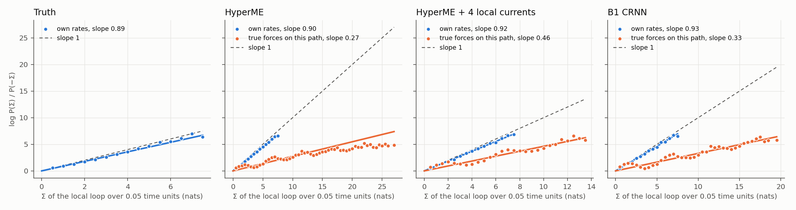

On the Brusselator limit cycle in a well-mixed volume of size 200, HyperME is closer to the truth than the CRNN. The period is 7.05 ± 0.96 in the truth, 7.19 ± 1.16 for HyperME and 7.93 ± 1.53 for the CRNN. The phase diffusion coefficient is 40 percent too high for HyperME and 81 percent too high for the CRNN. On the 8×8 grid the homogeneous cycle does not survive the noise in any model or in the truth. It breaks into a Turing pattern within two periods.

## Minimum-dissipation control

The same metric that defines the dynamics also defines the cheapest way to steer it. We moved a density on the 32×32 torus from one test state to another in time τ = 2 with a time-dependent potential, and minimised the entropy production by differentiating through the model's rollout. Tables: `results/ws5_control.md`.

For these rates the product of the forward and backward rate on an edge does not depend on the potential. So no protocol can beat the discrete Benamou–Brenier energy W²/τ with the geometric-mean mobility. The bound is reached by the Wasserstein geodesic, driven by the potential U = −ψ − log ρ, where ψ is the Kantorovich potential. Protocols optimised on the wired model reach 1.010 times the bound (untrained) and 1.015 (trained on 16 trajectories) when run in the true system. Their potentials match the geodesic one with correlation 0.999. The protocol optimised on the black-box Flux-GNN, which has no entropy production and minimises a kinetic-energy proxy, reaches the target but dissipates 1.087 times the bound. A sudden quench costs 1.46 times the bound and misses the target.

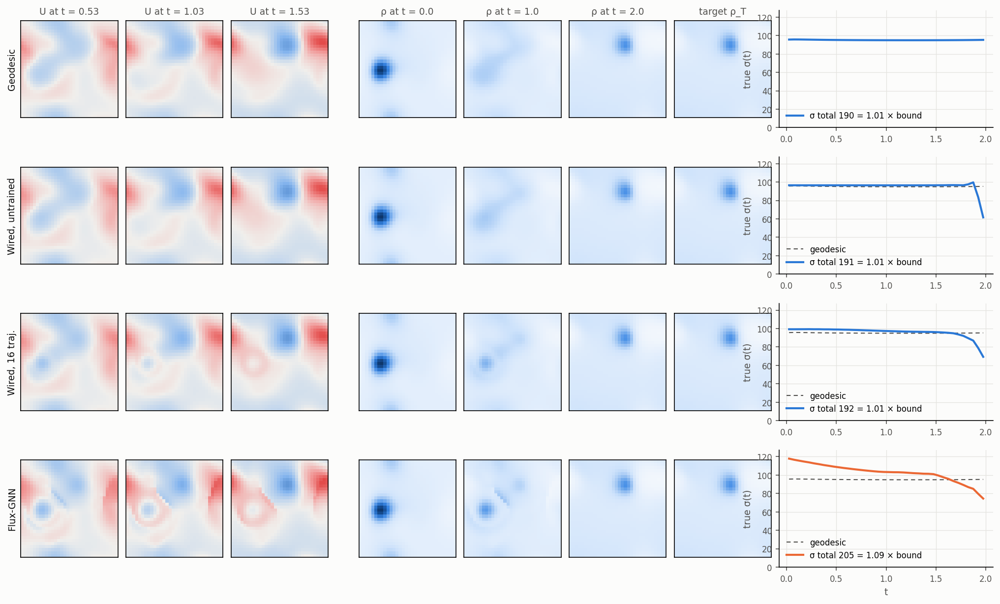

Inverse design is shorter still. To make a given density ρ* stationary, the wired model needs U = −log ρ*, which is exact (error 2e-15). The same target reached by optimising through Flux-GNN takes 20 minutes and is off by 3.2 percent in the true system.

## API

The prototype code is now collected in one library, `hyperme/`. The scripts in `fisher_hodge/` and `hyper/` are unchanged and give the same numbers as before.

A model lives on a hypergraph. Hyperedge `h` turns the reactants `ν_h⁺` into the products `ν_h⁻`. Transport along a graph edge is a hyperedge with one reactant and one product. The state `c` holds one concentration per species and site. The drive holds the knobs of the system: the potential `U`, the temperature `T`, the line integral of an external force along every edge, and the log concentrations of the chemostats.

The default mode wires the thermodynamics and learns only the kinetics. The chemical potential is `log c + U/T`, plus an optional correction for non-ideal solutions with a few parameters. The force and the chemostats enter the edge affinity `A` exactly. The network learns a symmetric rate prefactor from local features of each hyperedge, a global drive scale and one coefficient per harmonic cochain. No knob is a network input, so `model.edit(T=..., drive_scale=...)` changes a knob without retraining, and `drive_scale=0` removes the drive. Untrained on S2, the model is the SQRA discretisation of the reference equation (10T error 4.1e-3). With `edit` it follows a halved or doubled diffusion constant (errors 0.012 and 0.0015, against 0.44 and 0.34 without the edit) and a drift switched off or doubled (0.003 and 0.009). `mode='flexible'` keeps the learned free energy and drive map of the earlier experiments.

```python
import torch
from hyperme import Hypergraph, HyperME, integrators

rx = [({'A': 1, 'X': 2}, {'X': 3}), ({'X': 1}, {'B': 1})]           # Schlögl model at every site
hg = Hypergraph.reaction_transport(['X', 'A', 'B'], rx, grid_n=16, diffusing=['X'], chemostats=['A', 'B'])
model = HyperME(hg, nonideal='virial')                              # wired thermodynamics, learned kinetics
drive = dict(U=torch.randn(4, 256), T=torch.ones(4), chem_logc=torch.tensor([[2.0, 0.0]] * 4))
c = torch.rand(4, 256) + 0.5                                        # a batch of 4 states
dcdt = model(c, drive)                                              # S (a − b)
out = model.readouts(c, drive)            # J, f, ℓ, σ, excess, housekeeping, cycle affinities, moieties
hot = model.edit(T=2.0)                   # the same model at twice the temperature, no retraining
c, nsub = integrators.positive_ssp_rk2(hot, c, hot.prepare(drive), Dt=0.05)
```

| File | Contents |
|---|---|
| `complex.py` | `Hypergraph`. It holds the stoichiometric matrix `S` and orthonormal bases of `ker S` (cycles) and `ker Sᵀ` (moieties). The main builder `reaction_transport` copies a reaction list to every site of a spatial graph. Reactions may be many-to-many with any integer coefficients. Each listed species gets its own transport edges, and chemostatted species leave the state and enter as a drive. Smaller builders cover well-mixed networks, pure transport on a graph or periodic grid, and the C1 network. On the grid the cycle basis can be built from `d₁ᵀ` and the two harmonic cochains. |
| `model.py` | `HyperME` and its three parts. Wired mode: `WiredFreeEnergy` (`log c + U/T` with a virial or Debye–Hückel correction), `WiredKinetics` (`k_ref T exp(κ_θ)`), `WiredDrive` (exact force, chemostats, harmonic coefficients). Flexible mode: `FreeEnergy` with an MLP correction and optional non-local features `W∗c`, `Kinetics` from hyperedge features and optionally `c`, and a drive map projected onto `ker S`. Methods: `rates`, `flux`, `readouts`, `generator`, `edit`. |
| `integrators.py` | Explicit SSP-RK2 with positivity-preserving substeps. Modified Patankar schemes (Patankar–Euler and MPRK22), which are linearly implicit, positive and conserving at any step size and can be trained through. Implicit Euler with conjugate gradients for linear master equations. A variational implicit step in flux space. The matrix exponential. |
| `stochastic.py` | Gillespie, tau-leaping and chemical Langevin samplers that use the learned rates. They record firing counts and the entropy of every channel. `ws3.py` runs the fluctuation study. |
| `coarse.py` | Projected generator and lag `τ` propagator. Both check that the coarse stationary state and currents are the block sums of the fine ones and that `σ̄ ≤ σ`. |
| `baselines.py` | Flux-GNN, GNN-ODE, CRNN, reversible JKO and FINN with the same interface. FINN models transport only and treats reactions as a learned source term. |
| `presets.py`, `train.py`, `bench.py` | The S2 TC-ME and C1 models in this form, their data, the training protocol and a speed test. |

The substeps keep one step size per trajectory as a tensor. They talk to the host once per sampling interval instead of twice per substep. On S2 with the trained TC-ME on one GPU, a 200-step evaluation of 16 trajectories runs 3.1 times faster than the prototype loop, and a training step runs 2.1 times faster. On the CPU there is no host sync to save, so the CPU path keeps the loop. On the stiff Brusselator benchmark (C3), training with MPRK22 at 8 steps per sampling interval instead of about 29 explicit substeps makes an iteration 2.9 times faster and gives a 10T error of 0.023 under the exact integrator, against 0.048 for explicit training (one seed, `results/c3_patankar_summary.md`).

The tests run on the CPU. A GPU is used only when no other user has a process on it, and `hyperme.gpu_guard` checks this before anything starts.

```bash
python -m pytest hyperme/tests -m "not slow"          # about a minute
python -m pytest hyperme/tests -m slow                # retrains C1 HyperME (two seeds) and C3 with MPRK22 (one seed)
bash hyperme/tests/run_gpu_regression.sh              # waits for a free GPU, retrains S2 TC-ME, two seeds
```

The fast tests check five properties on random models over five hypergraphs, from the C1 and Schlögl networks with reactions and transport to pure transport. Every moiety is conserved, concentrations stay positive, `σ ≥ 0`, `F` decreases when `A = 0`, and `S A = 0`. They also load the prototype checkpoints and reproduce their rates and errors. The slow tests retrain from scratch with the prototype seeds and follow the prototype loss curves to the printed digit. HyperME on C1 reaches a 10T error of 0.0224, the mean of 0.0232 and 0.0216 (prototype 0.0224), and its 65 moieties stay constant to a relative error of 1.4e-15. TC-ME on S2 reaches 3.18e-3, the mean of 3.30e-3 and 3.06e-3 (prototype 3.18e-3).

## Layout

```
fisher_hodge/   models, data generators, training and evaluation
  common.py     32×32 periodic grid, incidence operators d and dᵀ
  models.py     FisherHodge, EuclidGF, GNNODE
  models2.py    FluxGNN, JKOAmort, JKOInst, FisherHodgeWFR and other stress-test models
  models_tcme.py, train_tcme.py   learned master equation on the grid (second round)
  rg_coarse.py, rg_lag.py, train_coarse.py   closed-form coarse-graining and the coarse baselines
  gen_data.py   reference solutions for S1, S2, S3 (64×64 finite volume, averaged to 32×32)
  gen_data2.py  reference solutions for S4, S5, S6 and the S3b training set
  train.py      train and evaluate one (system, model, seed)
  train2.py     same for the stress-test models
hyper/          learned master equation on hypergraphs: hyperme.py, the phosphorylation-cycle benchmark gen_crn.py,
                baselines, the identifiability experiment obs_hyper.py
hyperme/        the library: complex, model, integrators, stochastic, coarse, baselines, presets, train, bench
  tests/        structure, integrator, sampler, coarse-graining, baseline and regression tests
analysis/       Onsager–Fisher weighted Hodge decomposition of Markov chains (numpy)
viz/            scripts that make the figures above
assets/         figures and animations used in this file
results/        summary tables of the first round, the stress tests and the Markov analysis
```

## Running

In the code the systems carry short names, which the text above gives in parentheses:

| Name in code | System |
|---|---|
| `S1` | Fokker–Planck with a random smooth potential |
| `S2` | Fokker–Planck plus a divergence-free drift (steady circulation) |
| `S3` | Fisher–KPP reaction–diffusion |
| `S4` | nonlinear mobility `ρ^1.5` |
| `S5` | crowding mobility `ρ(1 − ρ)` |
| `S6` | non-local interaction (not run yet) |

Set `FH_ROOT` to the repository root. Data and checkpoints go to `$FH_ROOT/runs/`.

```bash
export FH_ROOT=$(pwd)
pip install -r requirements.txt
cd fisher_hodge
python gen_data.py                                   # writes runs/data/S1.pt, S2.pt, S3.pt
python train.py --sys S2 --model fisher_hodge --seed 0
python train.py --sys S2 --model euclid_gf --seed 0
python analyze.py                                    # tables in runs/summary.md
```

One training run takes about one hour on a single GPU. The stress-test models use `train2.py` and `gen_data2.py` with the same flags.

To make the figures, first cache full rollouts of the trained checkpoints, then run the drawing scripts:

```bash
python viz/rollout_all.py S2
python viz/viz_grid.py S2 S2 test_oodpot 0 fisher_hodge,euclid_gf,gnn_ode "Fokker–Planck with circulation"
python viz/viz_s2_flow.py test_oodpot 0
python viz/viz_markov_hodge.py
```

The Markov-chain analysis runs on the CPU:

```bash
cd analysis
python e1.py && python e2.py && python e3.py && python report.py
```

## Background

- Maas, *Gradient flows of the entropy for finite Markov chains*, J. Funct. Anal. 2011. The discrete transport metric with logarithmic-mean mobility.
- Chow, Huang, Li, Zhou, *Fokker–Planck equations for a free energy functional or Markov process on a graph*, ARMA 2012.
- Dechant, Sasa, Ito, *Geometric decomposition of entropy production*, Phys. Rev. Research 2022. The excess and housekeeping split used in the Markov analysis.
- Rancati, Maas, Locatello, *Learning discrete diffusion of graphs via free-energy gradient flows*, arXiv:2604.11311. The reversible free-energy baseline.
- Zheng, Allen-Blanchette, *Learning discrete Riemannian metrics for physical fields with cochain-frame equivariance* (RHMP), NeurIPS 2026. The Hodge block `dᵀ H d` with a learned cochain metric.
- Zheng, Zhong, Allen-Blanchette, *Topology-preserving neural operator learning via Hodge decomposition* (HSD), ICML 2026.
