# Neural Chart

> **Status.** Version 2.0 is in progress on this branch. The fit now includes variable projection, and porous media and the Brusselator now run on 16×16 grids. [Results at a glance](#results-at-a-glance) shows the new runs of the six benchmarks that have finished. The sections on each benchmark, the composition tables, the animations, `checkpoints/` and `results/` still come from earlier runs and will be replaced.

A reaction or transport hypergraph fixes the set of all rate laws on it that satisfy local detailed balance, and this set is a manifold, the thermodynamic manifold.
Each step has two coordinates on it.
The driving coordinate $f$ is the thermodynamic force of the step.
The material coordinate $k$ is what remains of the symmetric part of the rate once a known function of the state is taken out.
The Neural Chart is a chart of this manifold.
Learning a driven physical system from trajectories then means locating the system on the manifold, and two networks do this by learning a free energy and a material coordinate.
Both are assumed to follow the same law under every condition, which we call cross-condition invariance.
Three properties follow from this assumption.

- **Extrapolation in the drive.** A new drive, temperature, potential or chemostat level moves the system along coordinates that are already known, with no retraining.
- **Optimization.** The fit has a convex closed-form start on the class constants, and rollout training continues from it.
- **Identifiability.** The theory states when trajectories determine the flux of every step, the cycle currents and the entropy production, and when they cannot.

In addition, every point of the chart dissipates non-negatively with respect to its own force.
Manifolds of two systems that share species can be glued into the manifold of the larger system, and the theory states what the gluing needs and what it cannot know.

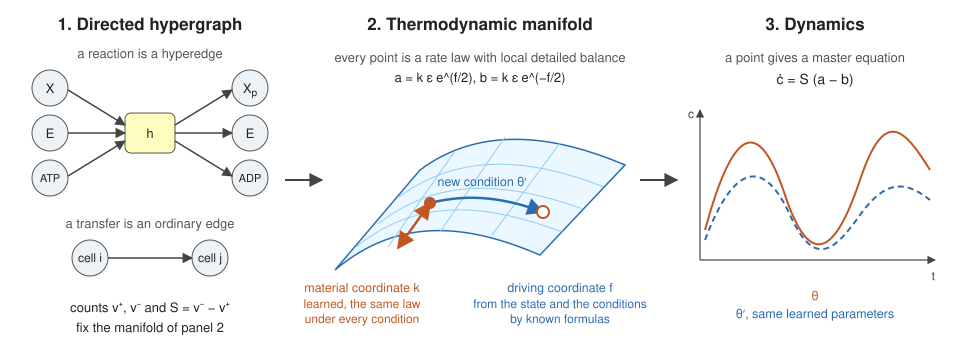

The library takes a hypergraph, the conditions and the trajectories.

```python
from neuralchart import Hypergraph, Conditions, Trajectories, NeuralChart

net = Hypergraph.from_strings(['A + X <-> 2 X', 'X <-> Y', 'Y <-> B'], chemostats=['A', 'B'])
chart = NeuralChart(net, chemostats=[mu0_A, mu0_B])     # looked-up standard free energies
chart.fit(Trajectories(c, Conditions(chem_logc=log_ab), dt=dt))

chart.rollout(c0, Conditions(chem_logc=log_ab_new), nsteps=200)
chart.entropy_production(c, conditions)
```

Every benchmark below uses this constructor and this fit.

**Contents**

- [The problem](#the-problem)
- [The idea: what stays the same when the conditions change](#the-idea-what-stays-the-same-when-the-conditions-change)
- [What the invariance gives](#what-the-invariance-gives)
- [The library](#the-library)
- [Composing manifolds](#composing-manifolds)
- [The benchmarks](#the-benchmarks)
- [Results at a glance](#results-at-a-glance)
- [Learned constitutive laws under new conditions](#learned-constitutive-laws-under-new-conditions)
- [Ideal reaction networks](#ideal-reaction-networks)
- [How each part contributes](#how-each-part-contributes)
- [Why the hypergraph is an input](#why-the-hypergraph-is-an-input)
- [Related work](#related-work)
- [Scope and limits](#scope-and-limits)
- [Reproduce](#reproduce)
- [Repository layout](#repository-layout)

## The problem

Most neural simulators learn the flux or the time derivative from the state $c$, the conditions $\theta$ (temperature, external field, drive, chemostat levels) and the material features $\xi$ together in one network.
Examples are FNO, graph networks that emit fluxes, and closures in universal differential equations.
Seen as a learning problem, this mixing leads to three failures, all visible in the benchmarks below.

1. **Spurious correlation and failure under a shift of the conditions.** The network cannot tell which changes of the rate come from the material and which come from the temperature or the drive. When the test conditions leave the training range, it fails. Trained at one temperature, FNO reaches an error of 2.3 at four times that temperature in porous media, and the UDE closure 1.0.
2. **An ill-conditioned, non-convex optimization.** The kinetic parameters and the state are strongly coupled, and gradient descent from a generic start stops at poor local optima. On the oscillating Brusselator every black-box model stays above an error of 0.29.
3. **Observational equivalence.** Very different internal parameters can produce almost the same trajectories. A model of the phosphorylation cycle built on a network of candidate reactions reaches a trajectory error of 2e-5, and its entropy production is still wrong by a factor of 10. Fluxes that circulate around a cycle leave the state unchanged and change the entropy production (Theorem 1 of [docs/theory.md](docs/theory.md)). The learned flux of each step, and every readout built on it, then cannot be trusted. The same freedom lets the UDE closure send up to 69 % of its edge fluxes against the physical force.

The Neural Chart addresses all three with one structural factorization of the rate of each step on a given hypergraph.

## The idea: what stays the same when the conditions change

### Channel fluxes on a directed hypergraph

The Neural Chart treats transport on a mesh and reactions in a network in one way, as channel fluxes on a directed hypergraph.
A step $h$ takes the species in its reactant count vector $\nu_h^+$ to those in its product count vector $\nu_h^-$, with species at sites as nodes.
A transfer between two cells moves one unit from one node to another, so an ordinary graph is the special case in which every column of the stoichiometric matrix $S=\nu^--\nu^+$ has one entry $-1$ and one entry $+1$.
A reaction joins several reactants to several products, for example $X+E+\mathrm{ATP}\to X_p+E+\mathrm{ADP}$ in the phosphorylation cycle.

The stoichiometry enters every formula below.
The force of a step is the difference of the chemical potentials on its two sides, weighted by the counts, $f_h=\langle\nu_h^+-\nu_h^-,\mu\rangle+A_h$.
The known scaling factor $\varepsilon_h=\exp\big(\tfrac12\langle\nu_h^++\nu_h^-,y\rangle\big)$, with $y=\log c+\nabla G$, is the geometric mean of the mass-action terms of the two sides.
With both written this way, the rate of a step is linear in its mobility however many molecules take part, and this linearity gives the convex closed-form start.

The cycles of the hypergraph are the vectors $z\in\ker S$, combinations of steps that leave every species unchanged.
Along a cycle the chemical potentials of the intermediate species cancel in $\sum_hz_hf_h$, and what remains is the drive that the chemostats and external fields supply.
In the phosphorylation cycle this is the free energy of ATP hydrolysis.
With the chemostat values as inputs, the cycle affinity of the model equals the true value exactly.
This works only because the stoichiometry of every reaction, including ATP, ADP and the enzyme, is part of the hypergraph.

### Two coordinates for each step

On a fixed hypergraph each step $h$ runs forward at rate $a_h$ and backward at rate $b_h$.
Write the two rates in the coordinates

$$f_h=\log\frac{a_h}{b_h},\qquad g_h=\sqrt{a_h b_h}.$$

Local detailed balance says that the driving coordinate $f_h$ is the thermodynamic force of the step,

$$f_h=\langle\nu_h^+-\nu_h^-,\mu\rangle+A_h,\qquad \mu=\partial_cF,\qquad F(c)=\sum_sc_s(\log c_s-1)+\frac{\langle c,U+\mu^0\rangle}{T}+G(c),$$

set by the free energy $F$ and the drive $A_h$.
The term $G$ is the excess free energy, and its gradient $\nabla G$ is the excess potential.
The flux of the step is $J_h=a_h-b_h=g_h\,\Psi(f_h)$ with $\Psi(f)=2\sinh(f/2)$.
For a given hypergraph the rate laws that satisfy local detailed balance form the thermodynamic manifold, with coordinates $f$ and $g$.
The hypergraph fixes this manifold: its stoichiometry sets how $f$ and $g$ depend on the chemical potentials, and a different hypergraph gives a different manifold.

### The condition-invariant material coordinate

The symmetric coordinate $g$ also changes with the state and the conditions $\theta$ (temperature, potential, drive, chemostat levels).
Part of that change is known.
We write

$$g_h(c,\theta,\xi)=k_h(\xi,c)\,\varepsilon_h(c,\theta),\qquad \varepsilon_h=\exp\Big(\tfrac12\big\langle\nu_h^++\nu_h^-,y\big\rangle\Big),\qquad y=\log c+\nabla G(c),$$

with the hypergraph factor $\varepsilon_h$ defined above.
It collects the mass-action factors, including the chemostat levels.
Known prefactors, the temperature $T$ and the geometric weight of a mesh edge, join it.
What remains is the material coordinate $k_h(\xi,c)>0$, the mobility of the step. It belongs to the material and its local state, such as the permeability of a pore or the rate constant of a reaction.

The roles are now divided.
The force $f$ and the factor $\varepsilon$ are computed by known formulas and take up every change of the conditions $\theta$.
Two functions are learned, the excess free energy $G$ and the material coordinate $k$, and neither reads $\theta$.
The standard potentials $\mu^0$ of the internal species are learned constants, and those of the chemostats are looked up.
Learning the dynamics becomes the task of locating one free energy and one mobility law on a manifold whose other coordinates are fixed.

**The central assumption.** Once the known factors are taken out, the excess free energy and the material coordinate do not read the conditions.
Where a mobility depends on the conditions in a known way, that dependence goes into a known prefactor.
In every benchmark here the true material coordinate has this property.

**Geometric remark.** The coordinates $(f,g)$ come from the information geometry of reaction networks and non-equilibrium thermodynamics.
At a frozen state the forward and backward event counts of a step are Poisson with intensities $a_h$ and $b_h$.
These laws form a dually flat exponential family, in which $(f_h,\log g_h)$ are natural coordinates and the current and the traffic $a_h+b_h$ are their dual coordinates.
The entropy production of a step is the Jeffreys divergence between this law and its reverse, which is a symmetrised Bregman divergence.
The Fisher metric couples $f_h$ and $\log g_h$ in proportion to the current $J_h$, so the two are Fisher-orthogonal only for a step at equilibrium.
The split used here is a product structure: the condition sets $f$ and the material sets $k$.
[docs/information_geometry.md](docs/information_geometry.md) says what this geometry contributes.

### The chart

A Neural Chart is a chart of the thermodynamic manifold under this assumption, strictly a parametrisation of it.
It has one form on every system,

$$a_h,b_h=k_h\,\varepsilon_h\,e^{\pm f_h/2},\qquad \log k_h=\log\omega_{c(h)}+g_\theta(\text{class},\xi_h,\log\bar c_h),\qquad G=G_\theta(c),$$

with one constant $\omega_c$ per class of steps, one MLP $g_\theta$ for all hyperedges, and one MLP $G_\theta$ per site with shared weights.
The local state $\bar c_h$ is the mean, over the cells $h$ touches, of the density of all species, and the material descriptors $\xi_h$ are optional.
What the model learns is thus a constitutive functional, a map from material descriptors and local state to mobilities and chemical potentials.
The dynamics follow from it through the master equation $\dot c=\sum_hS_h(a_h-b_h)$.

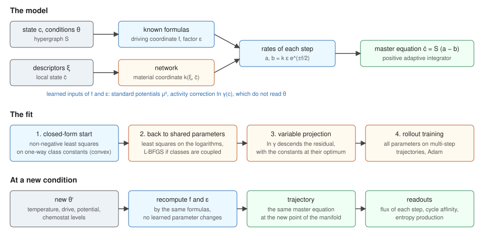

## What the invariance gives

[docs/theory.md](docs/theory.md) states and proves the results below (Theorem 0, Theorem 1, Proposition 4 and IG2).
It also shows what a gray-box model loses when its learned part reads the conditions or learns the force freely.

### Extrapolation in the drive

A new condition changes $f$ and $\varepsilon$ by known formulas and changes no learned parameter. At a fixed state, if the true mobility lies in the model class and the force is right, the flux error at any condition has a closed form, $\|J-J^{\rm true}\|^2_{\Lambda^{-1}}=\sum_h\delta_h^2\,\sigma_h^{\rm true}$ with $\delta_h=k_h/k_h^{\rm true}-1$ (IG2(c)). This does not make transfer automatic. A new condition can drive the system into states that training never visited, and it can change the true mobility of the material. Over long rollouts the error also depends on the stability of the dynamics.
In the benchmarks, eight times the training drive in porous media gives an error of 0.39, against 0.81 for the best baseline, and the stronger drive of the phosphorylation cycle leaves the error at 3.5e-6.

### Optimization

At initialisation both networks are zero, so every one-way rate is a class constant times a factor that the state and the conditions fix. The change of the state over a sampling interval is linear in the one-way class constants, and fitting it is a non-negative least-squares problem. This relaxation is convex and its optimum is global. The constants are then mapped back to the shared physical parameters, the class mobilities $\omega_c$ and the standard potentials, by least squares on their logarithms. When the classes are coupled through shared parameters, the code then minimises the residual over those parameters with L-BFGS, which is not convex.

The convex problem holds only when both networks are zero. Variable projection then trains $G_\theta$ and $g_\theta$ jointly on the same residual for 500 steps. At each step the class constants are solved again by non-negative least squares for the current networks, so the networks and the constants do not compete for the same part of the rate. Rollout training follows. Neither of these two stages is convex. With variable projection the error on the non-ideal Schlögl model at 10T under training conditions falls from 6.1e-03 to 7.2e-04.

### Identifiability

Under the invariance, trajectories recorded at different conditions constrain the same mobilities. The flux of step $h$ is $J_h=k_h\varphi_h(c,\theta)$ with a known $\varphi_h$. Noise-free data determine every $k_h$ exactly when no nonzero $v$ satisfies $\mathrm{diag}(\varphi^i)\,v\in\ker S$ at every data point $i$ (Theorem 0(iii)(d)). New conditions add data points with new $\varphi^i$ and shrink this set. Once $k$ and the force are determined, so are the flux of every step, the cycle currents and the entropy production. When the set is not empty, the data cannot separate the mechanisms it contains. In the phosphorylation cycle, for example, the two rate constants are identified when the cycle affinity is nonzero and the data contain two ratios of phosphorylated to unphosphorylated substrate. At zero affinity only their sum is. Two steps that remove the same species in the same proportion at every data point are never separated (the parallel-channel lemma).
In the benchmarks the learned $\log k$ has a Pearson r of at least 0.99 on the interacting and saturating phosphorylation tasks and 0.96 on heterogeneous media. It is weaker on the MAPK cascade (0.83 to 0.86). Without the hypergraph the readouts fail ([Why the hypergraph is an input](#why-the-hypergraph-is-an-input)).

### Non-negative dissipation

This part comes from local detailed balance alone. For every parameter value the flux of each step runs along the model's own force, so the entropy production computed with that force is non-negative. Local detailed balance with respect to that force, conservation of every moiety and positivity also hold, with no penalty or projection. Whether the model's force equals the true force depends on whether the learned standard potentials and excess free energy are right. We measure the gap and report it in every physics table as the fraction of steps whose flux runs against the true force.

[docs/method.md](docs/method.md) gives the fit and the evaluation protocol.

## The library

The user provides three things.

| Input | What it is | Constructors |
|---|---|---|
| Hypergraph | the species and the steps | `Hypergraph.from_strings`, `from_stoichiometry`, `from_grid`, `from_mesh`, `from_points` |
| Conditions | temperature, potential, drive, chemostat levels, and the standard free energies of the chemostats | `Conditions` |
| Trajectories | the state over time, at one or more conditions | `Trajectories` |

Descriptors of the material are optional. `chart.fit` then runs the closed-form start and the rollouts, with one set of numerical settings on every task.

A fitted chart reads out what the theory says the data determine.

| Readout | Method |
|---|---|
| prediction at a new condition | `chart.rollout` |
| flux, force and mobility of every step | `chart.flux`, `chart.force`, `chart.mobility` |
| excess potential | `chart.excess_potential` |
| entropy production and cycle affinity | `chart.entropy_production`, `chart.cycle_affinity` |
| larger systems | `compose(chart_a, chart_b, glue=...)`, `chart.refine` |

The cycle basis and the conservation laws come from the hypergraph, and `chart.save` and `NeuralChart.load` store the weights.
A worked example of about thirty lines is in [examples/driven_network.py](examples/driven_network.py).

## Composing manifolds

Let module $A$ have species $(X,Y)$ and module $B$ species $(Y,Z)$, so that $Y$ is shared.
Each module has its own fitted standard potentials, excess free energy and mobility.
The composite needs one potential field, one free energy and a mobility for every hyperedge.
Two manifolds glue when these three objects can be built from the modules.
[docs/gluing.md](docs/gluing.md) gives the statements and proofs.

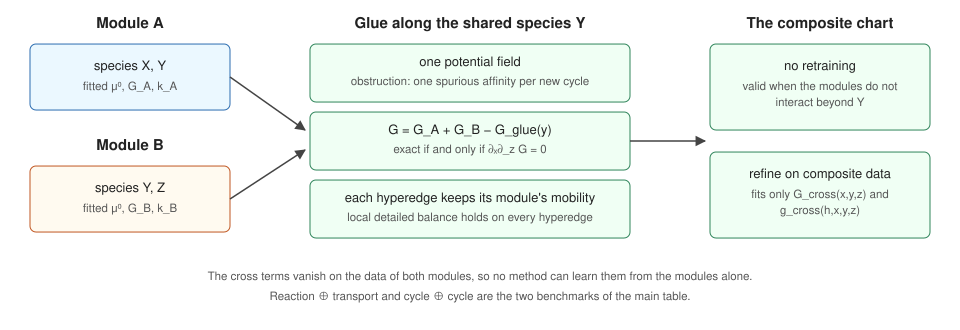

**Potentials.** A fitted $\mu^0$ is defined up to the conservation laws of its module, and this shift changes no force.
The obstruction to aligning two modules has one dimension for each new cycle that the gluing creates (Theorem 1).
If the gluing creates no new cycle, the alignment always exists and the module forces do not change.
If it does, an error in the fitted potentials appears as an affinity around a new cycle that has no physical drive behind it.
The chart reports this spurious affinity for each new cycle, and projecting onto one potential field removes it.

**Free energy.** The composite excess free energy is an inclusion and exclusion,

$$G(x,y,z)=G(x,y,0)+G(0,y,z)-G(0,y,0),$$

which holds for all states if and only if $\partial_x\partial_zG=0$ (Theorem 2).
The last term is the self energy of the shared species, which both modules contain.
The two modules give two estimates of it. The model uses their mean and reports their difference.

**What the modules cannot know.** A cross term that vanishes when $x=0$ or $z=0$ leaves the data of both modules unchanged (Proposition 3).
There are two kinds, a thermodynamic one in $G$ and a kinetic one in $k$, such as the inhibition of a step in $A$ by a species of $B$.
No method can learn them from the modules alone.
When they are absent, the mobilities do not read the other module's species and the modules are accurate on the states the composite visits, the glued chart gives the true rates with no retraining (Corollary 4).
When they are present, a short refinement on composite data fits only

$$G_{\rm cross}(x,y,z),\qquad g_{\rm cross}(h,x,y,z),$$

with the modules frozen and with both terms vanishing where the modules already determine the answer.
Local detailed balance and non-negative dissipation with respect to the model's force hold for any such terms.

### Results

Each module is fitted on its own data, and the composite is tested on data neither module saw.
The design was fixed before any result (`benchmarks/composition/__init__.py`).

**Reaction and transport.** A well-mixed phosphorylation cycle on one site is glued to transport of $X$ and $X_p$ in a potential on an 8×8 grid, which creates 63 new cycles.
The tests are the sets of the phosphorylation cycle.
Every species of the transport module is also in the reaction module, so no cross term exists to refine.

| Method | training conditions (ΔG 1–3) | drive ΔG 3–4 | stronger, finer potential U | 16×16 grid | affinity error |
|---|---|---|---|---|---|
| **Glued chart, no retraining** | 1.1e-05 | 1.1e-05 | 2.5e-05 | 1.4e-05 | 4.7e-16 |
| Chart fitted on composite data | 2.9e-06 | 3.5e-06 | 5.9e-06 | 3.5e-06 | 1.8e-15 |
| Flux-GNN on the data of both modules | 0.151 | 0.174 | 0.185 | 0.143 | 1.906 |
| Flux-GNN on composite data | 2.1e-03 | 0.038 | 0.113 | 4.1e-03 | N/A |

**Two cycles.** Two phosphorylation cycles share $X_p$ as the kinase input of the second and share ATP and ADP. This gluing creates no new cycle.
The tests are a coupled cascade under the training conditions, under a stronger drive, and from a start at 1.5 times the concentrations.

| Method | training conditions | stronger drive | start × 1.5 | affinity error |
|---|---|---|---|---|
| **Glued chart, no retraining** | 3.0e-05 | 1.8e-05 | 3.8e-05 | 5.6e-16 |
| Glued chart, refined on 2 coupled trajectories | 1.3e-05 | 4.5e-06 | 1.6e-05 | 5.8e-16 |
| Glued chart, refined on 8 | 5.7e-06 | 3.2e-06 | 8.1e-06 | 5.3e-16 |
| Glued chart, refined on 32 | 3.2e-06 | 2.4e-06 | 3.3e-06 | 5.6e-16 |
| Chart fitted on composite data | 9.2e-07 | 8.4e-07 | 1.2e-06 | 5.6e-16 |
| Flux-GNN on the data of both modules | 1.2e-03 | 7.7e-03 | 1.9e-03 | 0.612 |
| Flux-GNN on composite data | 1.1e-03 | 0.078 | 1.9e-03 | 2.152 |

The affinity error is the mean absolute error of the affinity around the cycles under the training conditions.
For the Neural Chart it is zero by construction, because the internal potentials cancel around a cycle and the chemostat values are inputs.
With no composite data the glued chart is about 1e4 times more accurate than Flux-GNN trained on the same data on reaction and transport, and 40 to 430 times on the two cycles.
A chart fitted from scratch on composite data is more accurate still, and it needs those data.
The largest spurious affinity is zero to rounding, and the force changes by less than 1e-15.

**With cross terms.** Two further cases were fixed in advance to fail without refinement, and they do.
With a cross term in $G$ the glued chart reaches 5.9e-3 to 0.050, and with an inhibition of one step by a species of the other module it reaches 0.096 to 0.20.
Flux-GNN on the data of both modules is at the same level.
Refinement on 32 coupled trajectories of 20 steps brings these errors to 1.9e-3 to 3.5e-3 and to 9.4e-3 to 0.021.
The tables are in [docs/gluing.md](docs/gluing.md#appendix-cases-with-cross-terms).

## The benchmarks

Each benchmark is one hypergraph with its conditions and its data, and the model and the fit are the same on all of them.
The truth differs in what it asks of the chart.

| Benchmark | Hypergraph | What the truth adds to one constant rate per class of steps | New conditions in the tests |
|---|---|---|---|
| Porous media | transport on a 16×16 mesh | a mobility from a hidden pore map, seen through 12 descriptors | temperature, drive, low-porosity media, finer grid, point cloud |
| Porous media with crowding | the same | a mobility that also falls with the local density | the same |
| Non-ideal Schlögl model | $A+2X\rightleftharpoons3X$, $X\rightleftharpoons B$, diffusing $X$ | an excess free energy of $X$ | higher concentrations, larger grid |
| Non-ideal Schlögl model, strong crowding | the same | the same excess free energy over a wider range | higher chemostat levels, larger grid |
| Phosphorylation cycle | $X+E+\mathrm{ATP}\rightleftharpoons X_p+E+\mathrm{ADP}$, $X_p\rightleftharpoons X$, diffusion in a potential | nothing | drive, potential, larger grid |
| Phosphorylation cycle on heterogeneous media | the same | mobilities from a hidden medium, seen through 3 descriptors | the same, on unseen media |
| Phosphorylation cycle with interactions | the same | a cross-species excess free energy | drive, potential, higher concentrations, larger grid |
| Phosphorylation cycle with a saturating rate | the same | a mobility that falls with the local density | drive, potential, higher concentrations, larger grid |
| Brusselator | four reactions, two diffusing species | nothing | chemostat levels, Turing regime, finer grid |
| MAPK cascade | 22 species, 20 reactions | nothing | ATP level, initial state |

The code is the same on all of them: `NeuralChart(hypergraph, chemostats=...)` and `chart.fit(trajectories)`.

## Results at a glance

Every model is trained once, with one seed, under the training conditions, and is then evaluated on every test set without retraining.
The error is the relative L2 error of the state at 10T (200 sampling steps), median over the test trajectories.
The hardest new condition is the test set on which the Neural Chart has its largest error.
The best baseline is the most accurate baseline in that column. The variant of the Neural Chart without its chart (Flux-GNN, described below) is an ablation and is not counted.

| Benchmark | training conditions: Neural Chart | best baseline | hardest new condition | Neural Chart | best baseline |
|---|---|---|---|---|---|
| Porous media | in training | | | | |
| Porous media with crowding | in training | | | | |
| Non-ideal Schlögl model | **7.2e-04** | 2.6e-03 (FNO) | a 3.5–4.0, b 2.0–3.5 (higher concentrations) | **0.012** | 0.033 (FNO) |
| Non-ideal Schlögl, strong crowding | **5.5e-04** | 0.015 (BSMS-GNN) | a 4.6–5.0, b 2.0–3.5 | **3.2e-03** | 7.0e-03 (BSMS-GNN) |
| Phosphorylation cycle | **7.2e-06** | 5.2e-03 (CRNN, condition features) | stronger, finer potential U | **2.8e-05** | 0.011 (CRNN, condition features) |
| Phosphorylation, heterogeneous media | **0.012** | 0.029 (CRNN, condition features) | stronger, finer potential U | **0.015** | 0.049 (CRNN, condition features) |
| Phosphorylation, interactions | **2.8e-04** | 0.022 (UDE closure) | stronger, finer potential U | **0.014** | 0.149 (CRNN, condition features) |
| Phosphorylation, saturating rate | **4.4e-04** | 0.019 (FNO) | X and Xp at the start × 3 | **0.010** | 0.090 (UDE closure) |
| Brusselator | in training | | | | |
| MAPK cascade | in training | | | | |

On these six benchmarks and every test set no step of the Neural Chart carries flux against its own force, no sample has negative entropy production, and no concentration becomes negative.

The Neural Chart is the most accurate on every test set of these six benchmarks.
The baseline errors on these six benchmarks come from earlier runs on the same data.

The baselines are:
- the UDE closure, a free neural flux on the same graph
- CRNN with mass action, which is given the same graph and fits free forward and backward rate constants
- CRNN with the conditions as features
- BSMS-GNN, FNO, GENERIC-FNO, and HelmFluid on porous media only
- persistence, $u(t)=u(0)$

The tables also show the Neural Chart without its chart, as an ablation.
In this variant a message-passing network on the same hypergraph emits the forward and backward rate of every step from the state, the conditions and the descriptors, with the same mass-action factors and the same integrator (we call it Flux-GNN).
It has no split into driving and material coordinates, so none of the properties above apply to it.

The physics tables count, for every model with its own edge flux, the steps whose flux runs against the true physical force, $J_hf_h<-10^{-6}(a_h+b_h)|f_h|$, and the samples with $\sigma<0$.
Models that return only a state update have N/A there.
Full tables, including training times, are in `results/<benchmark>/`.
In the animations negative values are magenta, and the panel title counts the negative cells.
Each benchmark also has a tracer animation.
Tracers move with the probability velocity $v=J/\rho$ of one diffusing species, computed from each model's own flux.
A tracer turns magenta in a cell with negative local entropy production, or in a cell touched by a step whose flux runs against the true force.

## Learned constitutive laws under new conditions

### Porous media

A density moves by diffusion and a divergence-free drive through random porous media.
The true mobility comes from an effective-medium rule on a 128×128 pore map that the models never see.
The models see 12 local porosity and connectivity descriptors per edge.
They are trained on 64 media at temperature 1 and drive amplitude 1 on a 32×32 grid.
The tests use 16 unseen media, other temperatures and drives, unseen low-porosity media (porosity 0.15–0.3, training 0.3–0.7), a 64×64 grid and a point cloud of 1024 Voronoi cells.

| Drive ×8 on an unseen medium | Point cloud (training conditions) |
|---|---|
|  |  |

| Method | training conditions | temperature ×0.25 | temperature ×4 | drive ×4 | drive ×8 | unseen low-porosity media | 64×64 grid | point cloud | parameters |
|---|---|---|---|---|---|---|---|---|---|
| **Neural Chart** | **0.065** | **0.075** | **0.104** | **0.186** | **0.394** | **0.077** | **0.075** | **0.090** | 6,340 |
| No chart (Flux-GNN) | 0.078 | 0.797 | 2.138 | 1.046 | 1.091 | 0.116 | 0.515 | 0.458 | 151,234 |
| UDE closure | 0.077 | 0.700 | 1.023 | 0.588 | 0.811 | 0.104 | 0.093 | 0.255 | 5,441 |
| BSMS-GNN | 0.736 | 0.911 | 2.430 | 2.945 | 3.050 | 0.737 | 1.079 | 0.915 | 1,724,417 |
| FNO | 0.510 | 0.894 | 2.256 | 2.544 | 7.262 | 0.460 | 0.516 | N/A | 1,188,609 |
| GENERIC-FNO | 1.852 | 1.210 | 2.562 | 1.272 | 1.146 | 1.021 | 1.428 | N/A | 1,002,388 |
| HelmFluid | 0.846 | 1.154 | 0.472 | 0.930 | 0.976 | 0.946 | N/A | N/A | 9,930,381 |
| Persistence (u(t) = u(0)) | 1.603 | 1.118 | 2.256 | 1.238 | 1.115 | 0.696 | 1.607 | 1.616 | 0 |

| Method | edges with flux against the true force | samples with σ < 0 | negative values |
|---|---|---|---|
| Neural Chart | 5.3e-03 | 0 | 0 |
| No chart (Flux-GNN) | 0.311 | 0 | 0 |
| UDE closure | 0.688 | 0.882 | 0.236 |
| BSMS-GNN | N/A | N/A | 0.518 |
| FNO | N/A | N/A | 0.512 |
| GENERIC-FNO | N/A | N/A | 0.335 |
| HelmFluid | N/A | N/A | 0.033 |

Under the training conditions the UDE closure and the variant without the chart are close to the Neural Chart (0.077 and 0.078 against 0.065).
Under changed temperature and drive their errors grow to 0.6–2.1.
The Neural Chart stays between 0.075 and 0.39.
One constant mobility for all edges gives an error near 1 on most test sets.
The UDE closure produces negative densities on all 64 test trajectories.

**The learned law.** The descriptors are local, so the same functional applies to the point cloud without retraining.


**Flows.** The animations below follow one test trajectory in an unseen medium.
Tracer particles move with the probability velocity $v=J/\rho$ of each model's own edge flux, so only models with an edge flux appear.
A particle turns magenta in a cell where the local entropy production is negative or where an edge carries flux against the physical force.


The local entropy production of the same scene stays non-negative everywhere for the Neural Chart.


The last animation uses a random point cloud of 1024 cells, with the parameters trained on the 32×32 grid.
More animations are in the [gallery](results/porous_media/gallery/).

### Porous media with crowding

The same task with a crowded mobility $M(x)/(1+\bar\rho_e/2)$, where $\bar\rho_e$ is the mean density of the two cells of the edge.
The model is not given the crowding form.
Its network $g_\theta$ reads the local density.

| Drive ×8 on an unseen medium | Point cloud (training conditions) |
|---|---|
|  |  |

| Method | training conditions | temperature ×0.25 | temperature ×4 | drive ×4 | drive ×8 | unseen low-porosity media | 64×64 grid | point cloud | parameters |
|---|---|---|---|---|---|---|---|---|---|
| **Neural Chart** | **0.056** | **0.060** | **0.130** | **0.143** | **0.339** | **0.055** | **0.067** | **0.082** | 6,340 |
| No chart (Flux-GNN) | 0.057 | 0.808 | 2.053 | 0.856 | 1.049 | 0.057 | 0.573 | 0.473 | 151,234 |
| UDE closure | 0.066 | 0.679 | 1.916 | 0.601 | 0.917 | 0.075 | 0.756 | 0.485 | 5,441 |
| BSMS-GNN | 0.592 | 0.837 | 2.739 | 1.386 | 1.355 | 0.435 | 1.008 | 0.713 | 1,724,417 |
| FNO | 0.464 | 0.898 | 2.370 | 1.897 | 3.316 | 0.386 | 0.469 | N/A | 1,188,609 |
| GENERIC-FNO | 1.158 | 0.924 | 1.768 | 1.098 | 1.054 | 0.371 | 1.206 | N/A | 1,002,388 |
| HelmFluid | 14.957 | 7.914 | 284.284 | 199.367 | 149.037 | 14.371 | N/A | N/A | 9,930,381 |
| Persistence (u(t) = u(0)) | 1.363 | 0.989 | 2.161 | 1.156 | 1.083 | 0.447 | 1.360 | 1.392 | 0 |

| Method | edges with flux against the true force | samples with σ < 0 | negative values |
|---|---|---|---|
| Neural Chart | 5.2e-03 | 0 | 0 |
| No chart (Flux-GNN) | 0.304 | 0 | 0 |
| UDE closure | 0.808 | 0.999 | 0.194 |
| BSMS-GNN | N/A | N/A | 0.704 |
| FNO | N/A | N/A | 0.560 |
| GENERIC-FNO | N/A | N/A | 0.279 |
| HelmFluid | N/A | N/A | 0.038 |

Under the training conditions the Neural Chart, the variant without the chart and the UDE closure are close (0.056, 0.057 and 0.066).
Under changed temperature, drive and discretisation the Neural Chart is 2.7 to 14 times more accurate than the best baseline of each column.
One constant mobility for all edges gives an error near 1 on most test sets.

### Non-ideal Schlögl model

The Schlögl model $A+2X\rightleftharpoons3X$, $X\rightleftharpoons B$ on an 8×8 periodic grid, with mass action in the activity $y=x\gamma(x)$, $\ln\gamma(x)=\Phi x/(1-\Phi x)$, $\Phi=0.25$.
The Neural Chart learns the excess potential $\nabla G_\theta$, the mobility and the standard potentials.
The closed-form start assumes $G_\theta=0$, and the rollouts fit the rest.


| Method | training conditions | a 3.5–4.0, b 2.0–3.5 (higher concentrations) | 16×16 grid | parameters |
|---|---|---|---|---|
| **Neural Chart** | 6.1e-03 | 0.082 | 4.5e-03 | 5,702 |
| Neural Chart with given standard potentials | 4.8e-03 | 0.080 | 4.6e-03 | 5,701 |
| No chart (Flux-GNN) | 1.8e-03 | 0.265 | 2.7e-03 | 150,850 |
| CRNN (mass action) | 0.060 | 0.726 | 0.062 | 6 |
| CRNN (condition features) | 0.026 | 0.340 | 0.035 | 4,674 |
| UDE closure | 0.046 | 0.645 | 0.046 | 4,737 |
| FNO | **2.6e-03** | **0.033** | **2.4e-03** | 172,545 |
| BSMS-GNN | 0.011 | 0.411 | 0.054 | 1,392,001 |
| GENERIC-FNO | 1.117 | 0.565 | 1.060 | 1,002,004 |
| Persistence (u(t) = u(0)) | 1.117 | 0.565 | 1.060 | 0 |

| Method | hyperedges with flux against the true force | samples with σ < 0 | negative values |
|---|---|---|---|
| Neural Chart | 0.257 | 0 | 0 |
| No chart (Flux-GNN) | 0.517 | 0.890 | 0 |
| CRNN (mass action) | 0.253 | 0 | 0 |
| CRNN (condition features) | 0.395 | 0.604 | 0 |
| UDE closure | 0.195 | 0.292 | 0 |
| FNO | N/A | N/A | 9.5e-05 |
| BSMS-GNN | N/A | N/A | 0 |
| GENERIC-FNO | N/A | N/A | 0 |

FNO is more accurate than the Neural Chart on all three test sets (2.6e-3 against 6.1e-3, 0.033 against 0.082 and 2.4e-3 against 4.5e-3), and it produces negative concentrations on two trajectories.
The Neural Chart is weakest at the higher concentrations, where 26 % of its hyperedges carry flux against the true force.
Started without the closed-form step, the same model reaches 0.011 there, with 0.04 % of its hyperedges against the true force.
The closed-form start assumes $G_\theta=0$, so on this task the start can hurt.
CRNN with mass action has the right graph but no excess free energy, and it reaches 0.73 at the higher concentrations.
The learned excess potential has a Pearson r of 0.986 or higher against the truth.


The tracers follow the transport flux of $X$ at higher concentrations, ten times faster than the clock in every panel.

### Non-ideal Schlögl model with strong crowding

The same model with the chemostat $a$ over 1.5–4.5 in place of 2.85–3.10.
Concentrations reach 2.23 in training, where the true $\ln\gamma$ is 1.26.

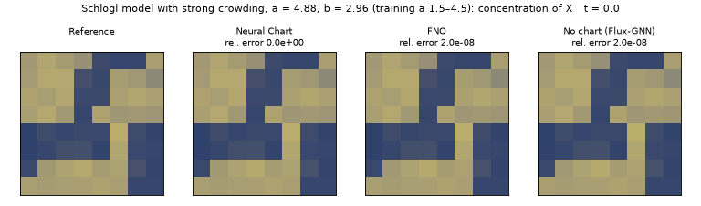

| Method | training conditions | a 4.6–5.0, b 2.0–3.5 | 16×16 grid | parameters |
|---|---|---|---|---|
| **Neural Chart** | **4.8e-03** | 0.018 | **6.4e-03** | 5,702 |
| Neural Chart with given standard potentials | 7.1e-03 | 0.022 | 7.3e-03 | 5,701 |
| No chart (Flux-GNN) | 3.1e-03 | 2.6e-03 | 2.9e-03 | 150,850 |
| CRNN (mass action) | 0.325 | 2.210 | 0.284 | 6 |
| CRNN (condition features) | 0.039 | 0.098 | 0.031 | 4,674 |
| UDE closure | 0.030 | 0.239 | 0.098 | 4,737 |
| FNO | 0.018 | 0.080 | 0.019 | 172,545 |
| BSMS-GNN | 0.015 | **7.0e-03** | 0.060 | 1,392,001 |
| GENERIC-FNO | 1.040 | 0.567 | 0.870 | 1,002,004 |
| Persistence (u(t) = u(0)) | 1.040 | 0.567 | 0.870 | 0 |

| Method | hyperedges with flux against the true force | samples with σ < 0 | negative values |
|---|---|---|---|
| Neural Chart | 4.4e-04 | 0 | 0 |
| No chart (Flux-GNN) | 0.544 | 1.000 | 0 |
| CRNN (mass action) | 0.186 | 0.021 | 0 |
| CRNN (condition features) | 0.107 | 0.060 | 0 |
| UDE closure | 0.404 | 0.631 | 0 |
| FNO | N/A | N/A | 2.9e-04 |
| BSMS-GNN | N/A | N/A | 0 |
| GENERIC-FNO | N/A | N/A | 0 |

The variant without the chart is the most accurate model on this task (3.1e-3, 2.6e-3 and 2.9e-3 against 4.8e-3, 0.018 and 6.4e-3), and 54 % of its hyperedges carry flux against the true force.
BSMS-GNN is also more accurate at the highest chemostat levels (7.0e-3).
Without $G_\theta$ the Neural Chart reaches 0.036 to 0.13.

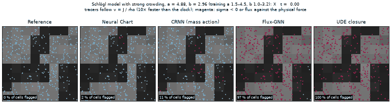

### Driven phosphorylation cycle

A substrate $X$ is phosphorylated by an immobile enzyme, $X+E+\mathrm{ATP}\rightleftharpoons X_p+E+\mathrm{ADP}$, and dephosphorylated, $X_p\rightleftharpoons X$, on an 8×8 periodic grid.
$X$ and $X_p$ diffuse in a smooth potential $U$.
The free energy of ATP hydrolysis $\Delta G$ drives a net current around the cycle.
The test sets change the drive, the potential and the grid.
All three enter the Neural Chart only through the force.


The animation shows the phosphorylated fraction $X_p/(X+X_p)$.

| Method | training conditions (ΔG 1–3) | drive ΔG 3–4 | stronger, finer potential U | 16×16 grid | parameters |
|---|---|---|---|---|---|
| **Neural Chart** | **2.9e-06** | **3.5e-06** | **5.9e-06** | **3.5e-06** | 5,961 |
| Neural Chart with given standard potentials | 2.8e-06 | 3.2e-06 | 4.8e-06 | 3.5e-06 | 5,958 |
| No chart (Flux-GNN) | 2.1e-03 | 0.038 | 0.113 | 4.1e-03 | 151,170 |
| CRNN (mass action) | 0.017 | 0.018 | 0.021 | 0.025 | 10 |
| CRNN (condition features) | 5.2e-03 | 0.045 | 0.011 | 7.6e-03 | 4,866 |
| UDE closure | 0.018 | 0.057 | 0.130 | 0.026 | 5,121 |
| FNO | 0.022 | 0.050 | 0.600 | 0.534 | 172,867 |
| BSMS-GNN | 0.180 | 0.189 | 0.449 | 0.350 | 1,392,515 |
| GENERIC-FNO | 1.049 | 0.967 | 1.034 | 0.904 | 1,005,172 |
| Persistence (u(t) = u(0)) | 0.836 | 0.909 | 0.917 | 0.795 | 0 |

| Method | hyperedges with flux against the true force | samples with σ < 0 | negative values |
|---|---|---|---|
| Neural Chart | 3.1e-05 | 0 | 0 |
| No chart (Flux-GNN) | 0.140 | 0 | 0 |
| CRNN (mass action) | 0.068 | 0 | 0 |
| CRNN (condition features) | 0.222 | 0 | 0 |
| UDE closure | 0.405 | 0 | 0.032 |
| FNO | N/A | N/A | 0.037 |
| BSMS-GNN | N/A | N/A | 0.191 |
| GENERIC-FNO | N/A | N/A | 0.109 |

The Neural Chart stays between 2.9e-6 and 5.9e-6 on every test set, including the stronger drive and the new potential, close to the integration floor of about 2e-6.
The best baseline, CRNN with condition features, is at 5e-3 under the training conditions and at 0.011 in the new potential. The variant without the chart is at 2e-3 and 0.11.
CRNN with mass action has the right graph but one rate constant per class of steps, so it cannot represent the spatial potential, and it stays near 0.02.
The networks stay near zero on this task, with $|g_\theta|$ and $|\nabla G_\theta|$ below 0.01.


The tracers follow the transport flux of $X$ under the stronger drive, four times faster than the clock.

### Phosphorylation cycle on heterogeneous media

The same network on hidden periodic media.
The rate constant of every hyperedge is multiplied by a function of a hidden map $H(x)$ with 8 pixels per site, and this function does not read the conditions.
The models see 3 descriptors per hyperedge, and all tests use unseen media.

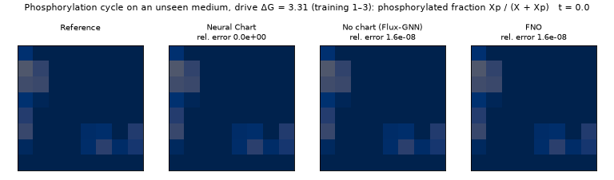

| Method | unseen media, training conditions (ΔG 1–3) | unseen media, drive ΔG 3–4 | unseen media, stronger, finer potential U | unseen media, 16×16 grid | parameters |
|---|---|---|---|---|---|
| **Neural Chart** | **0.014** | **0.016** | **0.016** | **0.016** | 6,153 |
| Neural Chart with given standard potentials | 0.014 | 0.016 | 0.015 | 0.016 | 6,150 |
| No chart (Flux-GNN) | 0.013 | 0.028 | 0.082 | 0.015 | 151,554 |
| CRNN (mass action) | 0.154 | 0.119 | 0.141 | 0.170 | 10 |
| CRNN (condition features) | 0.029 | 0.059 | 0.049 | 0.033 | 5,058 |
| UDE closure | 0.034 | 0.049 | 0.139 | 0.042 | 5,313 |
| FNO | 0.064 | 0.074 | 0.449 | 0.417 | 172,963 |
| BSMS-GNN | 0.983 | 0.753 | 0.963 | 5.009 | 1,392,899 |
| GENERIC-FNO | 0.942 | 1.002 | 0.967 | 0.864 | 1,005,316 |
| Persistence (u(t) = u(0)) | 0.840 | 0.888 | 0.930 | 0.858 | 0 |

| Method | hyperedges with flux against the true force | samples with σ < 0 | negative values |
|---|---|---|---|
| Neural Chart | 0.015 | 0 | 0 |
| No chart (Flux-GNN) | 0.099 | 0 | 0 |
| CRNN (mass action) | 0.137 | 0 | 0 |
| CRNN (condition features) | 0.148 | 0 | 0 |
| UDE closure | 0.411 | 0.900 | 0.031 |
| FNO | N/A | N/A | 0.036 |
| BSMS-GNN | N/A | N/A | 0.199 |
| GENERIC-FNO | N/A | N/A | 0.097 |

The error of the Neural Chart stays at 0.014 to 0.016 across the unseen media, the drive, the potential and the grid.
One constant mobility per class gives 0.18 to 0.24, so $g_\theta$ is what captures the medium.
Its $\log k$ has a Pearson r of 0.96 to 0.97 against the truth on unseen media, with an RMSE of 0.26 to 0.28.
The variant without the chart is as accurate under the training conditions (0.013) and reaches 0.082 in the new potential.

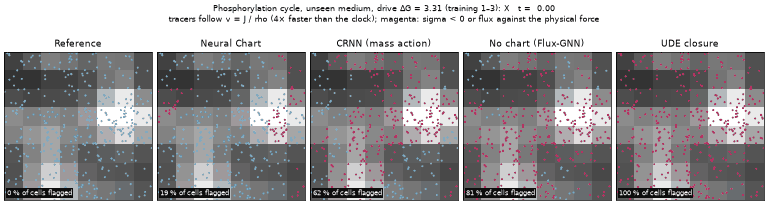

### Phosphorylation cycle with interactions

The same network with a true excess free energy that couples species, $G=\chi_1c_Xc_{X_p}+\chi_2c_{X_p}c_E$ per site, with $\chi_1=-0.15$ and $\chi_2=0.15$.

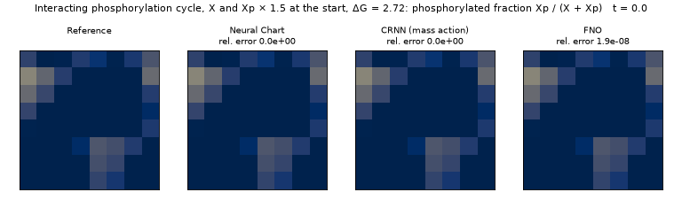

| Method | training conditions (ΔG 1–3) | drive ΔG 3–4 | stronger, finer potential U | X and Xp at the start × 1.5 | 16×16 grid | parameters |
|---|---|---|---|---|---|---|
| **Neural Chart** | **1.9e-03** | **2.9e-03** | **0.022** | **3.1e-03** | **1.7e-03** | 5,961 |
| Neural Chart with given standard potentials | 4.5e-04 | 1.0e-03 | 8.3e-03 | 1.8e-03 | 4.6e-04 | 5,958 |
| No chart (Flux-GNN) | 5.0e-03 | 0.035 | 0.227 | 0.022 | 5.6e-03 | 151,170 |
| CRNN (mass action) | 0.062 | 0.086 | 0.172 | 0.098 | 0.072 | 10 |
| CRNN (condition features) | 0.048 | 0.067 | 0.149 | 0.080 | 0.050 | 4,866 |
| UDE closure | 0.022 | 0.054 | 0.230 | 0.049 | 0.023 | 5,121 |
| FNO | 0.029 | 0.052 | 0.668 | 0.233 | 0.572 | 172,867 |
| BSMS-GNN | 0.306 | 0.284 | 0.410 | 0.555 | 0.615 | 1,392,515 |
| GENERIC-FNO | 0.868 | 0.932 | 0.945 | 0.770 | 0.860 | 1,005,172 |
| Persistence (u(t) = u(0)) | 0.862 | 0.884 | 0.935 | 0.880 | 0.842 | 0 |

| Method | hyperedges with flux against the true force | samples with σ < 0 | negative values |
|---|---|---|---|
| Neural Chart | 0.020 | 0 | 0 |
| No chart (Flux-GNN) | 0.238 | 0 | 0 |
| CRNN (mass action) | 0.158 | 0 | 0 |
| CRNN (condition features) | 0.210 | 0 | 0 |
| UDE closure | 0.311 | 0.339 | 0.022 |
| FNO | N/A | N/A | 0.037 |
| BSMS-GNN | N/A | N/A | 0.104 |
| GENERIC-FNO | N/A | N/A | 0.099 |

Without $G_\theta$ the error is 0.066 to 0.29, and with it 1.7e-3 to 0.022.
The learned excess potential has a Pearson r of 0.85 to 0.93 against the truth, and the learned $\log k$ has 0.99 or higher.
The stronger and finer potential is the hardest test set for the Neural Chart.

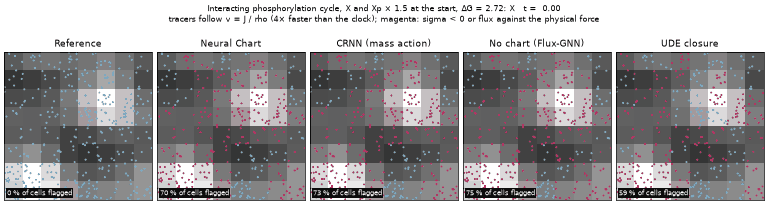

### Phosphorylation cycle with a saturating rate

The same network with the symmetric rate constant of the phosphorylation step multiplied by $1/(1+(c_X+c_{X_p}+c_E)/2)$.
This factor depends on the local state and does not read the conditions.

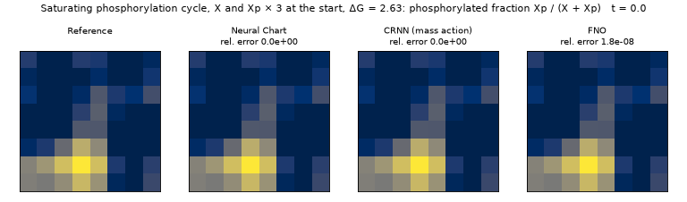

| Method | training conditions (ΔG 1–3) | drive ΔG 3–4 | stronger, finer potential U | X and Xp at the start × 3 | 16×16 grid | parameters |
|---|---|---|---|---|---|---|
| **Neural Chart** | **7.2e-04** | **2.5e-03** | **9.3e-03** | **0.014** | **1.2e-03** | 5,961 |
| Neural Chart with given standard potentials | 1.0e-03 | 4.3e-03 | 8.3e-03 | 0.016 | 1.4e-03 | 5,958 |
| No chart (Flux-GNN) | 2.3e-03 | 0.031 | 0.117 | 0.080 | 3.3e-03 | 151,170 |
| CRNN (mass action) | 0.046 | 0.037 | 0.146 | 0.215 | 0.054 | 10 |
| CRNN (condition features) | 0.028 | 0.052 | 0.093 | 0.210 | 0.043 | 4,866 |
| UDE closure | 0.020 | 0.053 | 0.110 | 0.090 | 0.028 | 5,121 |
| FNO | 0.019 | 0.049 | 0.580 | 0.381 | 0.509 | 172,867 |
| BSMS-GNN | 0.484 | 0.333 | 0.455 | 0.648 | 0.311 | 1,392,515 |
| GENERIC-FNO | 0.712 | 0.808 | 0.876 | 0.590 | 0.799 | 1,005,172 |
| Persistence (u(t) = u(0)) | 0.767 | 0.877 | 0.857 | 0.760 | 0.763 | 0 |

| Method | hyperedges with flux against the true force | samples with σ < 0 | negative values |
|---|---|---|---|
| Neural Chart | 0.012 | 0 | 0 |
| No chart (Flux-GNN) | 0.230 | 0 | 0 |
| CRNN (mass action) | 0.033 | 0 | 0 |
| CRNN (condition features) | 0.362 | 0 | 0 |
| UDE closure | 0.235 | 0 | 0.023 |
| FNO | N/A | N/A | 0.014 |
| BSMS-GNN | N/A | N/A | 0.239 |
| GENERIC-FNO | N/A | N/A | 0.068 |

One constant mobility per class gives 0.011 to 0.042, and $g_\theta$ gives 7.2e-4 to 0.014.
The learned $\log k$ has a Pearson r of 0.993 or higher against the truth, including at three times the starting concentration.

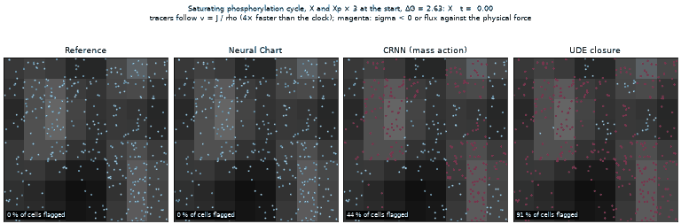

## Ideal reaction networks

In these two benchmarks the truth is ideal mass action, and the two networks have nothing to learn beyond constants.
CRNN with mass action is given the same graph and only those constants, so it has exactly the right model class and is the fair comparison.

### Brusselator: oscillations and Turing patterns

The Brusselator $A\to X$, $2X+Y\to3X$, $B+X\to Y+D$, $X\to E$ with chemostats $A$, $B$, $D$, $E$ on a 32×32 periodic grid, with diffusing $X$ and $Y$.
Depending on the chemostat levels it shows a limit cycle or Turing patterns.

| Turing pattern formation (a = 1.90, b = 3.90) | Oscillation, both chemostats outside the training range (a = 1.39, b = 4.30) |
|---|---|
|  |  |

| Method | training conditions | b 3.2–3.7 | b 4.0–4.6 | a 1.3–1.5 (a and b outside training) | Turing regime (below the Hopf line) | 64×64 grid | parameters |
|---|---|---|---|---|---|---|---|
| **Neural Chart** | 4.4e-03 | 4.1e-03 | 0.013 | 0.056 | **4.3e-03** | 0.020 | 5,994 |
| Neural Chart with given standard potentials | 9.5e-05 | 4.6e-04 | 3.4e-04 | 4.9e-04 | 1.9e-04 | 2.0e-04 | 5,992 |
| No chart (Flux-GNN) | 0.075 | 0.499 | 0.639 | 0.638 | 0.292 | 0.201 | 151,170 |
| CRNN (mass action) | **2.4e-03** | **3.0e-03** | **3.4e-03** | **4.1e-03** | 0.026 | **0.013** | 12 |
| CRNN (condition features) | 0.724 | 0.755 | 0.771 | 0.802 | 0.698 | 0.749 | 4,866 |
| UDE closure | 0.550 | 0.622 | 0.689 | 1.004 | 1.408 | 0.573 | 4,929 |
| BSMS-GNN | 0.729 | 0.805 | 0.687 | 0.858 | 1.849 | 0.761 | 1,723,522 |
| FNO | 0.297 | 0.370 | 0.678 | 0.639 | 0.321 | 0.697 | 1,188,514 |
| GENERIC-FNO | 0.780 | 0.835 | 1.016 | 0.762 | 0.580 | 0.825 | 1,003,588 |
| Persistence (u(t) = u(0)) | 0.780 | 0.835 | 1.016 | 0.762 | 0.580 | 0.825 | 0 |

| Method | hyperedges with flux against the true force | samples with σ < 0 | negative values |
|---|---|---|---|
| Neural Chart | 6.3e-05 | 0 | 0 |
| No chart (Flux-GNN) | 0.139 | 0 | 0 |
| CRNN (mass action) | 0.067 | 0 | 0 |
| CRNN (condition features) | 0.311 | 0 | 0 |
| UDE closure | 0.627 | 1.000 | 0.498 |
| BSMS-GNN | N/A | N/A | 0.940 |
| FNO | N/A | N/A | 3.2e-03 |
| GENERIC-FNO | N/A | N/A | 0 |

CRNN with mass action is more accurate than the Neural Chart on five of the six test sets, most of all with both chemostats outside training (4.1e-3 against 0.056).
The Neural Chart is ahead in the Turing regime (4.3e-3 against 0.026).
Both are far more accurate than every other baseline.
Without the chart the model reaches 0.075 under the training conditions and 0.29 to 0.64 under new ones.

The steps of the Brusselator are close to irreversible, and the affinity of such a step, and with it the internal standard potentials, is only weakly determined by data (Theorem 0(iii)(d) and Theorem 2 of the theory notes).
With all standard potentials given, the error drops to 9.5e-5 to 4.9e-4.
Learned chemostat values give a lower trajectory error than the looked-up ones (1.5e-3 to 0.012) and a larger error of the entropy production.

In the Turing regime half of the test trajectories start from a uniform state, which is unstable to spatial perturbations.
In FP32 integration rounding noise can break the symmetry and grow into a pattern, so the error of these trajectories depends on rounding.
This is the source of the 0.026 of CRNN with mass action in that column (`results/brusselator/NOTES.md`).


The tracer animation follows the Turing trajectory above.


### MAPK cascade

The Huang–Ferrell MAPK cascade with 22 species and 20 reactions (binding and catalysis of every enzymatic step) on a 4×4 grid.
ATP, ADP and $P_i$ are chemostatted, and the kinase MAPK diffuses.
The test sets change the ATP level and the initial state.


The animation shows all 22 species at the 16 sites.

| Method | training conditions (ATP 0.5–2) | ATP 3–5 | ATP 0.15–0.3 | phosphorylated initial states | parameters |
|---|---|---|---|---|---|
| **Neural Chart** | **3.4e-03** | **9.5e-03** | **7.7e-03** | **3.7e-03** | 9,039 |
| Neural Chart with given standard potentials | 3.8e-03 | 6.8e-04 | 1.5e-03 | 3.1e-03 | 9,017 |
| No chart (Flux-GNN) | 6.3e-03 | 0.115 | 0.409 | 6.1e-03 | 153,410 |
| CRNN (mass action) | 8.5e-03 | 0.027 | 0.020 | 8.7e-03 | 46 |
| CRNN (condition features) | 8.1e-03 | 0.032 | 0.099 | 8.3e-03 | 5,890 |
| UDE closure | 0.090 | 0.745 | 0.390 | 0.084 | 8,641 |
| FNO | 0.469 | 0.819 | 0.675 | 0.472 | 61,206 |
| BSMS-GNN | 2.307 | 8.783 | 4.501 | 10.463 | 1,066,006 |
| GENERIC-FNO | 1.682 | 1.734 | 1.563 | 1.818 | 1,035,220 |
| Persistence (u(t) = u(0)) | 0.649 | 0.755 | 0.407 | 1.181 | 0 |

| Method | hyperedges with flux against the true force | samples with σ < 0 | negative values |
|---|---|---|---|
| Neural Chart | 0.073 | 0 | 0 |
| No chart (Flux-GNN) | 0.133 | 0 | 0 |
| CRNN (mass action) | 0.054 | 0 | 0 |
| CRNN (condition features) | 0.232 | 0 | 0 |
| UDE closure | 0.837 | 1.000 | 0.354 |
| FNO | N/A | N/A | 0.421 |
| BSMS-GNN | N/A | N/A | 0.495 |
| GENERIC-FNO | N/A | N/A | 0.362 |

The variant without the chart is close to the Neural Chart under the training conditions (6.3e-3 against 3.4e-3).
At new ATP levels its error grows to 0.12 and 0.41, while the Neural Chart stays at 9.5e-3 and 7.7e-3 and CRNN with mass action at 0.027 and 0.020.
ATP enters the Neural Chart only through the force, so a new ATP level changes no learned parameter.
The internal standard potentials are weakly determined here too. At low ATP 7.3 % of the hyperedges carry flux against the true force, and with all potentials given the error drops from 7.7e-3 to 1.5e-3.
The learned $\log k$ has a Pearson r of 0.83 to 0.86 against the truth, with an RMSE of about 1.1.


The tracers follow phosphorylated MAPK ($K_p+K_{pp}$) at low ATP.

## How each part contributes

Every variant is the Neural Chart with one change (`neuralchart/chart.py`, `VARIANTS`).

| Part of the model | Variant without it | 10T error, Neural Chart → variant, training conditions unless stated |
|---|---|---|
| the chart itself, the split into driving and material coordinates | a hypergraph network emits both rates (Flux-GNN) | porous media at temperature ×4 0.10 → 2.14, Brusselator 4.4e-3 → 0.075, MAPK at low ATP 7.7e-3 → 0.41 |
| material network $g_\theta$ | one constant mobility per class | porous media 0.065 → 1.1, heterogeneous media 0.014 → 0.19, saturating rate 7.2e-4 → 0.011 |
| excess free energy $G_\theta$ | $G=0$ | interactions 1.9e-3 → 0.082, non-ideal Schlögl 6.1e-3 → 0.11, strong crowding 4.8e-3 → 0.055 |
| closed-form start | zero-initialised rollouts | phosphorylation cycle 2.9e-6 → 6.4e-3, Schlögl 2.2e-5 → 0.026, saturating rate 7.2e-4 → 0.011, MAPK 3.4e-3 → 0.023, interactions 1.9e-3 → 8.5e-3, heterogeneous media 0.014 → 0.033. It does not help on strong crowding (4.8e-3 → 3.7e-3) or on non-ideal Schlögl at higher concentrations (0.082 → 0.011) |
| drive $A$ | $A=0$, a reversible model | errors of 0.10 to 1.4: the driven steady states cannot be represented |
| looked-up chemostat values | learned chemostat values | interactions 1.9e-3 → 4.4e-3, Brusselator 4.4e-3 → 2.7e-3. The trajectory error can improve while the entropy production gets worse |
| learned internal potentials | all standard potentials given | Brusselator 4.4e-3 → 9.5e-5, MAPK at low ATP 7.7e-3 → 1.5e-3, interactions 1.9e-3 → 4.5e-4 |

Removing $G_\theta$ leaves the tasks with a learned mobility unchanged, and removing $g_\theta$ costs them more than a factor of ten.
Removing $G_\theta$ costs the tasks with an excess free energy more than a factor of ten.
On the non-ideal Schlögl tasks removing $g_\theta$ costs accuracy too, although the true mobility is constant there.

## Why the hypergraph is an input

The hypergraph is the base of the chart.
On a fixed hypergraph the data determine the coordinates of the model, up to the directions that Theorem 0(iii)(d) of the theory notes identifies.
Without it, trajectories do not determine the thermodynamic structure.
Different hypergraphs can produce nearly the same trajectories with different forces and a different entropy production.

On the reaction networks the hypergraph does two concrete things.

1. **Hyperedges turn high-order reactions into a problem that is linear in $k$.** The step $2X+Y\rightleftharpoons3X$ of the Brusselator is cubic in the concentrations. On its hyperedge the rate is one class constant times a factor that the stoichiometry and the current chemical potentials fix, so the closed-form start treats it in the same way as a transfer between two cells.
2. **Hypergraph cycles fix the energy balance.** ATP, ADP, the enzyme and the substrate are bound together on one hyperedge, so a sum of forces around a cycle cancels the intermediates and leaves the free energy of hydrolysis. With the hypergraph given and the chemostat values as inputs, the cycle affinity of the phosphorylation cycle equals the truth. On a network of candidates the phosphorylation step splits into two half-reactions, and the entropy production becomes 10.2 times the truth. The right hypergraph is necessary for these readouts, and it does not suffice on its own. On the Brusselator and the MAPK cascade nearly irreversible steps leave the internal potentials uncertain, and the readouts inherit that error.

We tested this with version 1.0 of the model on a network of all candidate reactions with up to three state molecules on each side.
This network has a larger thermodynamic manifold, and every smaller network is one of its boundary faces, where $k_e=0$ for the reactions it leaves out.
Finding a sparse network then means projecting the data onto a low-dimensional boundary face.
A sparsity penalty on $k$ pushes the fit towards such a face, and the reactions that carry at least 1 % of the flux are read out as the network.
This experiment is not part of the release, and every value in the table comes from version 1.0.

| Benchmark | 10T error, network of candidates | 10T error, hypergraph given | entropy production, candidate model / truth |
|---|---|---|---|
| Brusselator | 0.019 | 2.6e-03 | 1.08, with 6.4 % of the steps against the true force |
| Phosphorylation cycle | 2.0e-05 | 5.9e-06 | 10.2 |

The candidate model still predicts the trajectories, but its entropy production is wrong by a factor of up to 10.
The data cannot tell its extra reactions apart from the true ones.
Conservation laws and catalysts give the manifold directions along which the Fisher metric of the data is singular, so the trajectories do not determine the internal fluxes.
In the phosphorylation cycle the product of the ATP and ADP levels is constant in the data, so the phosphorylation step splits into two half-reactions with the same effect on the state.
In the Brusselator the reverse of $A\to X$ and the step $X\to E$ both remove $X$ in proportion to its concentration, so their split is not determined.

An accurate trajectory therefore does not imply the right thermodynamics.
Fixing the hypergraph removes these directions.

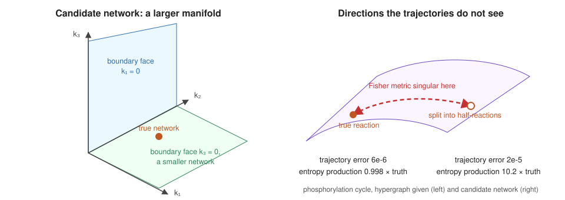

## Related work

**Reaction neural networks.**
CRNN ([Ji and Deng 2021](https://doi.org/10.1021/acs.jpca.0c09316)) learns mass-action rate constants on a reaction network, and is one of our baselines.
The global reaction neural network GRNN ([Kircher, Döppel and Votsmeier 2024](https://doi.org/10.1016/j.cej.2024.149863)) embeds the stoichiometry and the thermodynamics.
A network that can read the temperature and the species state gives the forward rates, and the equilibrium constants give the backward rates.
The Neural Chart goes one step further in how it splits the rate.
It writes the symmetric part as $g=k\,\varepsilon$, takes the known state and condition factor $\varepsilon(c,\theta)$ out, and asks the learned material coordinate $k$ to follow one law across conditions.
A GRNN could express this subclass by restricting its network in the same way.
What the Neural Chart adds is the use of the restriction: the cross-condition error relation, the identifiability criterion, and the readouts of edge fluxes, cycle currents and entropy production that rest on them.

**Networks that learn free energy and dissipation.**
OnsagerNet ([Yu, Tian, E and Li 2021](https://doi.org/10.1103/PhysRevFluids.6.114402)) learns dynamics with a generalized Onsager principle, including a free energy, a dissipation and external forces.
VONNs ([Huang et al. 2022](https://arxiv.org/abs/2112.09085)) learn a free energy and a dissipation potential from spatiotemporal data, guarantee the second law through the network structure, and discuss why these potentials cannot be recovered uniquely.
Learning constitutive laws with neural networks, building the second law into the architecture, and asking about identifiability are therefore not new in themselves.
VONNs learn a general dissipation potential and cover a broader class of systems.
The Neural Chart assumes more, namely a known network and a known rate structure.
With these assumptions it can ask more specific questions: which part of the rate law stays fixed when the conditions change, what error follows at a new condition, and when a change of conditions makes two mechanisms in the model distinguishable.

**Composition.**
Baez and Pollard ([2017](https://doi.org/10.1142/s0129055x17500283)) give a compositional framework for known reaction networks.
Neary and Topcu ([2022](https://arxiv.org/abs/2212.00893)) train port-Hamiltonian networks on subsystems and predict composite systems without composite data.
Hernández et al. ([2023](https://doi.org/10.1007/s00466-023-02296-w)) learn complex systems by parts with port-metriplectic networks.
In those models subsystems meet at ports.
Here modules meet at shared species of a hypergraph, which brings in the potential gauge, the new cycles and the double-counted self energy.

## Scope and limits

- **The hypergraph is given.** The model receives the reaction hypergraph or the mesh. Learning which reactions exist from data is not part of this release.
- **What is fixed.** The hypergraph, local detailed balance, the form of $\varepsilon$ and the way the potential and the drive enter are assumptions and are not learned.
- **Second law.** Non-negative dissipation holds with respect to the model's own force. The physics tables measure the distance to the true force.
- **Transfer across conditions is conditional.** It needs the invariance to hold in the truth and the test states to lie where the networks are accurate. A new condition can drive the system to states that training never visited.
- **The convex start covers one step.** The non-negative least squares on the class constants is convex. The mapping back to coupled parameters and the rollouts are not.
- **Chemostat standard free energies are inputs.** Where they cannot be looked up, they are fitted, density data do not fix them, and cycle affinities and the entropy production are unreliable.
- **Internal standard potentials are weakly determined by concentration data.** Theorem 0(iii)(d) and Theorem 2 of [docs/theory.md](docs/theory.md) show why: the affinity of a step that is close to irreversible carries little information in the data.
- **$G_\theta$ is local.** Gradient energies and long-range interactions are outside the model class.
- **Composition.** The zero-shot result needs the conditions of Corollary 4, and otherwise composite data are needed.
- **One seed.** Every number is from one training run.

## Reproduce

**Environment.** Python 3.10 or later, PyTorch 2.4 or later, NumPy and SciPy.
The reported runs used PyTorch 2.14 with CUDA 13.0.

```bash
pip install -e ".[bench]"
pytest                      # unit tests, under a minute on a CPU
pytest -m slow              # regression tests on the benchmark data (needs data/, see below)
```

**One command for every task and model.**

```bash
python -m neuralchart.run --task schlogl_nonideal --cmd generate                  # reference data
python -m neuralchart.run --task schlogl_nonideal --model chart                   # train and evaluate
python -m neuralchart.run --task schlogl_nonideal --model chart --cmd evaluate    # evaluate stored weights
python -m neuralchart.run --task schlogl_nonideal --cmd tables                    # results/<task>/
python -m neuralchart.run --task schlogl_nonideal --cmd gifs                      # assets/
```

The data go to `data/<task>/`, or to `$NEURALCHART_DATA/<task>` when that variable is set.
The trained charts of every benchmark are in `checkpoints/`.

Tasks: `porous_media`, `porous_media_crowding`, `schlogl`, `schlogl_nonideal`, `schlogl_nonideal_strong`, `phosphorylation_cycle`, `phosphorylation_heterogeneous`, `phosphorylation_interacting`, `phosphorylation_saturating`, `brusselator`, `mapk_cascade`, `compose_reaction_transport`, `compose_cycle_cycle`, `compose_thermo_cross`, `compose_kinetic_cross`.

Models: `chart` and its ablations (`chart-const-k`, `chart-no-excess`, `chart-zero-init`, `chart-reversible`, `chart-learned-chem-mu0`, `chart-given-mu0`, `flux_gnn`), and the baselines `ude`, `crnn_mass_action`, `crnn_features`, `fno`, `bsms`, `generic_fno`, `helmfluid` (porous media only) and `persistence`.
HelmFluid needs its upstream code (see [THIRD_PARTY.md](THIRD_PARTY.md)).

## Repository layout

```
neuralchart/            the library
  chart.py              NeuralChart: fit, rollout, readouts, save, load; ablations
  model.py              master equation: free energy, mobility, drive, rates
  graphs.py             hypergraphs of reaction and transport networks
  data.py               Conditions, Trajectories
  fit.py                closed-form start and rollout training
  compose.py            composition of hypergraphs and of fitted charts
  fast.py               fast integrator with error control (GPU and CPU)
  integrators.py        positive SSP-RK2
  diagnostics.py        local detailed balance rule, entropy production error
  run.py                one dispatch for every task and model
  baselines/            Flux-GNN (the ablation without the chart), CRNN, BSMS-GNN, GENERIC-FNO, HelmFluid wrapper
benchmarks/<family>/    data, test sets, evaluation, tables and animations of each benchmark family
examples/               a fit on a small driven network
results/<task>/         tables (markdown and csv)
checkpoints/<task>/     trained Neural Chart checkpoints
assets/                 figures and animations of this page
docs/                   method and protocol, theory, gluing, information geometry appendix
tests/                  unit and regression tests
```

## Licence

MIT (see [LICENSE](LICENSE)). Third-party code and methods are listed in [THIRD_PARTY.md](THIRD_PARTY.md).
