# Neural Chart

The Neural Chart learns a driven physical system from trajectories by separating what changes with the conditions from what stays the same.
On a given reaction or transport hypergraph, each rate is split into two factors.
The first is known as a function of the state and the conditions.
The second belongs to the material and is learned.
The model assumes that this material factor follows the same law under every condition, which we call cross-condition invariance.
Three properties follow from this assumption.

- **Extrapolation in the drive.** The model can be moved to a new drive, temperature, potential or chemostat level without retraining.
- **Optimization.** The fit has a convex closed-form start, from which rollout training succeeds.
- **Identifiability.** The theory states when trajectories determine the flux of every step, the cycle currents and the entropy production, and when they cannot.

On top of these, the model dissipates non-negatively for every value of its parameters.

The model receives the state, the hypergraph of reaction and transport steps, and the conditions of each trajectory: the temperature, an external potential and drive, and the chemostat levels.
Each reaction is a hyperedge that joins its reactants to its products, and each transport step is an edge between two cells.
The model returns a master equation on that hypergraph.

**Contents**

- [The problem](#the-problem)
- [The idea: what stays the same when the conditions change](#the-idea-what-stays-the-same-when-the-conditions-change)
- [What the invariance gives](#what-the-invariance-gives)
- [What is learned in each benchmark](#what-is-learned-in-each-benchmark)
- [Results at a glance](#results-at-a-glance)
- [Learned constitutive laws under new conditions](#learned-constitutive-laws-under-new-conditions): porous media, porous media with crowding, non-ideal Schlögl model, phosphorylation cycle
- [Ideal reaction networks](#ideal-reaction-networks): Schlögl model, Brusselator, MAPK cascade
- [How each part contributes](#how-each-part-contributes)
- [Why the hypergraph is an input](#why-the-hypergraph-is-an-input)
- [Related work](#related-work)
- [Scope and limits](#scope-and-limits)
- [Reproduce](#reproduce)
- [Repository layout](#repository-layout)

## The problem

Most neural simulators learn the flux or the time derivative from the state $c$, the conditions $\theta$ (temperature, external field, drive, chemostat levels) and the material features $\xi$ together in one network.
Examples are FNO, graph networks that emit fluxes, and closures in universal differential equations.
Seen as a learning problem, this mixing leads to three failures, all visible in the benchmarks below.

1. **Spurious correlation and failure under a shift of the conditions.** The network cannot tell which changes of the rate come from the material and which come from the temperature or the drive. When the test conditions leave the training range, it fails. Trained at one temperature, FNO reaches an error of 2.3 at four times that temperature in porous media, and the UDE closure 1.0.
2. **An ill-conditioned, non-convex optimization.** The kinetic parameters and the state are strongly coupled, and gradient descent from a generic start stops at poor local optima. On the oscillating Brusselator every black-box model stays above an error of 0.29. The Neural Chart itself, started without its closed-form step, stays at 0.50.
3. **Observational equivalence.** Very different internal parameters can produce almost the same trajectories. A model of the Schlögl model built on a library of candidate reactions reaches a trajectory error of 2e-5, and its entropy production is still wrong by a factor of 4, and by up to 24 on other tasks. Fluxes that circulate around a cycle leave the state unchanged and change the entropy production (Theorem 1 of [docs/theory.md](docs/theory.md)). The learned flux of each step, and every readout built on it, then cannot be trusted. The same freedom lets the UDE closure send up to 69 % of its edge fluxes against the physical force.

The Neural Chart addresses all three with one structural factorization of the rate of each step on a given hypergraph.

## The idea: what stays the same when the conditions change

### Channel fluxes on a directed hypergraph

The Neural Chart treats transport on a mesh and reactions in a network in one way, as channel fluxes on a directed hypergraph.
A step $h$ takes the species in its reactant count vector $\nu_h^+$ to those in its product count vector $\nu_h^-$, with species at sites as nodes.
A transfer between two cells moves one unit from one node to another, so an ordinary graph is the special case in which every column of the stoichiometric matrix $S=\nu^--\nu^+$ has one entry $-1$ and one entry $+1$.
A reaction joins several reactants to several products, for example $X+E+\mathrm{ATP}\to X_p+E+\mathrm{ADP}$ in the phosphorylation cycle.

The stoichiometry enters every formula below.
The force of a step is the difference of the chemical potentials on its two sides, weighted by the counts, $f_h=\langle\nu_h^+-\nu_h^-,\mu\rangle+A_h$.
The known scaling factor $\varepsilon_h=\exp\big(\tfrac12\langle\nu_h^++\nu_h^-,\mu\rangle\big)$ is the geometric mean of the mass-action terms of the two sides.
With both written this way, the rate of a step is linear in its mobility however many molecules take part, and this linearity gives the convex closed-form start.

The cycles of the hypergraph are the vectors $z\in\ker S$, combinations of steps that leave every species unchanged.
Along a cycle the chemical potentials of the intermediate species cancel in $\sum_hz_hf_h$, and what remains is the drive that the chemostats and external fields supply.
In the phosphorylation cycle this is the free energy of ATP hydrolysis.
The model reads this cycle affinity as 5.945 against a true 5.960.
It can do so only because the stoichiometry of every reaction, including ATP, ADP and the enzyme, is part of the hypergraph.

### Two coordinates for each step

On a fixed hypergraph each step $h$ runs forward at rate $a_h$ and backward at rate $b_h$.
Write the two rates in the coordinates

$$f_h=\log\frac{a_h}{b_h},\qquad g_h=\sqrt{a_h b_h}.$$

Local detailed balance says that $f_h$ is the thermodynamic force of the step,

$$f_h=\langle\nu_h^+-\nu_h^-,\mu\rangle+A_h,\qquad \mu=\log c+U/T+\mu^0/T+\ln\gamma(c),$$

set by the chemical potentials $\mu$ and the drive $A_h$.
For a given hypergraph the rate laws that satisfy local detailed balance form a manifold with coordinates $f$ and $g$.
The hypergraph fixes this manifold: its stoichiometry sets how $f$ and $g$ depend on the chemical potentials, and a different hypergraph gives a different manifold.

### The condition-invariant material factor

The symmetric coordinate $g$ also changes with the state and the conditions $\theta$ (temperature, potential, drive, chemostat levels).
Part of that change is known.
We write

$$g_h(c,\theta,\xi)=k_h(\xi,c)\,\varepsilon_h(c,\theta),\qquad \varepsilon_h=\exp\Big(\tfrac12\big\langle\nu_h^++\nu_h^-,\mu(c,\theta)\big\rangle\Big),$$

with the hypergraph factor $\varepsilon_h$ defined above.
It collects the mass-action factors, the chemostat levels and the potential.
In porous media a known prefactor $T$ joins it.
What remains, the mobility $k_h(\xi,c)>0$, belongs to the material and its local state, such as the permeability of a pore or the rate constant of a reaction.

The roles are now divided.
The scaling factor $\varepsilon(c,\theta)$ and the force $f(c,\theta)$ are computed by known formulas and take up every change of the conditions $\theta$. Their only learned inputs are the standard potentials and, for non-ideal mixtures, the activity correction, neither of which reads $\theta$.
The mobility $k(\xi,c)$ is the only part a network learns, and it is restricted to a constitutive law that is the same under every condition.
Learning the dynamics becomes the task of locating one condition-invariant coordinate $k$ on a manifold whose other coordinates are fixed.

**The central assumption.** Once the known factors are taken out, the mobility does not read the conditions.
Where it depends on them in a known way, that dependence goes into $\varepsilon$.
In every benchmark here the true mobility has this property.

### The chart

A Neural Chart is a parametrisation of the manifold under this assumption.
The force has a fixed physical form.
In porous media all of it is known.
On reaction networks it contains learned standard potentials $\mu^0_\theta$, and on non-ideal mixtures a learned activity correction $\ln\gamma_\theta(c)$, a monotone function of the concentration.
The mobility comes from a network that reads the material descriptors and the local state, and never the conditions,

$$\log k_h=\log\omega_{c(h)}+g_\theta(\xi_h)+s\,m(\bar c_h),$$

with one constant $\omega_c$ per class of steps, an MLP $g_\theta$ of local material descriptors $\xi_h$, and a monotone term $m$ of the local state $\bar c_h$.
What the model learns is thus a constitutive functional, a map from material descriptors and local state to mobilities and chemical potentials.
The dynamics follow from it through the master equation $\dot c=\sum_h S_h\,(a_h-b_h)$.

## What the invariance gives

[docs/theory.md](docs/theory.md) states and proves the results below (Theorem 0, Theorem 1, Proposition 4 and IG2).
It also shows what a gray-box model loses when its learned part reads the conditions or learns the force freely.

### Extrapolation in the drive

A new condition changes $f$ and $\varepsilon$ by known formulas and changes no learned parameter. At a fixed state, if the true mobility lies in the model class and the force is right, the flux error at any condition has a closed form, $\|J-J^{\rm true}\|^2_{\Lambda^{-1}}=\sum_h\delta_h^2\,\sigma_h^{\rm true}$ with $\delta_h=k_h/k_h^{\rm true}-1$ (IG2(c)). This does not make transfer automatic. A new condition can drive the system into states that training never visited, and it can change the true mobility of the material. Over long rollouts the error also depends on the stability of the dynamics.
In the benchmarks, eight times the training drive in porous media gives an error of 0.41, against 0.81 for the best baseline, and the stronger drive of the phosphorylation cycle leaves the error at 6.5e-6.

### Optimization

Every one-way rate is a class constant times a factor that the current force and activity fix. With those held fixed, the change of the state over a sampling interval is linear in the one-way class constants, and fitting it is a non-negative least-squares problem. This relaxation is convex and its optimum is global. The constants are then mapped back to the shared physical parameters, the class mobilities $\omega_c$ and the standard potentials, by least squares on their logarithms. When the classes are coupled through shared parameters, the code then minimises the residual over those parameters with L-BFGS, which is not convex. The variable projection that fits the activity correction and the rollout training that follows are not convex either. The start puts them close to a good solution. Without it the same training ends 100 to 10^6 times less accurate on every reaction network (see [How each part contributes](#how-each-part-contributes)).

### Identifiability

Under the invariance, trajectories recorded at different conditions constrain the same mobilities. The flux of step $h$ is $J_h=k_h\varphi_h(c,\theta)$ with a known $\varphi_h$. Noise-free data determine every $k_h$ exactly when no nonzero $v$ satisfies $\mathrm{diag}(\varphi^i)\,v\in\ker S$ at every data point $i$ (Theorem 0(iii)(d)). New conditions add data points with new $\varphi^i$ and shrink this set. Once $k$ and the force are determined, so are the flux of every step, the cycle currents and the entropy production. When the set is not empty, the data cannot separate the mechanisms it contains. In the phosphorylation cycle, for example, the two rate constants are identified when the cycle affinity is nonzero and the data contain two ratios of phosphorylated to unphosphorylated substrate. At zero affinity only their sum is. Two steps that remove the same species in the same proportion at every data point are never separated (the parallel-channel lemma).
In the benchmarks the model reads the cycle affinity of the phosphorylation cycle as 5.945 against a true 5.960, and the entropy production of the Schlögl model to a relative error of 1e-5. Without the hypergraph these readouts fail ([Why the hypergraph is an input](#why-the-hypergraph-is-an-input)).

### Non-negative dissipation

This part comes from local detailed balance alone. For every parameter value the flux of each step runs along the model's own force, so the entropy production computed with that force is non-negative. Local detailed balance with respect to that force, conservation of every moiety and positivity also hold, with no penalty or projection. Whether the model's force equals the true force depends on whether the learned standard potentials and activity correction are right. In porous media nothing in the force is learned. On the reaction networks we measure the gap and report it in every physics table as the fraction of steps whose flux runs against the true force.

[docs/method.md](docs/method.md) gives the fit and the evaluation protocol.

## What is learned in each benchmark

The same code runs every benchmark.
Each benchmark changes only the hypergraph, the inputs that exist (descriptors, local state, potential, chemostats) and the training data.

| Benchmark | System | Learned part | Parameters |
|---|---|---|---|
| Porous media | drift and diffusion of a density through random porous media | mobility of each edge as a function of 12 porosity and connectivity descriptors | 5,381 |
| Porous media with crowding | the same, with a mobility that falls with the local density | mobility as a function of the descriptors and the local density | 5,381 |
| Non-ideal Schlögl model | bistable reaction and diffusion with crowded activities | activity correction $\ln\gamma(c)$, standard potentials, rate constants | 55 |
| Phosphorylation cycle | an ATP-driven cycle with diffusion in an external potential | standard potentials, rate constants | 9 |
| Schlögl model | ideal bistable reaction and diffusion | standard potentials, rate constants | 6 |
| Brusselator | ideal reaction and diffusion with oscillations and Turing patterns | standard potentials, rate constants | 12 |
| MAPK cascade | ideal enzyme cascade with 22 species and 20 reactions | standard potentials, rate constants | 48 |

In the first three benchmarks the learned part is a function of the material or of the state.
In the phosphorylation cycle the test is the drive and the potential, which enter as coordinates.
The last three are ideal mass action.
There the mobility reduces to a set of constants, and the question is whether the model recovers them as well as a mechanistic fit does.

## Results at a glance

Every model is trained once, with one seed, under the training conditions, and is then evaluated on every test set without retraining.
The error is the relative L2 error of the state at 10T (200 sampling steps), median over the test trajectories.
The best baseline is the most accurate baseline in that column. The variant of the Neural Chart without its chart (Flux-GNN, described below) is an ablation and is not counted.

| Benchmark | training conditions: Neural Chart | best baseline | hardest new condition | Neural Chart | best baseline |
|---|---|---|---|---|---|
| Porous media | **0.064** | 0.077 (UDE closure) | temperature ×4 | **0.090** | 0.472 (HelmFluid) |
| Porous media with crowding | 0.067 | **0.066** (UDE closure) | drive ×8 | **0.376** | 0.917 (UDE closure) |
| Non-ideal Schlögl model | **3.4e-04** | 2.6e-03 (FNO) | higher concentrations | **0.010** | 0.033 (FNO) |
| Phosphorylation cycle | **5.9e-06** | 5.2e-03 (CRNN, condition features) | stronger, finer potential | **5.9e-06** | 0.011 (CRNN, condition features) |
| Schlögl model | **1.8e-06** | 4.1e-06 (CRNN, mass action) | new chemostat levels | **1.2e-06** | 3.7e-06 (CRNN, mass action) |
| Brusselator | 2.6e-03 | **2.4e-03** (CRNN, mass action) | both chemostats outside training | **3.7e-03** | 4.1e-03 (CRNN, mass action) |
| MAPK cascade | **6.6e-03** | 8.1e-03 (CRNN, condition features) | ATP 0.15–0.3 | **0.011** | 0.020 (CRNN, mass action) |

On every benchmark and every test set no step of the Neural Chart carries flux against its own force, no sample has negative entropy production, and no concentration becomes negative.

The baselines are:
- the UDE closure, a free neural flux on the same graph
- CRNN with mass action, which is given the same graph and fits free forward and backward rate constants
- CRNN with the conditions as features
- BSMS-GNN, FNO, GENERIC-FNO, and HelmFluid on porous media only
- persistence, $u(t)=u(0)$

The tables also show the Neural Chart without its chart, as an ablation.
In this variant a message-passing network on the same hypergraph emits the forward and backward rate of every step from the state, the conditions and the descriptors, with the same mass-action factors and the same integrator (we call it Flux-GNN).
It has no split into force and mobility, so none of the properties above apply to it.

The physics tables count, for every model with its own edge flux, the steps whose flux runs against the true physical force, $J_hf_h<-10^{-6}(a_h+b_h)|f_h|$, and the samples with $\sigma<0$.
Models that return only a state update have N/A there.
Full tables, including training times, are in `results/<benchmark>/`.
In the animations negative values are magenta, and the panel title counts the negative cells.
Each benchmark also has a tracer animation.
Tracers move with the probability velocity $v=J/\rho$ of one diffusing species, computed from each model's own flux.
A tracer turns magenta in a cell with negative local entropy production, or in a cell touched by a step whose flux runs against the true force.

## Learned constitutive laws under new conditions

### Porous media

A density moves by diffusion and a divergence-free drive through random porous media.
The true mobility comes from an effective-medium rule on a 128×128 pore map that the models never see.
The models see 12 local porosity and connectivity descriptors per edge.
They are trained on 64 media at temperature 1 and drive amplitude 1 on a 32×32 grid.
The tests use 16 unseen media, other temperatures and drives, unseen low-porosity media (porosity 0.15–0.3, training 0.3–0.7), a 64×64 grid and a point cloud of 1024 Voronoi cells.

| Drive ×8 on an unseen medium | Point cloud (training conditions) |
|---|---|
| 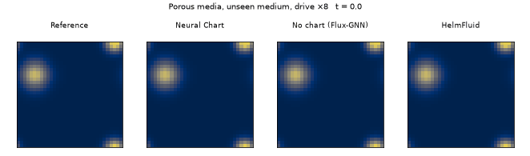 | 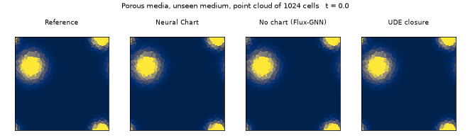 |

| Method | training conditions | temperature ×0.25 | temperature ×4 | drive ×4 | drive ×8 | unseen low-porosity media | 64×64 grid | point cloud | parameters |
|---|---|---|---|---|---|---|---|---|---|
| **Neural Chart** | **0.064** | **0.084** | **0.090** | **0.195** | **0.407** | **0.081** | **0.071** | **0.090** | 5,381 |
| No chart (Flux-GNN) | 0.078 | 0.797 | 2.138 | 1.046 | 1.091 | 0.116 | 0.515 | 0.458 | 151,234 |
| UDE closure | 0.077 | 0.700 | 1.023 | 0.588 | 0.811 | 0.104 | 0.093 | 0.255 | 5,441 |
| BSMS-GNN | 0.736 | 0.911 | 2.430 | 2.945 | 3.050 | 0.737 | 1.079 | 0.915 | 1,724,417 |
| FNO | 0.510 | 0.894 | 2.256 | 2.544 | 7.262 | 0.460 | 0.516 | N/A | 1,188,609 |
| GENERIC-FNO | 1.852 | 1.210 | 2.562 | 1.272 | 1.146 | 1.021 | 1.428 | N/A | 1,002,388 |
| HelmFluid | 0.846 | 1.154 | 0.472 | 0.930 | 0.976 | 0.946 | N/A | N/A | 9,930,381 |
| Persistence (u(t) = u(0)) | 1.603 | 1.118 | 2.256 | 1.238 | 1.115 | 0.696 | 1.607 | 1.616 | 0 |

| Method | edges with flux against the true force | samples with σ < 0 | negative values |
|---|---|---|---|
| Neural Chart | 0 | 0 | 0 |
| No chart (Flux-GNN) | 0.311 | 0 | 0 |
| UDE closure | 0.688 | 0.882 | 0.236 |
| BSMS-GNN | N/A | N/A | 0.518 |
| FNO | N/A | N/A | 0.512 |
| GENERIC-FNO | N/A | N/A | 0.335 |
| HelmFluid | N/A | N/A | 0.033 |

Under the training conditions the UDE closure and the variant without the chart are close to the Neural Chart (0.077 and 0.078 against 0.064).
Under changed temperature and drive their errors grow to 0.6–2.1.
The Neural Chart stays between 0.08 and 0.41.
The UDE closure produces negative densities on all 64 test trajectories.

**The learned law.** Mapped back to space, the learned mobility matches the true mobility of unseen media (`results/porous_media/law.md`).
The Pearson r of log k over edges is 0.994 on the training grid and on the 64×64 grid, and 0.992 on the low-porosity media.
The descriptors are local, so the same functional applies to the point cloud without retraining.

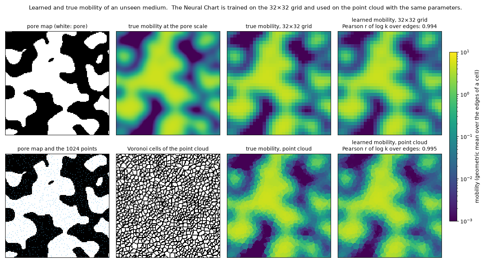

**Flows.** The animations below follow one test trajectory in an unseen medium.
Tracer particles move with the probability velocity $v=J/\rho$ of each model's own edge flux, so only models with an edge flux appear.
A particle turns magenta in a cell where the local entropy production is negative or where an edge carries flux against the physical force.

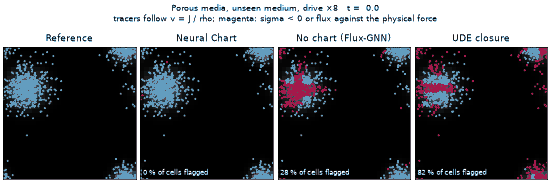

Under drive ×8 the tracers of the Neural Chart follow the reference, and no cell is flagged.
The variant without the chart flags about a third of the cells and the UDE closure about two thirds.

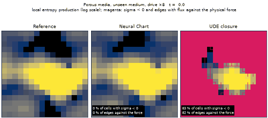

The local entropy production of the same scene stays non-negative everywhere for the Neural Chart.
The UDE closure has negative entropy production in about half of the cells.

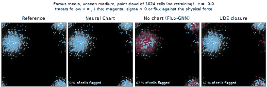

On a random point cloud of 1024 cells, with the parameters trained on the 32×32 grid, the flow of the Neural Chart again follows the reference.
More animations are in the [gallery](results/porous_media/gallery/).

### Porous media with crowding

The same task with a crowded mobility $M(x)/(1+\bar\rho_e/2)$, where $\bar\rho_e$ is the mean density of the two cells of the edge.
The model is not given the crowding form.
It reads $\bar\rho_e$ through its monotone state term.

| Drive ×8 on an unseen medium | Point cloud (training conditions) |
|---|---|
| 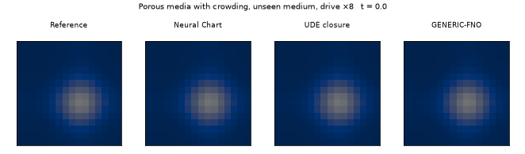 | 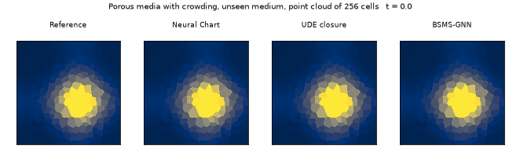 |

| Method | training conditions | temperature ×0.25 | temperature ×4 | drive ×4 | drive ×8 | unseen low-porosity media | 64×64 grid | point cloud | parameters |
|---|---|---|---|---|---|---|---|---|---|
| **Neural Chart** | 0.067 | **0.114** | **0.101** | **0.168** | **0.376** | **0.062** | **0.077** | **0.091** | 5,381 |
| No chart (Flux-GNN) | 0.057 | 0.808 | 2.053 | 0.856 | 1.049 | 0.057 | 0.573 | 0.473 | 151,234 |
| UDE closure | **0.066** | 0.679 | 1.916 | 0.601 | 0.917 | 0.075 | 0.756 | 0.485 | 5,441 |
| BSMS-GNN | 0.592 | 0.837 | 2.739 | 1.386 | 1.355 | 0.435 | 1.008 | 0.713 | 1,724,417 |
| FNO | 0.464 | 0.898 | 2.370 | 1.897 | 3.316 | 0.386 | 0.469 | N/A | 1,188,609 |
| GENERIC-FNO | 1.158 | 0.924 | 1.768 | 1.098 | 1.054 | 0.371 | 1.206 | N/A | 1,002,388 |
| HelmFluid | 14.957 | 7.914 | 284.284 | 199.367 | 149.037 | 14.371 | N/A | N/A | 9,930,381 |
| Persistence (u(t) = u(0)) | 1.363 | 0.989 | 2.161 | 1.156 | 1.083 | 0.447 | 1.360 | 1.392 | 0 |

| Method | edges with flux against the true force | samples with σ < 0 | negative values |
|---|---|---|---|
| Neural Chart | 0 | 0 | 0 |
| No chart (Flux-GNN) | 0.304 | 0 | 0 |
| UDE closure | 0.808 | 0.999 | 0.194 |
| BSMS-GNN | N/A | N/A | 0.704 |
| FNO | N/A | N/A | 0.560 |
| GENERIC-FNO | N/A | N/A | 0.279 |
| HelmFluid | N/A | N/A | 0.038 |

Under the training conditions the UDE closure and the variant without the chart are as accurate as the Neural Chart or slightly better (0.066 and 0.057 against 0.067).
Under changed temperature, drive and discretisation the Neural Chart is 2.4 to 17.5 times more accurate than the best baseline of each column.
Without the state input the Neural Chart reaches 0.241 under the training conditions.
The true mobility without its crowding factor gives the same error, so the state term is what captures the crowding.
The learned mobility matches the true crowded mobility with a flux-weighted relative error of 0.11 on unseen media (`results/porous_media_crowding/law.md`).

### Non-ideal Schlögl model

The Schlögl model $A+2X\rightleftharpoons3X$, $X\rightleftharpoons B$ on an 8×8 periodic grid, with mass action in the activity $y=x\gamma(x)$, $\ln\gamma(x)=\Phi x/(1-\Phi x)$, $\Phi=0.25$.
The Neural Chart learns $\ln\gamma$ as a monotone correction of the chemical potential, together with the standard potentials and the rate constants.
In the closed-form start the rate constants are projected out, so $\ln\gamma$ is fitted against the least-squares optimum of the rest.

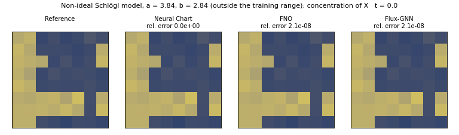

| Method | training conditions | a 3.5–4.0, b 2.0–3.5 (higher concentrations) | 16×16 grid | parameters |
|---|---|---|---|---|
| **Neural Chart** | **3.4e-04** | **0.010** | **3.1e-04** | 55 |
| Neural Chart with given standard potentials | 5.3e-04 | 0.012 | 4.0e-04 | 52 |
| No chart (Flux-GNN) | 1.8e-03 | 0.265 | 2.7e-03 | 150,850 |
| CRNN (mass action) | 0.060 | 0.726 | 0.062 | 6 |
| CRNN (condition features) | 0.026 | 0.340 | 0.035 | 4,674 |
| UDE closure | 0.046 | 0.645 | 0.046 | 4,737 |
| FNO | 2.6e-03 | 0.033 | 2.4e-03 | 172,545 |
| BSMS-GNN | 0.011 | 0.411 | 0.054 | 1,392,001 |
| GENERIC-FNO | 1.117 | 0.565 | 1.060 | 1,002,004 |
| Persistence (u(t) = u(0)) | 1.117 | 0.565 | 1.060 | 0 |

| Method | hyperedges with flux against the true force | samples with σ < 0 | negative values |
|---|---|---|---|
| Neural Chart | 2.2e-05 | 0 | 0 |
| No chart (Flux-GNN) | 0.517 | 0.890 | 0 |
| CRNN (mass action) | 0.253 | 0 | 0 |
| CRNN (condition features) | 0.395 | 0.604 | 0 |
| UDE closure | 0.195 | 0.292 | 0 |
| FNO | N/A | N/A | 9.5e-05 |
| BSMS-GNN | N/A | N/A | 0 |
| GENERIC-FNO | N/A | N/A | 0 |

CRNN with mass action has the right graph but cannot represent the non-ideal activity, and it reaches 0.73 at the higher concentrations.
FNO is the closest baseline (0.033 against 0.010 at the higher concentrations) and produces negative concentrations on two trajectories.
The learned $\ln\gamma$ has slope 0.998 against the truth over the training range, and its RMSE grows from 3.6e-3 there to 0.025 at the higher concentrations (`results/schlogl_nonideal/activity_coefficient.md`).
The entropy production read from the model has a relative error of 1.6e-3 to 0.022, and the cycle affinity matches the reference to three digits (`results/schlogl_nonideal/thermodynamic_readouts.md`).
The few hyperedges counted against the true force (2e-5) sit where that force is close to zero.

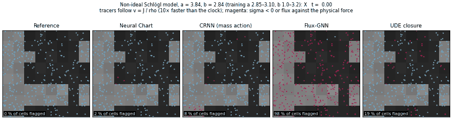

The tracers follow the transport flux of $X$ at higher concentrations, ten times faster than the clock in every panel.
Over the clip 0.03 % of the cells of the Neural Chart are flagged.
CRNN with mass action flags 83 %, the UDE closure 35 % and the variant without the chart almost every cell.

### Driven phosphorylation cycle

A substrate $X$ is phosphorylated by an immobile enzyme, $X+E+\mathrm{ATP}\rightleftharpoons X_p+E+\mathrm{ADP}$, and dephosphorylated, $X_p\rightleftharpoons X$, on an 8×8 periodic grid.
$X$ and $X_p$ diffuse in a smooth potential $U$.
The free energy of ATP hydrolysis $\Delta G$ drives a net current around the cycle.
The test sets change the drive, the potential and the grid.
All three enter the Neural Chart only through the force.

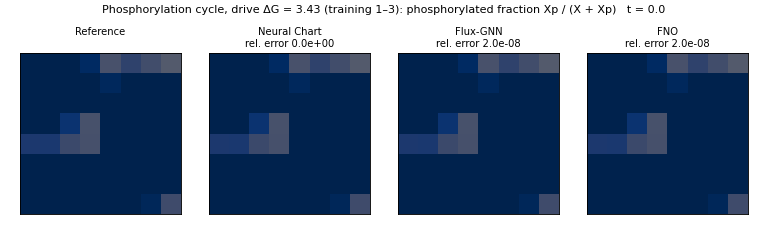

The animation shows the phosphorylated fraction $X_p/(X+X_p)$.

| Method | training conditions (ΔG 1–3) | drive ΔG 3–4 | stronger, finer potential U | 16×16 grid | parameters |
|---|---|---|---|---|---|
| **Neural Chart** | **5.9e-06** | **6.5e-06** | **5.9e-06** | **8.2e-06** | 9 |
| Neural Chart with given standard potentials | 3.3e-06 | 2.3e-06 | 2.6e-06 | 3.4e-06 | 4 |
| No chart (Flux-GNN) | 2.1e-03 | 0.038 | 0.113 | 4.1e-03 | 151,170 |
| CRNN (mass action) | 0.017 | 0.018 | 0.021 | 0.025 | 10 |
| CRNN (condition features) | 5.2e-03 | 0.045 | 0.011 | 7.6e-03 | 4,866 |
| UDE closure | 0.018 | 0.057 | 0.130 | 0.026 | 5,121 |
| FNO | 0.022 | 0.050 | 0.600 | 0.534 | 172,867 |
| BSMS-GNN | 0.180 | 0.189 | 0.449 | 0.350 | 1,392,515 |
| GENERIC-FNO | 1.049 | 0.967 | 1.034 | 0.904 | 1,005,172 |
| Persistence (u(t) = u(0)) | 0.836 | 0.909 | 0.917 | 0.795 | 0 |

| Method | hyperedges with flux against the true force | samples with σ < 0 | negative values |
|---|---|---|---|
| Neural Chart | 0 | 0 | 0 |
| No chart (Flux-GNN) | 0.140 | 0 | 0 |
| CRNN (mass action) | 0.068 | 0 | 0 |
| CRNN (condition features) | 0.222 | 0 | 0 |
| UDE closure | 0.405 | 0 | 0.032 |
| FNO | N/A | N/A | 0.037 |
| BSMS-GNN | N/A | N/A | 0.191 |
| GENERIC-FNO | N/A | N/A | 0.109 |

The Neural Chart stays between 5.9e-6 and 8.2e-6 on every test set, including the stronger drive and the new potential, close to the integration floor of about 2e-6.
The best baseline, CRNN with condition features, is at 5e-3 under the training conditions and at 0.011 in the new potential. The variant without the chart is at 2e-3 and 0.11.
CRNN with mass action has the right graph but one rate constant per class of steps, so it cannot represent the spatial potential, and it stays near 0.02.
The entropy production read from the model has a relative error of 1.3e-3 to 2.5e-3, and the cycle affinity is 5.945 against 5.960 under the training conditions and 7.462 against 7.477 under the stronger drive (`results/phosphorylation_cycle/thermodynamic_readouts.md`).

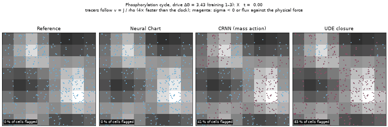

The tracers follow the transport flux of $X$ under the stronger drive, four times faster than the clock.
No cell of the Neural Chart is flagged over the clip.
CRNN with mass action flags 41 % of the cells, the variant without the chart 72 % and the UDE closure 91 %.

## Ideal reaction networks

In these three benchmarks the truth is ideal mass action.
The learned part of the Neural Chart reduces to standard potentials and rate constants.
CRNN with mass action is given the same graph and the same number of constants, so it is the fair comparison.

### Schlögl model: bistability and travelling fronts

The Schlögl model $A+2X\rightleftharpoons3X$, $X\rightleftharpoons B$ with chemostats $A$, $B$ on an 8×8 periodic grid, with diffusing $X$.
It is bistable, and a planar front between the two states travels with a speed whose sign changes at the Maxwell point.

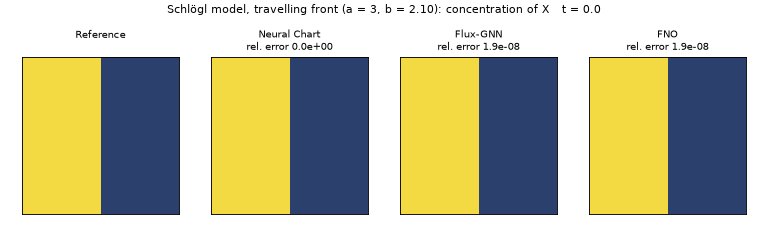

| Method | training conditions | a 3.15–3.35, b 0.3–1.0 | planar fronts, a = 3, b 1.7–2.3 | 16×16 grid | parameters |
|---|---|---|---|---|---|
| **Neural Chart** | **1.8e-06** | **1.2e-06** | 2.3e-06 | **7.9e-07** | 6 |
| Neural Chart with given standard potentials | 2.2e-06 | 1.7e-06 | **2.0e-06** | 2.1e-06 | 3 |
| No chart (Flux-GNN) | 0.018 | 0.943 | 6.4e-03 | 1.4e-03 | 150,850 |
| CRNN (mass action) | 4.1e-06 | 3.7e-06 | 5.8e-06 | 3.5e-06 | 6 |
| CRNN (condition features) | 0.059 | 1.405 | 0.073 | 0.010 | 4,674 |
| UDE closure | 0.123 | 0.923 | 0.057 | 0.172 | 4,737 |
| FNO | 0.025 | 0.952 | 8.6e-03 | 0.014 | 172,545 |
| BSMS-GNN | 0.022 | 1.037 | 0.011 | 0.056 | 1,392,001 |
| GENERIC-FNO | 2.246 | 4.569 | 0.581 | 0.659 | 1,002,004 |
| Persistence (u(t) = u(0)) | 2.246 | 4.569 | 0.581 | 0.659 | 0 |

| Method | hyperedges with flux against the true force | samples with σ < 0 | negative values |
|---|---|---|---|
| Neural Chart | 0 | 0 | 0 |
| No chart (Flux-GNN) | 0.241 | 0.235 | 0 |
| CRNN (mass action) | 0 | 0 | 0 |
| CRNN (condition features) | 0.164 | 0 | 0 |
| UDE closure | 0.456 | 0.835 | 0.043 |
| FNO | N/A | N/A | 7.2e-03 |
| BSMS-GNN | N/A | N/A | 0.240 |
| GENERIC-FNO | N/A | N/A | 0 |

The Neural Chart and CRNN with mass action are both at the floor of the integrator, about 2e-6, which the true rates also reach.
The learned standard potentials give the cycle affinity of the reference to four digits, and the entropy production has a relative error of 1e-5 (`results/schlogl/thermodynamic_readouts.md`).
The black boxes reach 1e-3 to 1e-2 in the training ranges and fail at the new chemostat levels, with errors near 1.
GENERIC-FNO equals persistence on this task: its instance normalisation removes the spatial mean of every update, and the update collapses to zero.

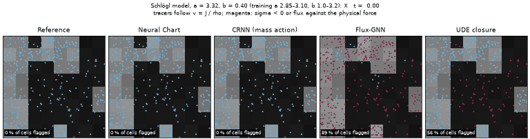

At new chemostat levels (a = 3.32, b = 0.40) the tracers of the Neural Chart and of CRNN with mass action follow the reference, and no cell is flagged.
The variant without the chart flags 83 % of the cells and the UDE closure 97 %.

### Brusselator: oscillations and Turing patterns

The Brusselator $A\to X$, $2X+Y\to3X$, $B+X\to Y+D$, $X\to E$ with chemostats $A$, $B$, $D$, $E$ on a 32×32 periodic grid, with diffusing $X$ and $Y$.
Depending on the chemostat levels it shows a limit cycle or Turing patterns.

| Turing pattern formation (a = 1.90, b = 3.90) | Oscillation, both chemostats outside the training range (a = 1.39, b = 4.30) |
|---|---|
| 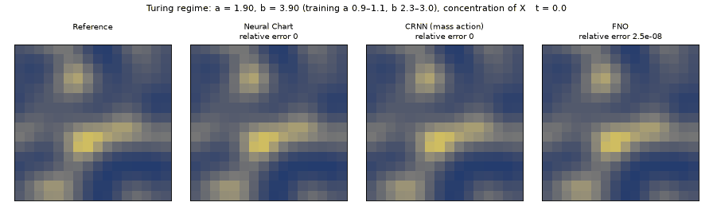 | 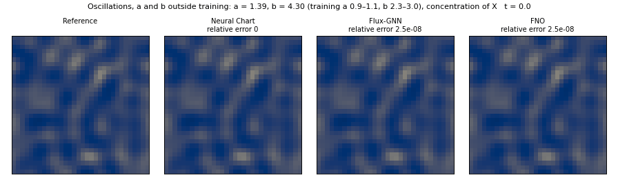 |

| Method | training conditions | b 3.2–3.7 | b 4.0–4.6 | a 1.3–1.5 (a and b outside training) | Turing regime (below the Hopf line) | 64×64 grid | parameters |
|---|---|---|---|---|---|---|---|
| **Neural Chart** | 2.6e-03 | **3.0e-03** | **3.4e-03** | **3.7e-03** | **2.1e-03** | **0.013** | 12 |
| Neural Chart with given standard potentials | 1.6e-04 | 4.7e-05 | 3.7e-05 | 1.3e-04 | 3.8e-05 | 1.7e-04 | 6 |
| No chart (Flux-GNN) | 0.075 | 0.499 | 0.639 | 0.638 | 0.292 | 0.201 | 151,170 |
| CRNN (mass action) | **2.4e-03** | 3.0e-03 | 3.4e-03 | 4.1e-03 | 0.026 | 0.013 | 12 |
| CRNN (condition features) | 0.724 | 0.755 | 0.771 | 0.802 | 0.698 | 0.749 | 4,866 |
| UDE closure | 0.550 | 0.622 | 0.689 | 1.004 | 1.408 | 0.573 | 4,929 |
| BSMS-GNN | 0.729 | 0.805 | 0.687 | 0.858 | 1.849 | 0.761 | 1,723,522 |
| FNO | 0.297 | 0.370 | 0.678 | 0.639 | 0.321 | 0.697 | 1,188,514 |
| GENERIC-FNO | 0.780 | 0.835 | 1.016 | 0.762 | 0.580 | 0.825 | 1,003,588 |
| Persistence (u(t) = u(0)) | 0.780 | 0.835 | 1.016 | 0.762 | 0.580 | 0.825 | 0 |

| Method | hyperedges with flux against the true force | samples with σ < 0 | negative values |
|---|---|---|---|
| Neural Chart | 0.022 | 0 | 0 |
| No chart (Flux-GNN) | 0.139 | 0 | 0 |
| CRNN (mass action) | 0.067 | 0 | 0 |
| CRNN (condition features) | 0.311 | 0 | 0 |
| UDE closure | 0.627 | 1.000 | 0.498 |
| BSMS-GNN | N/A | N/A | 0.940 |
| FNO | N/A | N/A | 3.2e-03 |
| GENERIC-FNO | N/A | N/A | 0 |

The Neural Chart and CRNN with mass action are equally accurate here, and both are at least 40 times more accurate than every other baseline. The variant without the chart is at least 15 times less accurate.
On every test set the Neural Chart oscillates on the same trajectories as the reference.
Outside the Turing regime its period error is at most 1.7e-3.
From spatial starts it forms patterns with the reference wavenumber on every trajectory (`results/brusselator/oscillation_patterns.md`).
Without the chart the model reaches 0.075 under the training conditions, but it loses the limit cycle and the Turing pattern when the conditions change (0.29 to 0.64).

The steps of the Brusselator are close to irreversible, and the affinity of such a step, and with it the standard potentials, is only weakly determined by data (Theorem 0(iii)(d) and Theorem 2 of the theory notes).
With learned potentials the model's force differs from the true force on up to 2.2 % of the hyperedges, and the entropy production is overestimated by 20 to 27 %, as for CRNN with mass action.
With the given standard potentials the error drops to 4e-5 to 1.7e-4, and the entropy production error to 4e-5 (`results/brusselator/entropy_readout.md`).

In the Turing regime half of the test trajectories start from a uniform state, which is unstable to spatial perturbations.
In FP32 integration rounding noise can break the symmetry and grow into a pattern, so the error of these trajectories depends on rounding.
This is the source of the 0.026 of CRNN with mass action in that column (`results/brusselator/NOTES.md`).

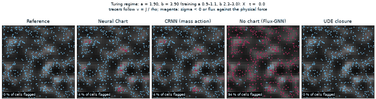

The tracer animation of the Turing trajectory above shows the limit of learned standard potentials.
In the spots of high $X$ the step $A\to X$ runs backwards in the Neural Chart and in CRNN with mass action, and both flag 16 % of the cells.
Its reverse rate is about 1e-3 of the forward rate and is not fixed by the training data.
The variant without the chart flags 72 % of the cells.
The UDE closure flags almost none, but its field collapses.

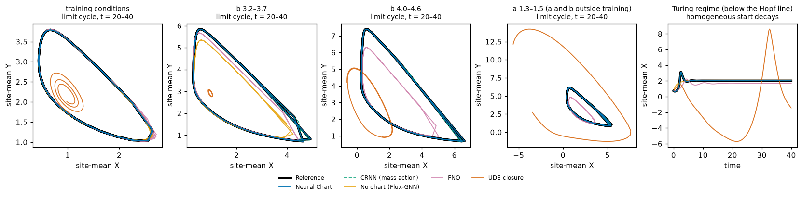

### MAPK cascade

The Huang–Ferrell MAPK cascade with 22 species and 20 reactions (binding and catalysis of every enzymatic step) on a 4×4 grid.
ATP, ADP and $P_i$ are chemostatted, and the kinase MAPK diffuses.
The test sets change the ATP level and the initial state.

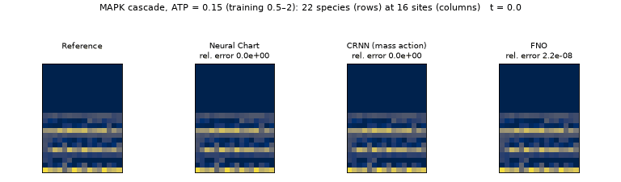

The animation shows all 22 species at the 16 sites.

| Method | training conditions (ATP 0.5–2) | ATP 3–5 | ATP 0.15–0.3 | phosphorylated initial states | parameters |
|---|---|---|---|---|---|
| **Neural Chart** | **6.6e-03** | **0.021** | **0.011** | **6.6e-03** | 48 |
| Neural Chart with given standard potentials | 6.0e-03 | 4.2e-03 | 9.9e-04 | 6.1e-03 | 23 |
| No chart (Flux-GNN) | 6.3e-03 | 0.115 | 0.409 | 6.1e-03 | 153,410 |
| CRNN (mass action) | 8.5e-03 | 0.027 | 0.020 | 8.7e-03 | 46 |
| CRNN (condition features) | 8.1e-03 | 0.032 | 0.099 | 8.3e-03 | 5,890 |
| UDE closure | 0.090 | 0.745 | 0.390 | 0.084 | 8,641 |
| FNO | 0.469 | 0.819 | 0.675 | 0.472 | 61,206 |
| BSMS-GNN | 2.307 | 8.783 | 4.501 | 10.463 | 1,066,006 |
| GENERIC-FNO | 1.682 | 1.734 | 1.563 | 1.818 | 1,035,220 |
| Persistence (u(t) = u(0)) | 0.649 | 0.755 | 0.407 | 1.181 | 0 |

| Method | hyperedges with flux against the true force | samples with σ < 0 | negative values |
|---|---|---|---|
| Neural Chart | 0.021 | 0 | 0 |
| No chart (Flux-GNN) | 0.133 | 0 | 0 |
| CRNN (mass action) | 0.054 | 0 | 0 |
| CRNN (condition features) | 0.232 | 0 | 0 |
| UDE closure | 0.837 | 1.000 | 0.354 |
| FNO | N/A | N/A | 0.421 |
| BSMS-GNN | N/A | N/A | 0.495 |
| GENERIC-FNO | N/A | N/A | 0.362 |

The variant without the chart matches the Neural Chart under the training conditions (6.3e-3 against 6.6e-3).
At new ATP levels its error grows to 0.12 and 0.41, while the Neural Chart stays at 0.021 and 0.011 and CRNN with mass action at 0.027 and 0.020.
ATP enters the Neural Chart only through the force, so a new ATP level changes no learned parameter.
Here too the standard potentials are weakly determined: the cycle affinity of the first futile cycle is 20.7 against 17.0, and with the given potentials the error at low ATP drops from 0.011 to 1e-3 (`results/mapk_cascade/thermodynamic_readouts.md`).

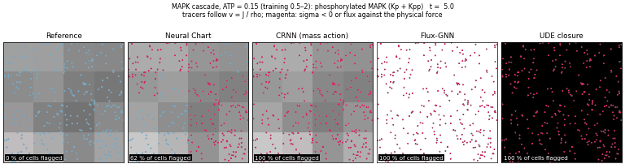

The tracers follow phosphorylated MAPK ($K_p+K_{pp}$) at low ATP.
Here the Neural Chart flags 57 % of the cells over the clip: at 12 of the 16 sites the step in which active MAPKKK binds MAPKK runs against a weak true force (about 0.27), because its learned force has the opposite sign.
The state still follows the reference to 0.011.
CRNN with mass action, the UDE closure and the variant without the chart flag 91 to 100 % of the cells.

## How each part contributes

Every variant is the Neural Chart with one change (`neuralchart/chart.py`, `CONFIGS`).
The tables are in `results/<benchmark>/ablations.md`.

| Part of the model | Variant without it | Benchmark | 10T error, Neural Chart → variant |
|---|---|---|---|
| the chart itself, the split into force and mobility | a hypergraph network emits both rates (Flux-GNN) | all | porous media at temperature ×4 0.090 → 2.14, Brusselator 2.6e-3 → 0.075 under the training conditions and up to 0.64 under new ones, up to 52 % of the hyperedges against the true force on the non-ideal Schlögl model |
| material functional $g_\theta(\xi)$ | one constant mobility for all edges | porous media | 0.064 → 1.18 |
| state term $s\,m(\bar c)$ | no state input | porous media with crowding | 0.067 → 0.241, the error of the true mobility without the crowding factor |
| activity functional $\ln\gamma_\theta(c)$ | ideal activities | non-ideal Schlögl | 3.4e-4 → 0.072, and 0.010 → 0.585 at higher concentrations |
| variable projection in the closed-form start | ideal least-squares start, then rollouts | non-ideal Schlögl | 3.4e-4 → 0.016, and 0.010 → 0.119 at higher concentrations |
| convex start | $\omega=1$, $\mu^0=0$ at initialisation | Schlögl, phosphorylation cycle, non-ideal Schlögl, Brusselator, MAPK | 1.8e-6 → 2.6, 5.9e-6 → 0.014, 3.4e-4 → 0.47, 2.6e-3 → 0.50, 6.6e-3 → 0.69 |
| drive $A$ | $A=0$, a reversible model | the same five | errors of 0.08 to 1.5 under the training conditions: the driven steady states cannot be represented |
| force fixed by physics | a learned global scale on the drive | porous media | no change in accuracy (the scale converges to 0.996), but 0.1 % of the edges then carry flux against the true force |
| thermochemical data | standard potentials taken from the data generator | reaction networks | similar in the training ranges, but on the Brusselator 2.6e-3 → 1.6e-4 and on the MAPK cascade at low ATP 0.011 → 9.9e-4 |

Without the convex start the same model, trained with the same budget, is 100 to 10^6 times less accurate on every reaction network.

## Why the hypergraph is an input

The hypergraph is the base of the chart.
On a fixed hypergraph the data determine the coordinates of the model, up to the directions that Theorem 0(iii)(d) of the theory notes identifies.
Without it, trajectories do not determine the thermodynamic structure.
Different hypergraphs can produce nearly the same trajectories with different forces and a different entropy production.

We tested this with the same model on a library of all candidate reactions with up to three state molecules on each side.
In the language of the chart, this is a larger manifold in which every smaller network is a face where some mobilities are zero.
A sparsity penalty on the mobilities pushes the fit towards such a face, and the reactions that carry at least 1 % of the flux are read out as the network.
This experiment is not part of the release.

| Benchmark | 10T error, library of candidates | 10T error, hypergraph given | entropy production, library model / truth |
|---|---|---|---|
| Schlögl model | 2.2e-05 | 1.8e-06 | 4.0 |
| Brusselator | 0.019 | 2.6e-03 | 1.08, with 6.4 % of the steps against the true force |
| Phosphorylation cycle | 2.0e-05 | 5.9e-06 | 10.2 |
| Non-ideal Schlögl model, strong crowding | 0.011 | 0.091 | 23.8 |

The library model still predicts the trajectories, but its entropy production is wrong by a factor of up to 24.
The data cannot tell its extra reactions apart from the true ones.
Two mechanisms produce them.

1. **Equivalent directions.** Conservation laws and catalysts give the manifold directions that the data do not see. In the phosphorylation cycle the product of the ATP and ADP levels is constant in the data, so the phosphorylation step splits into two half-reactions with the same effect on the state. In the Brusselator the reverse of $A\to X$ and the step $X\to E$ both remove $X$ in proportion to its concentration, so their split is not determined.
2. **Topology standing in for the constitutive law.** When the chemical potential cannot express the true non-ideality, extra reactions take up what is missing. In the last row the chemostat $A$ varies over 1.5–4.5, so the crowding is much stronger than in the benchmark above. The activity correction of the Neural Chart is a sum of bounded tanh units and cannot follow it, so the given-hypergraph model reaches only 0.091. The library model fits the data better by adding reactions that do not exist.

An accurate trajectory therefore does not imply the right thermodynamics.
Fixing the hypergraph removes the first mechanism.
The second calls for an activity correction that is flexible enough for the mixture at hand.

## Related work

**Reaction neural networks.**
CRNN ([Ji and Deng 2021](https://doi.org/10.1021/acs.jpca.0c09316)) learns mass-action rate constants on a reaction network, and is one of our baselines.
The global reaction neural network GRNN ([Kircher, Döppel and Votsmeier 2024](https://doi.org/10.1016/j.cej.2024.149863)) embeds the stoichiometry and the thermodynamics.
A network that can read the temperature and the species state gives the forward rates, and the equilibrium constants give the backward rates.
The Neural Chart goes one step further in how it splits the rate.
It writes the symmetric part as $g=k\,\varepsilon$, takes the known state and condition factor $\varepsilon(c,\theta)$ out, and asks the learned material factor $k$ to follow one law across conditions.
A GRNN could express this subclass by restricting its network in the same way.
What the Neural Chart adds is the use of the restriction: the cross-condition error relation, the identifiability criterion, and the readouts of edge fluxes, cycle currents and entropy production that rest on them.

**Networks that learn free energy and dissipation.**
OnsagerNet ([Yu, Tian, E and Li 2021](https://doi.org/10.1103/PhysRevFluids.6.114402)) learns dynamics with a generalized Onsager principle, including a free energy, a dissipation and external forces.
VONNs ([Huang et al. 2022](https://arxiv.org/abs/2112.09085)) learn a free energy and a dissipation potential from spatiotemporal data, guarantee the second law through the network structure, and discuss why these potentials cannot be recovered uniquely.
Learning constitutive laws with neural networks, building the second law into the architecture, and asking about identifiability are therefore not new in themselves.
VONNs learn a general dissipation potential and cover a broader class of systems.
The Neural Chart assumes more, namely a known network and a known rate structure.
With these assumptions it can ask more specific questions: which part of the rate law stays fixed when the conditions change, what error follows at a new condition, and when a change of conditions makes two mechanisms in the model distinguishable.

## Scope and limits

- **The hypergraph is given.** The model receives the reaction hypergraph or the mesh. Learning which reactions exist from data is not part of this release. On large networks it also needs a sparse solver for the closed-form start, since a library of candidate reactions for the MAPK cascade has 68,000 columns.
- **Standard potentials are weakly determined by concentration data.** The model keeps the second law with respect to its own force. Where its learned potentials are off, a small fraction of steps (up to 2.2 % on the Brusselator and the MAPK cascade) carry flux against the true force, and readouts that depend on the potentials, such as the entropy production, inherit that error. Theorem 0(iii)(d) and Theorem 2 of [docs/theory.md](docs/theory.md) show why: the affinity of a step that is close to irreversible carries little information in the data.
- **Bounded activity correction.** The learned $\ln\gamma$ is a sum of bounded units. It covers the crowding of the non-ideal Schlögl benchmark, and it does not cover the much stronger crowding of the last row of the table above.
- **One seed.** Every number is from one training run.

## Reproduce

**Environment.** Python 3.10 or later, PyTorch 2.4 or later, NumPy and SciPy.
The reported runs used PyTorch 2.14 with CUDA 13.0.

```bash
pip install -e ".[bench]"
pytest                      # unit tests, under a minute on a CPU
pytest -m slow              # regression tests on the benchmark data (needs data/, see below)
```

**Data.** Every benchmark generates its reference data.
The data go to `data/<benchmark>/`, or to `$NEURALCHART_DATA/<benchmark>` when that variable is set.

```bash
python -m benchmarks.porous_media.run generate --variant porous_media --device cuda           # finite volumes on 128×128 in FP64, about 3 h
python -m benchmarks.porous_media.run generate --variant porous_media_crowding --device cuda  # about 3 h
python -m benchmarks.brusselator.run generate                  # CPU processes, about a minute
python -m benchmarks.schlogl.run generate                      # CPU, seconds
python -m benchmarks.schlogl_nonideal.run generate
python -m benchmarks.phosphorylation_cycle.run generate
python -m benchmarks.mapk_cascade.run generate                 # CPU, about a minute
```

**Evaluate the shipped checkpoints.** The Neural Chart checkpoints of every benchmark are in `checkpoints/`.

```bash
python -m scripts.evaluate --benchmark porous_media --model chart --settings
python -m scripts.evaluate --benchmark schlogl_nonideal --model chart
```

**Train.** One command per model and benchmark.
Results go to `runs/<benchmark>/`.
The fast integrator (`--fast`, error control in FP32) is the setting of every reported number.

```bash
python -m scripts.train --benchmark porous_media --model chart --device cuda --fast
python -m scripts.train --benchmark porous_media_crowding --model chart --device cuda --fast
python -m scripts.train --benchmark brusselator --model chart --device cuda --fast
python -m scripts.train --benchmark schlogl --model chart --device cuda
python -m scripts.train --benchmark schlogl_nonideal --model chart --device cuda
python -m scripts.train --benchmark phosphorylation_cycle --model chart --device cuda
python -m scripts.train --benchmark mapk_cascade --model chart --device cuda
```

Model keys: `chart` and its variants (`chart-given-mu0`, `chart-no-state`, `chart-const-k`, `chart-learned-drive`, `chart-zero-init`, `chart-reversible`, `chart-ideal`, `chart-no-varpro`), `oracle`, and the baselines `ude`, `flux_gnn`, `crnn_mass_action`, `crnn_features`, `fno`, `bsms`, `generic_fno`, `helmfluid` (porous media only) and `persistence`.
HelmFluid needs its upstream code (see [THIRD_PARTY.md](THIRD_PARTY.md)).

**Tables and animations.**

```bash
python -m scripts.make_tables --benchmark all                        # results/<benchmark>/*.md and *.csv
python -m scripts.make_tables --benchmark schlogl --runs runs/schlogl # tables from your own runs
python -m scripts.make_gifs --benchmark porous_media --device cuda    # assets/*.gif (baseline weights from runs/)
```

**Training times.** Projected times for 4000 training steps on one NVIDIA L40 with the recommended flags.
The Neural Chart needs `--fast` only.
The UDE closure uses `--fast --control err_only --compile_rates`, and Flux-GNN `--fast --compile_rates --fuse_net`.
On the Brusselator both also use `--compact`.
≈ marks a time taken from a measurement on other hardware or without these flags.
The sources are in `results/<benchmark>/NOTES.md`.

| Benchmark | Neural Chart | UDE closure | Flux-GNN | FNO, BSMS-GNN, GENERIC-FNO, HelmFluid |
|---|---|---|---|---|
| porous media (each variant) | ≈ 15 to 25 min | 7 min | 1.1 h | 3 to 30 min |
| Brusselator | ≈ 20 min | 35 min | 6.6 h | ≈ 3 to 8 min |
| Schlögl, non-ideal Schlögl, phosphorylation cycle | ≈ 5 to 15 min | 4 min | ≈ 15 to 30 min | ≈ 1 to 3 min |
| MAPK cascade | ≈ 30 min | 6 min | ≈ 35 min | 1 to 5 min |

**Speed options** of the fast integrator, all off by default and with the same scheme:
`--compact` lets finished trajectories leave the batch,
`--compile_rates` compiles the rate evaluation with `torch.compile` (needs the CPython headers),
and `--fuse_net` merges the gathers of Flux-GNN.
They change results only at FP32 rounding level.

## Repository layout

```
neuralchart/            the library
  model.py              master equation: free energy, mobility, drive, rates
  chart.py              Neural Chart configurations (CONFIGS) and variants
  fit.py                closed-form NNLS, variable projection, rollout training
  integrators.py        positive SSP-RK2
  fast.py               fast integrator with error control (GPU and CPU)
  diagnostics.py        local detailed balance rule
  graphs.py             hypergraphs of reaction and transport networks
  baselines/            Flux-GNN (the variant without the chart), CRNN, BSMS-GNN, GENERIC-FNO, HelmFluid wrapper
benchmarks/<name>/      data generation, test sets, models, evaluation, tables, animations, entry point run.py
scripts/                train, evaluate, make_tables, make_gifs, physics_summary
results/<name>/         tables (markdown and csv)
checkpoints/<name>/     trained Neural Chart checkpoints
assets/                 animations of this page
docs/                   method and protocol, theory
tests/                  unit and regression tests
```

## Licence

MIT (see [LICENSE](LICENSE)). Third-party code and methods are listed in [THIRD_PARTY.md](THIRD_PARTY.md).
