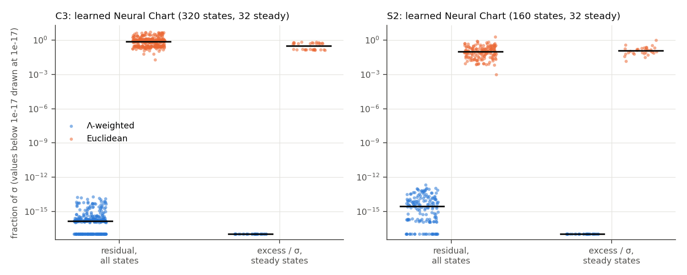
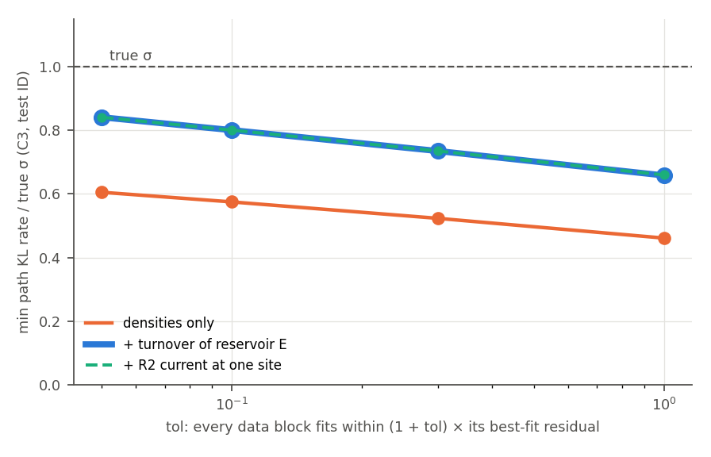
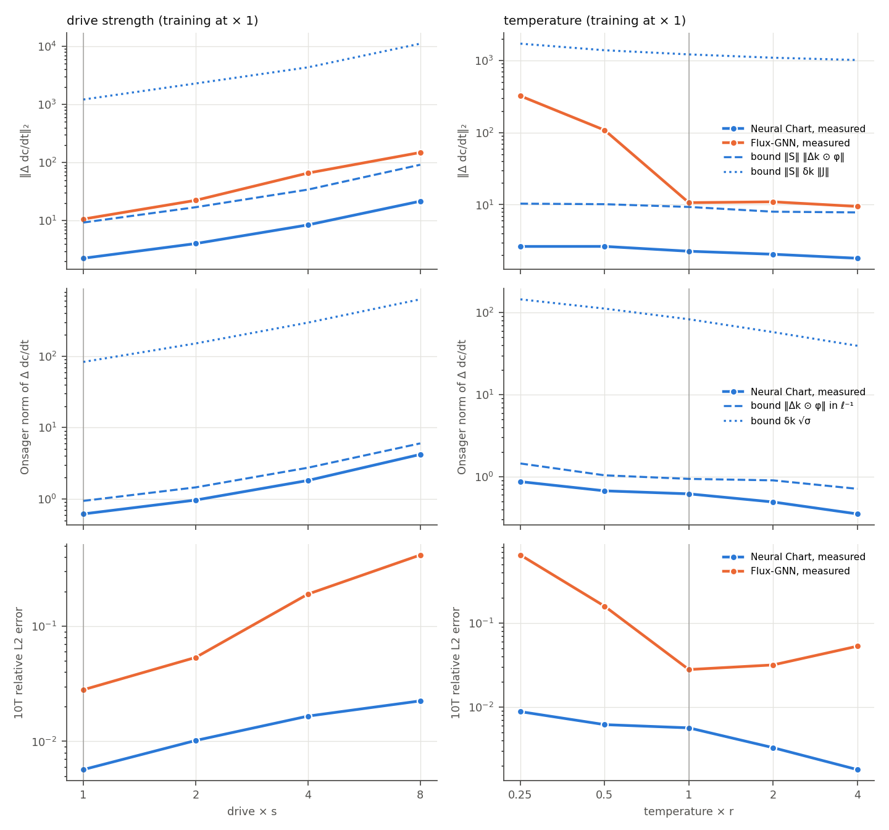

# Information geometry of the Thermodynamic Neural Chart: five numerical checks

Code: `hyperme/info_geometry.py` (stages `c1_train`, `c1_path`, `pyth`, `proj`, `coarse`, `ex_data`, `ex_train`, `ex_eval`, `plot`, `report`), tests `hyperme/tests/test_info_geometry.py`. CPU only: machine 49 for everything except the two black-box trainings of check 5, which ran on the CPU of axiom. float64. Runs in `runs/hyperme/infogeo/`.

The Thermodynamic Neural Chart is the wired model: the condition fixes the force `f` by local detailed balance, and the network gives the symmetric kinetic coordinate `k`, the learned constitutive law. Each check below takes one statement of the information-geometric reading (README, "Where the geometry lives", and `results/theory_notes.md`) and tests it on a learned chart.

## 1. Entropy production is a path KL

**Setup.** C1 phosphorylation cycle at one site: X + E + ATP ⇌ Xp + E + ADP with rates k1 x e e^{dG/2} and k1 xp e e^{−dG/2}, and Xp ⇌ X with rates k2 xp and k2′ x (k1 = 2, k2 = 1, k2′ = 0.02, as in `hyper/gen_crn.py`). ATP and ADP are chemostats, E is catalytic. Ω = 200, so X + Xp = 200 molecules and E = 200. The learned chart has the wired force (log c + μ⁰ with the ATP/ADP chemostat) and a table of log k. It is fitted with `fit()` (closed-form step, then 2000 Adam steps at lr 1e-2, MPRK22 × 8) on 16 deterministic trajectories with dG drawn from [1, 3]. Its one-way rates match the truth to 0.03 percent, except the slow reverse channel of R2, which is 2.2 percent high.

**Estimator.** For each Gillespie path ω on [0, t], log P[ω] / P[ω̃] for the time-reversed path ω̃ is the sum over jumps of log w_q(x) / w_{−q}(x′) plus the boundary term log p(x₀) − log p(x_t). The waiting-time factors cancel. Paths start from the stationary law of the same rates, 64 per case, up to t = 200 (about 10⁵ jumps per path). The estimate is this log ratio divided by t. The reference values are the channel-resolved entropy production of the master equation, computed exactly on the birth–death chain of #Xp, and Ω Σ_h (a_h − b_h) log(a_h / b_h) at the deterministic fixed point.

| rates | dG | path KL at t = 1 / 10 / 50 / 200 (± s.e.) | master equation | Ω σ_det, own rates | Ω σ_det, true rates |
|---|---|---|---|---|---|
| truth | 2.0 | 891.1 ± 9.3 / 890.3 ± 2.6 / 892.0 ± 1.3 / **891.26 ± 0.61** | 891.34 | 891.34 | 891.34 |
| truth | 3.5 (OOD) | 1316.1 ± 11.7 / 1322.8 ± 3.6 / 1324.4 ± 1.9 / **1324.48 ± 0.89** | 1324.17 | 1324.17 | 1324.17 |
| learned chart | 2.0 | 887.8 ± 9.2 / 887.3 ± 2.5 / 889.0 ± 1.3 / **888.25 ± 0.61** | 888.35 | 888.35 | 891.34 |
| learned chart | 3.5 (OOD) | 1312.5 ± 11.7 / 1319.4 ± 3.6 / 1321.0 ± 1.9 / **1321.09 ± 0.88** | 1320.80 | 1320.80 | 1324.17 |

- The path estimate converges to the master-equation value as 1/√t, from about 1 percent at t = 1 to 0.07 percent at t = 200. At t = 200 it is within 0.13 to 0.35 standard errors of the exact value in all four cases, with the true and with the learned rates, in and outside the training range of dG.
- At one site with E fixed the network is first order in X and Xp, so the stationary law is binomial and the master-equation value equals Ω σ_det exactly at every Ω (ratio 1.00000 at Ω = 50, 200, 1000, 5000). The check therefore compares the path KL with the deterministic formula directly.
- For the chart, log(a / b) is the physical force by construction, so the path KL of its own process is its physical entropy production. It is 0.34 percent below the true value at dG = 2 and 0.25 percent below at dG = 3.5.

## 2. Pythagorean split on learned models: Fisher against Euclidean

**Setup.** For the learned one-way rates (a, b) at a state, f = log(a / b), ℓ = Λ(a, b) and σ = Σ ℓ f². The force is projected onto im Sᵀ, once in the ℓ-weighted inner product (the Fisher, or Onsager, metric) and once in the Euclidean one. Both parts are measured in the ℓ energy: excess = ‖g‖²_ℓ, housekeeping = ‖f − g‖²_ℓ. The residual is |σ − excess − housekeeping| / σ. This is E1 of `fisher_hodge_positioning.md`, now on learned models instead of random chains.

- **C3**, the learned wired Brusselators `c3_base_wired_s0` and `c3_v1_wired_s0` (`results/c3_one_observable.md`), 8 × 8 grid, hypergraph S with the autocatalytic hyperedge 2X + Y → 3X. States: the 16 test_id and 16 test_ood initial states and the learned rollouts at t = 1, 5, 20 and 400. At t = 400, 8 of 16 trajectories per set have settled (relative change over the last 10 time units at most 5e-17). The other 8 oscillate (relative change 0.13 to 1.45) and enter only the residual column.
- **S2**, the learned wired Fokker–Planck model `s2_wired_n16_s0` (`runs/hyperme/ws5`), 32 × 32 torus. States: the stationary state of the learned generator and the learned evolution from the test initial state at t = 0, 0.05, 0.5 and 2, for the 16 test_id and 16 test_oodpot drives.

| learned model | states | residual Λ, median / max | residual Euclid, median / max | steady states | excess/σ Λ, median / max | excess/σ Euclid, median / max | CV of ℓ |
|---|---|---|---|---|---|---|---|
| C3 base | 160 | 1.5e-16 / 1.2e-14 | 1.2 / 5.2 | 16 | 2.6e-30 / 1.7e-29 | 0.56 / 0.71 | 1.50 |
| C3 V1 | 160 | 1.5e-16 / 2.0e-14 | 0.31 / 1.1 | 16 | 3.8e-30 / 2.7e-29 | 0.15 / 0.17 | 1.55 |
| S2 | 160 | 2.9e-15 / 2.1e-13 | 0.10 / 2.1 | 32 | 8.4e-30 / 3.0e-28 | 0.12 / 1.0 | 1.62 |

The Λ-weighted split is exact to rounding on every learned state, and at every steady state its excess vanishes to 1e-28 of σ. The Euclidean split misses σ by a median of 10 percent on S2 and 120 percent on C3, where ℓ spans many decades across reaction and transport hyperedges. At the steady states it assigns 12 percent (S2) to 56 percent (C3 base) of σ to a relaxation that is not happening. This is the E1 conclusion, reproduced on learned models: the exact identity is the orthogonality of the Λ metric, and the physical content is that the steady excess is zero.

## 3. The σ lower bound as an I-projection

**Rewriting.** For one-way rates (a, b) the relative entropy rate between the path measure of the jump process and that of its time reversal is Σ_h D(a_h ‖ b_h) + D(b_h ‖ a_h), with D(x ‖ y) = x log(x / y) − x + y the relative entropy of Poisson intensities. The two −x + y terms cancel, so this is Σ_h (a_h − b_h) log(a_h / b_h) = σ. The lower bound of `results/c3_one_observable.md` is therefore the smallest path KL between the process and its time reversal over the rates that fit the data. `path_kl_min` solves it in this form, edge by edge on the 1008 training states with autograd gradients, independently of the class-pair aggregation of `c3_observable.sigma_min_convex`.

| data (combined residual, as before) | tol | σ_min / σ_true ID ; OOD, σ form | same, path-KL form | training minimum, σ form ; KL form |
|---|---|---|---|---|
| densities | 0.1 | 0.576294 ; 0.618380 | 0.576294 ; 0.618380 | 2221.4487 ; 2221.4487 |
| densities | 1.0 | 0.461581 ; 0.497133 | 0.461581 ; 0.497133 | 1781.5729 ; 1781.5729 |
| densities + E turnover | 0.1 | 0.803540 ; 0.810787 | 0.803540 ; 0.810787 | 3048.7266 ; 3048.7266 |
| densities + E turnover | 1.0 | 0.650052 ; 0.657939 | 0.650052 ; 0.657939 | 2471.8328 ; 2471.8328 |

The two forms agree to every printed digit and reproduce the 0.58 and 0.80 of the earlier report.

**Shrinking the feasible set.** With one combined residual, adding an observable changes the normalization, so the sets are not nested. Here each data block has its own constraint: residual_q(κ) ≤ (1 + tol) residual_q(κ̂) for every block q in the set, with κ̂ the best fit to all blocks. Adding a block then adds a constraint, and the bound can only rise. The blocks are the densities (48 driven trajectories), the turnover of reservoir E (Σ_sites J_R4), and the R2 current at one site (the Y consumed by 2X + Y → 3X at site 0). The template is the true parameter set, so κ = 1 is the truth. The true rates fit the densities 4.6 percent worse than κ̂ (the Simpson error of the derivative fit at Δt = 0.2), so tol starts at 0.05. At tol = 0.03 the truth falls outside the density set, and the bound is no longer a bound.

| feasible set | tol 0.05 | tol 0.1 | tol 0.3 | tol 1.0 |
|---|---|---|---|---|
| densities | 0.605 | 0.575 | 0.523 | 0.461 |
| + E turnover | 0.841 | 0.801 | 0.735 | 0.658 |
| + R2 current at site 0 | 0.841 | 0.801 | 0.735 | 0.660 |

min path KL / true σ, median over the test_id trajectories. The true rates lie in every set, and the true σ is above the bound at every test state. The test_ood values are 0.005 to 0.044 higher.

The E turnover raises the bound by 0.20 to 0.24 of σ at every tolerance. The local R2 current adds at most 0.002. It resolves the R2/R3 loop at that site (R2 and R3 change X and Y at the same site in opposite directions), but the slack in σ is the reverse rate of R2, one part in a thousand of its forward rate. A net current fixes a − b and leaves b free, which is the deterministic case of Theorem 2(v): when b/a is nearly constant, the information on the reverse rate is nearly zero. A bound on that part of σ needs jump counts, not currents.

## 4. Coarse graining is data processing

**Setup.** The learned S2 generators (the chart `s2_wired_n16_s0`, and the TC-ME `S2_tcme_s0` used in E4) frozen at their stationary states, 16 test_id and 16 test_oodpot drives each. 4000 single-particle paths per drive, 5000 jumps each (2 × 10⁷ jumps), started from π. The fine estimate sums log Q_ij / Q_ji over the jumps. The same paths are then observed through 2 × 2 blocks (16 × 16) and 4 × 4 blocks (8 × 8). The coarse estimate sums log Q̄_ab / Q̄_ba over the block changes, with Q̄ the projected generator, and the plug-in estimate uses only the block-change counts, Σ (N_ab − N_ba) log(N_ab / N_ba) / t. Both include the boundary term. "Exact" is the E4 formula Σ X_ab log(X_ab / X_ba) at stationarity.

| model | drives | σ₃₂ path / exact | σ₁₆ path / exact / plug-in | σ₈ path / exact / plug-in | max \|path − exact\| / s.e. | σ₃₂ > σ₁₆ > σ₈ (path) |
|---|---|---|---|---|---|---|
| chart | test_id | 1.550 / 1.557 | 0.744 / 0.748 / 0.743 | 0.329 / 0.329 / 0.328 | 2.3 | 16/16 |
| chart | test_oodpot | 6.544 / 6.520 | 2.998 / 3.002 / 2.999 | 1.200 / 1.197 / 1.198 | 2.1 | 16/16 |
| TC-ME | test_id | 1.567 / 1.571 | 0.753 / 0.755 / 0.754 | 0.332 / 0.333 / 0.333 | 2.2 | 16/16 |
| TC-ME | test_oodpot | 6.443 / 6.443 | 2.974 / 2.977 / 2.974 | 1.179 / 1.178 / 1.179 | 2.8 | 16/16 |

Medians over the drives, entropy production per unit time in probability units. The path estimates agree with the exact values within 2.8 standard errors in all 192 comparisons, the plug-in counts agree as well, and the estimated σ decreases at every coarsening step for 64 of 64 learned generators. The TC-ME values reproduce E4 (1.57, 0.754, 0.333). σ roughly halves at each step on test_id and drops by a factor of 2.2 to 2.5 on test_oodpot: the entropy produced by transitions inside a block, and by the circulation the block hides, is invisible to anyone who sees only the block label.

## 5. The transfer bound of Theorem 0(iii)(b)

**Why a new benchmark.** The bound assumes that the truth lies in G(S): the same wired force, and a kinetic coordinate k_true that depends on the material and not on the condition. The S2 reference is a 64 × 64 finite-volume solve, which no 32 × 32 SQRA generator matches exactly (the untrained wired model is off by 0.4 percent in distribution, E7). So the check uses **S2-M**, an S2 variant whose true generator is in G(S) by construction. It is the SQRA generator on the 32 × 32 torus with μ = log ρ + U/T, A = (line integral of the drift)/T, with the U and drift fields of the S2 data, and k_true = (D/h²) T m(ξ). The mobility depends on a smooth random material field M (one per sample, standard deviation 1) through log m = 0.2 (2·[horizontal edge] − 1) + 0.5 tanh(M̄_e) − 0.25 M̄_e², with M̄_e the edge mean of M. It does not depend on the condition. Trajectories are exact (matrix exponential of the generator).

**Models and protocol.** Training data: 16 trajectories at the training condition (S2 training fields, 21 frames at Δt = 0.05). Test: the 16 test_id fields with their own material fields, at drive × 1, 2, 4, 8 (the drift scaled) and temperature × 0.25, 0.5, 2, 4 (T enters μ, A and k). The **Thermodynamic Neural Chart** wires the force exactly (the drive scale fixed at 1, no harmonic term) and learns k = (D/h²) T exp(core + s_k MLP(orientation, M̄)), 32 hidden units, with `fit()` (closed-form step, then 2000 Adam steps at lr 1e-3, batch 8, rollout K in [4, 8]). **Flux-GNN** learns both one-way rates from U/T, M, log T, the edge features and the drift line integral divided by T (the best-informed black box of G1), with the same protocol and 32 hidden units (64 took 14 s per step on the CPU). It trained for 3.3 hours on the CPU of axiom to a final loss of 5.4e-5 (chart 1.7e-5). A UDE closure (the uniform-mobility SQRA plus a GNN correction of dc/dt) was started with the same protocol and stopped after 65 minutes without a logged step: at about 11 s per step it would have needed more than 6 hours. It is not reported.

**Bounds.** With ΔJ = J_model − J_true = (k/k_true − 1) ⊙ J_true at shared forces:

- Euclidean, Theorem 0(iii)(b): ‖Δċ‖₂ ≤ ‖S‖₂ ‖ΔJ‖₂ ≤ ‖S‖₂ δ_k ‖J_true‖₂, with ‖S‖₂ = 2√2 on the torus and δ_k = max_h |k_h/k_true,h − 1|.
- Onsager norm: ‖Δċ‖_{(SℓSᵀ)⁺} ≤ ‖ΔJ‖_{ℓ⁻¹} = (Σ_h (k_h/k_true,h − 1)² σ_h)^{1/2} ≤ δ_k √σ_true, with ℓ the true Onsager weights. The first step is the minimum principle of Theorem 1(d), ‖x‖²_{(SℓSᵀ)⁺} = min{‖J‖²_{ℓ⁻¹} : SJ = x}, and the second uses J_h²/ℓ_h = σ_h. So the error of the vector field, measured as the excess dissipation it would need, is at most the relative kinetic error times √σ. This is our form, pending the exact form from the theory notes.

δ_k does not depend on the condition, because k does not see it (checked: the same 1.92 at all 8 conditions). The vector-field errors are taken at the true states at t = 0, T and 10T (48 states per condition, median).

| condition | ‖Δċ‖₂ chart / bound ‖S‖‖ΔJ‖ / bound ‖S‖δ_k‖J‖ | Onsager norm: chart / ‖ΔJ‖_ℓ⁻¹ / δ_k√σ | ‖ΔJ‖/‖J‖ chart | ‖Δċ‖₂ Flux-GNN | ‖Δċ‖/‖ċ‖ at t = 0: chart / Flux-GNN | 10T error: chart / Flux-GNN |
|---|---|---|---|---|---|---|
| training (× 1) | 2.26 / 9.31 / 1215 | 0.62 / 0.94 / 83 | 0.012 | 10.7 | 0.020 / 0.083 | 0.0057 / 0.028 |
| drive × 2 | 4.05 / 17.1 / 2293 | 0.96 / 1.45 / 151 | 0.013 | 22.4 | 0.023 / 0.125 | 0.010 / 0.054 |
| drive × 4 | 8.47 / 34.3 / 4347 | 1.81 / 2.74 / 296 | 0.014 | 66 | 0.027 / 0.287 | 0.017 / 0.190 |
| drive × 8 | 21.7 / 91.8 / 11100 | 4.20 / 6.01 / 628 | 0.014 | 149 | 0.027 / 0.643 | 0.022 / 0.416 |
| temperature × 0.25 | 2.64 / 10.3 / 1712 | 0.87 / 1.45 / 146 | 0.012 | 322 | 0.026 / 1.93 | 0.0089 / 0.647 |
| temperature × 0.5 | 2.64 / 10.2 / 1387 | 0.67 / 1.04 / 112 | 0.012 | 108 | 0.023 / 0.933 | 0.0062 / 0.159 |
| temperature × 2 | 2.05 / 8.00 / 1093 | 0.49 / 0.90 / 58 | 0.013 | 11.0 | 0.019 / 0.510 | 0.0033 / 0.032 |
| temperature × 4 | 1.81 / 7.82 / 1016 | 0.35 / 0.71 / 40 | 0.013 | 9.5 | 0.018 / 0.754 | 0.0018 / 0.053 |

- **The bound holds at every state and condition.** Over all 384 states, the measured error of the chart is at most 0.48 of ‖S‖‖ΔJ‖ and 0.049 of ‖S‖δ_k‖J‖. In the Onsager norm it is at most 0.89 of ‖ΔJ‖_{ℓ⁻¹} (median 0.62 to 0.68) and 0.092 of δ_k√σ.
- **The relative error does not grow with the condition, the absolute error does.** The current-weighted kinetic error ‖ΔJ‖/‖J‖ is 1.2 to 1.4 percent at every drive and temperature, and the relative error of the vector field at t = 0 is 1.8 to 2.7 percent. The absolute error grows with the drive, from 2.3 to 21.7 at × 8, following |φ| = 2ε|sinh(f/2)|, and the bound grows with it. This is the statement of the theorem: the new condition enters only through φ.
- **The δ_k form is valid but loose: about 500 times the measured error at the median (at least 20), and 130 times in the Onsager norm (at least 11).** δ_k = 1.92 is set by 4 percent of the edges, where the material field is beyond ±2 and the mobility is small. These edges carry little current, so the data hardly constrain them. On the other 96 percent of the edges the learned k is within 5 percent. The tight Euclidean form is about 4 times the measured error (at least 2.1) and the tight Onsager form about 1.5 times (at least 1.1). The Onsager form weights each edge by its dissipation σ_h, so the slow, poorly identified edges drop out.
- **The black box has no such bound, and its error grows with the condition.** Flux-GNN starts 4 to 5 times worse in distribution (8 against 2 percent relative vector-field error, 10T error 2.8 against 0.57 percent), part of which is the smaller network and the CPU budget. Its relative vector-field error then grows to 64 percent at drive × 8 and to 193 percent at temperature × 0.25, while the chart stays at 2 to 3 percent. The 10T error of Flux-GNN grows to 42 and 65 percent.
- **The bound is on the vector field, not on trajectories.** The 10T error of the chart grows from 0.57 to 2.2 percent at drive × 8, although its relative vector-field error does not change, through the Gronwall factor of the stronger drive.

## Limits

One seed per model and one material law. C1 is tested at one site, where the network is first order, so the master equation and the deterministic formula coincide exactly. Check 2 uses two learned C3 charts and one S2 chart. In check 3 the tolerance is relative to the best fit and the fit is noise-free, so it is not a confidence level. The truth is inside every set from tol = 0.05 on. Check 4 freezes each learned generator at its stationary state. In check 5 the truth is constructed to lie in G(S), which is the hypothesis of the theorem. On the original S2 data the truth is a finer discretization, and the bound would need a misspecification term. Flux-GNN runs with 32 hidden units, and the UDE closure is missing for lack of CPU time.
