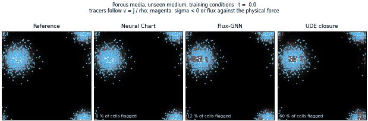
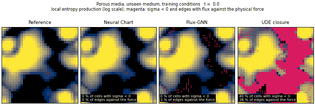
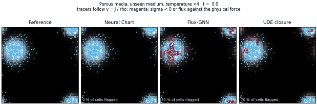
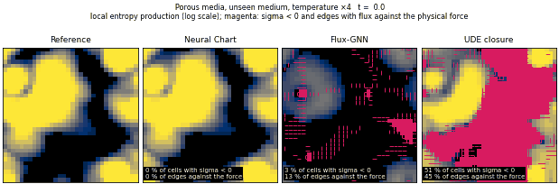
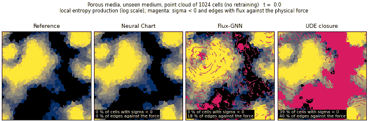
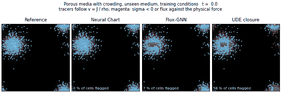
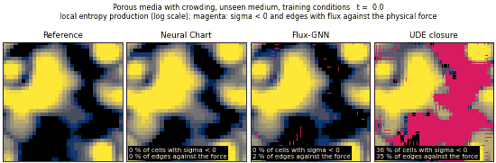
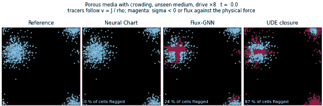
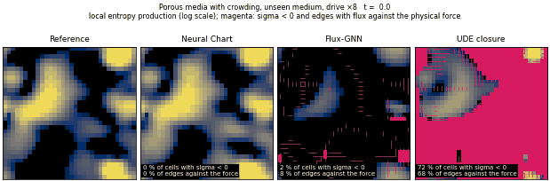

# Flow animations, porous media

Each animation follows one test trajectory in an unseen medium from t = 0 to 10.
The panels are the reference, the Neural Chart, Flux-GNN and the UDE closure, the models that have their own edge flux.
In the track animations, tracer particles move with the probability velocity v = J / rho of each model.
A particle turns magenta in a cell where the local entropy production is negative or where an edge carries flux against the physical force.
In the entropy animations, the colour shows the local entropy production on a log scale.
Cells with negative entropy production and edges with flux against the physical force are magenta.
`python -m benchmarks.porous_media.run gallery` renders them again.
Three more animations are in `assets/`: track and entropy under drive ×8, and track on the point cloud.

### Tracers under the training conditions

### Local entropy production under the training conditions

### Tracers at four times the training temperature

### Local entropy production at four times the training temperature

### Local entropy production on a random point cloud of 1024 cells, with the parameters trained on the 32×32 grid

### Tracers in the medium with crowding, under the training conditions

### Local entropy production in the medium with crowding, under the training conditions

### Tracers in the medium with crowding, at eight times the training drive

### Local entropy production in the medium with crowding, at eight times the training drive

