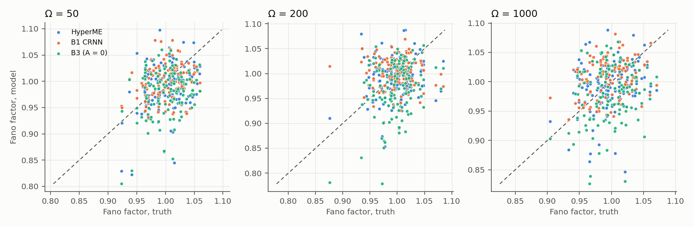

# WS3: fluctuations of the learned stochastic process

Question: when the learned rates are sampled as a chemical master equation, do their fluctuations match those of the true system, and do they do so better than a black-box rate model? Code `hyperme/ws3.py` (stages `c1_ssa`, `c1_tau`, `c3`, `c3wm`, `analyze`, `plot`, `report`), samplers in `hyperme/stochastic.py`. CPU, machine 49.

Setup. C1 phosphorylation cycle on the 8 x 8 grid, drive of `test_id` trajectory 0 (dG = 1.87, true local cycle affinity dG + log(k2/k2') = 5.78), every run started from the true state at t = 10 and recorded after a burn-in of 3 time units for 12 more, 32 trajectories. Models: the truth (true rate constants, mass action), HyperME (`hyper/runs/main/hyperme_s0`), HyperME trained with the R1 currents at 4 sites as an extra observable (`E5_runs/hyperme_obs-local4_s0`), B1 CRNN (`crnn_s0`), B3 HyperME with A = 0 (`hyperme_rev_s0`). Exact Gillespie at Omega = 50 (about 330 000 events per trajectory); Poisson tau-leaping (tau = 0.002) at Omega = 50, 200, 1000, which agrees with the exact sampler at Omega = 50 within the statistical spread of 32 trajectories (median Fano 1.007 vs 0.985, channel noise ratios within 10 percent). C3 Brusselator: the truth, HyperME trained with MPRK22 x 8, B1 CRNN, Omega = 200.

## What holds and what does not

- **(a) Occupation-number fluctuations do not separate the models.** All five give Fano factors of X and Xp within 3 to 4 percent of the truth at every Omega, and the site-to-site pattern is noise (correlation with the truth 0.1 to 0.3, B3 included). Single-time density fluctuations are as blind to the drive as the mean densities are.
- **(b) Single-channel current noise does separate them, and it shows the same blind spot as the means.** The relation Var(N+ − N−)/t = a + b of an isolated Poisson channel does not hold in the network, for the truth either: 0.71 for R1, 1.32 for R2, 0.6 to 0.8 for transport, from correlations between channels. So the e-geodesic reading of Λ(a, b), which is a statement about one isolated channel, is not testable channel by channel here. What the counts do measure is each channel's force log(a/b) and its noise level. The truth has log(a/b) = 4.91 on the nearly irreversible R2. HyperME has 1.43, B1 1.40, and HyperME with 4 current observables 2.03. HyperME reproduces the transport noise (ratio 0.95 to 1.05) but its R1 and R2 currents are 20 to 25 percent low and so is their noise. B3 has no net reaction current at all.
- **(c) The fluctuation relation with each model's own rates holds for every model, the black box included.** Slopes are 0.89 (truth), 0.90 (HyperME), 0.92 (HyperME + currents), 0.93 (B1) for 0.05-time windows. This is expected: for any Markov jump process with reversible channels the relation is an identity of the path measure, so B1 passes it as well. The slopes are below 1 because Σ here is the medium entropy of one local loop only, without the system term and the coupling to transport. B3 has slope 0: its loop entropy is a potential difference and averages out. **With the true forces evaluated on the model's paths the relation fails for every learned model**: slope 0.27 to 0.36 for HyperME, 0.33 to 0.36 for B1, 0.46 for HyperME with currents. The paths have about a third of the true irreversibility, because the R2 affinity is under-identified (C1, `results/crn_identifiability_summary.md`). Adding current observables moves the slope towards the truth, as the identifiability result predicts. On this test HyperME is not better than the black box.
- **(d) Limit-cycle noise in C3: HyperME is closer to the truth than B1.** In a well-mixed volume (one site, the same learned local rates, exact Gillespie, 570 to 650 periods per model) the period is 7.05 ± 0.96 for the truth, 7.19 ± 1.16 for HyperME and 7.93 ± 1.53 for B1. The phase diffusion coefficient is 0.052, 0.072 (+40 percent) and 0.093 (+81 percent). On the 8 x 8 grid the homogeneous limit cycle does not survive intrinsic noise at Omega = 200 in any model or in the truth: the noise breaks the spatial symmetry and the system falls onto a Turing pattern within two periods (peak-to-peak of the site-mean X drops from 2 to 0.1 by t = 21), at the same time in all three.

In short, the learned stochastic process is right where the deterministic data pin it down (densities, transport noise, the shape of the limit cycle) and wrong where they do not (the irreversibility of near-irreversible channels). Fluctuations measured on the system would identify the missing affinity: the true path ensemble has slope 1 against the true forces, a learned one does not.

### (a) Occupation numbers of X and Xp at every site (128 per model), Fano factor

| sampler, Omega | model | median Fano | median abs. rel. difference to truth | correlation with truth across sites |
|---|---|---|---|---|
| exact SSA, 50 | truth | 0.985 | – | – |
| exact SSA, 50 | HyperME | 0.985 | 0.036 | 0.17 |
| exact SSA, 50 | HyperME + 4 local currents | 0.972 | 0.039 | 0.07 |
| exact SSA, 50 | B1 CRNN | 0.995 | 0.029 | 0.19 |
| exact SSA, 50 | B3 (A = 0) | 0.972 | 0.032 | 0.19 |
| tau-leap, 50 | truth | 1.007 | – | – |
| tau-leap, 50 | HyperME | 0.994 | 0.027 | 0.29 |
| tau-leap, 50 | HyperME + 4 local currents | 0.975 | 0.041 | 0.20 |
| tau-leap, 50 | B1 CRNN | 0.999 | 0.032 | 0.18 |
| tau-leap, 50 | B3 (A = 0) | 0.986 | 0.034 | 0.25 |
| tau-leap, 200 | truth | 1.000 | – | – |
| tau-leap, 200 | HyperME | 0.995 | 0.029 | 0.11 |
| tau-leap, 200 | HyperME + 4 local currents | 0.972 | 0.033 | 0.28 |
| tau-leap, 200 | B1 CRNN | 1.001 | 0.027 | -0.05 |
| tau-leap, 200 | B3 (A = 0) | 0.978 | 0.036 | 0.30 |
| tau-leap, 1000 | truth | 0.994 | – | – |
| tau-leap, 1000 | HyperME | 0.996 | 0.029 | 0.24 |
| tau-leap, 1000 | HyperME + 4 local currents | 0.975 | 0.033 | 0.24 |
| tau-leap, 1000 | B1 CRNN | 1.009 | 0.025 | 0.26 |
| tau-leap, 1000 | B3 (A = 0) | 0.986 | 0.036 | 0.19 |

### (b) Net firing count of single reaction channels, exact SSA, Omega = 50 (median over the 64 sites)

| model | channel | mean one-way rates a + b | Var(N+ - N-)/t over a + b | J over a - b | J / J_truth | Var/t over truth | log(a/b) |
|---|---|---|---|---|---|---|---|
| truth | R1 | 73.9 | 0.71 | 0.997 | – | – | 0.86 |
| truth | R2 | 27.0 | 1.32 | 0.998 | – | – | 4.91 |
| truth | TX | 19.8 | 0.77 | – | – | – | 0.00 |
| truth | TXp | 54.5 | 0.59 | – | – | – | -0.00 |
| HyperME | R1 | 55.0 | 0.79 | 1.000 | 0.80 | 0.79 | 0.90 |
| HyperME | R2 | 33.7 | 0.93 | 0.999 | 0.75 | 0.88 | 1.43 |
| HyperME | TX | 22.4 | 0.67 | – | – | 1.05 | 0.01 |
| HyperME | TXp | 54.1 | 0.58 | – | – | 0.95 | -0.00 |
| HyperME + 4 local currents | R1 | 52.6 | 1.04 | 1.002 | 1.02 | 0.90 | 1.28 |
| HyperME + 4 local currents | R2 | 34.6 | 1.24 | 0.998 | 1.02 | 1.29 | 2.03 |
| HyperME + 4 local currents | TX | 18.8 | 0.75 | – | – | 0.95 | -0.00 |
| HyperME + 4 local currents | TXp | 60.3 | 0.58 | – | – | 1.02 | 0.00 |
| B1 CRNN | R1 | 52.4 | 1.01 | 1.001 | 1.07 | 0.97 | 1.40 |
| B1 CRNN | R2 | 47.0 | 1.03 | 1.001 | 1.08 | 1.34 | 1.40 |
| B1 CRNN | TX | 18.9 | 0.76 | – | – | 1.00 | -0.02 |
| B1 CRNN | TXp | 52.2 | 0.58 | – | – | 0.93 | -0.02 |
| B3 (A = 0) | R1 | 61.1 | 0.58 | 0.289 | 0.00 | 0.60 | 0.00 |
| B3 (A = 0) | R2 | 22.5 | 0.76 | 0.947 | 0.00 | 0.46 | 0.01 |
| B3 (A = 0) | TX | 19.9 | 0.69 | – | – | 0.98 | -0.00 |
| B3 (A = 0) | TXp | 57.8 | 0.58 | – | – | 0.99 | -0.00 |

### (c) Fluctuation relation for the local R1 + R2 loop, exact SSA, Omega = 50

Slope of log P(Σ)/P(−Σ) against Σ, fitted through the origin over bins of width 0.5 with at least 10 counts on both sides; Σ pooled over 64 sites x 32 trajectories x non-overlapping windows after burn-in. "own" = medium entropy under the rates that generated the path, "true forces" = under the true rates evaluated on the same path.

| model | window | slope, own rates | slope, true forces on this path | mean Σ own / true | bins (own / true) |
|---|---|---|---|---|---|
| truth | 0.05 | 0.89 ± 0.00 | – | 11.3 / – | 15 / – |
| truth | 0.25 | 0.82 ± 0.05 | – | 56.4 / – | 6 / – |
| HyperME | 0.05 | 0.90 ± 0.00 | 0.27 ± 0.00 | 2.8 / 7.7 | 15 / 53 |
| HyperME | 0.25 | 0.89 ± 0.01 | 0.36 ± 0.01 | 13.9 / 38.6 | 12 / 25 |
| HyperME + 4 local currents | 0.05 | 0.92 ± 0.00 | 0.46 ± 0.00 | 7.4 / 11.4 | 15 / 27 |
| HyperME + 4 local currents | 0.25 | 0.91 ± 0.02 | 0.46 ± 0.01 | 37.1 / 56.9 | 9 / 15 |
| B1 CRNN | 0.05 | 0.93 ± 0.00 | 0.33 ± 0.00 | 5.9 / 12.2 | 15 / 38 |
| B1 CRNN | 0.25 | 0.90 ± 0.02 | 0.36 ± 0.01 | 29.6 / 61.2 | 10 / 22 |
| B3 (A = 0) | 0.05 | -0.00 ± 0.00 | 0.00 ± 0.00 | -0.0 / 0.0 | 11 / 80 |
| B3 (A = 0) | 0.25 | -0.00 ± 0.01 | 0.00 ± 0.00 | -0.0 / 0.2 | 13 / 115 |

### (d) C3 limit cycle at Omega = 200

Well-mixed (one site, exact SSA, 32 trajectories x 150 time units):

| model | mean period | std | CV | phase diffusion D = 2 pi^2 Var(T) / T^3 | periods counted |
|---|---|---|---|---|---|
| truth | 7.05 | 0.96 | 0.136 | 0.0515 | 645 |
| HyperME | 7.19 | 1.16 | 0.162 | 0.0719 | 630 |
| B1 CRNN | 7.93 | 1.53 | 0.193 | 0.0931 | 568 |

8 x 8 grid (tau-leaping, 32 trajectories), median peak-to-peak of the site-mean X in time windows:

| model | t 0-7 | 7-14 | 14-21 | 21-40 | 40-77 |
|---|---|---|---|---|---|
| truth | 2.05 | 1.32 | 0.17 | 0.09 | 0.10 |
| HyperME | 1.91 | 1.40 | 0.14 | 0.09 | 0.10 |
| B1 CRNN | 1.68 | 1.41 | 0.19 | 0.10 | 0.11 |
