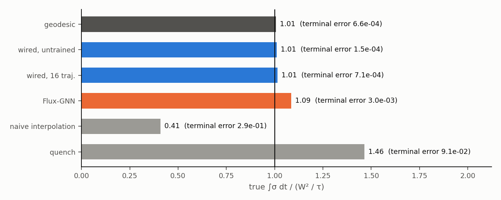

# WS5: minimum-dissipation control with the learned model

Code `hyperme/ws5.py` (stages `bound`, `opt`, `eval`, `inverse`, `plot`). Machine 49, GPU 0 shared with one colleague (at most 2 processes, at most 10 GB).

## Task

S2 without drift: a density on the 32 x 32 torus with D = 0.02, moved from rho_0 (the final state of `test_id` trajectory 0) to rho_T (the final state of trajectory 1) in time tau = 2. The control is a potential U(t) on the nodes: 20 time nodes, linear in between, held constant over each sampling interval of 0.05. The cost is the time-integrated entropy production. The terminal state is imposed with an augmented Lagrangian, and gradients go through the explicit positive substeps of the rollout (Adam: 1000 steps for the two wired models, 400 for Flux-GNN, which costs 5 s per step).

"True system" means the untrained wired model. It is the SQRA discretisation of the reference equation (10T error 4.1e-3 against the 64 x 64 finite-volume reference). The reference solver itself cannot take a 32 x 32 control field.

## Lower bound

For the SQRA rates a = k rho_i e^{(U_i - U_j)/2} and b = k rho_j e^{(U_j - U_i)/2}, the product ab = k^2 rho_i rho_j does not depend on U. So a flux J on an edge costs at least 2 J asinh(J / 2g), with g = k sqrt(rho_i rho_j), whatever the potential. For slow protocols this is J^2 / g. The minimum over all protocols is then the discrete Benamou–Brenier energy with the geometric-mean mobility, W^2 / tau, and the potential U = -psi - log rho attains it (psi is the Kantorovich potential of the geodesic). We solved the time-discrete Benamou–Brenier problem (40 intervals, midpoint mobility, a weighted Poisson solve per interval, L-BFGS) and got W^2 / tau = 188.97. The largest J/g on the geodesic is 0.125, so the exact cost differs from the quadratic one by about 0.1 percent. The geodesic potential also gives the reference protocol.

## Results: every protocol run in the true system

| protocol | true ∫σ dt | / bound | terminal error | U(t) vs the geodesic potential (correlation, relative difference) |
|---|---|---|---|---|
| geodesic (Benamou–Brenier) | 190.31 | 1.007 | 6.6e-4 | – |
| optimised on the wired model, untrained | 190.85 | 1.010 | 1.5e-4 | 0.999, 5 % |
| optimised on the wired model, trained on 16 trajectories | 191.72 | 1.015 | 7.1e-4 | 0.996, 9 % |
| optimised on Flux-GNN (black box, proxy cost) | 205.32 | 1.087 | 3.0e-3 | 0.962, 28 % |
| quench (U = −log rho_T from t = 0) | 276.68 | 1.464 | 9.1e-2 | – |
| naive interpolation of the equilibrium potentials | 77.19 | 0.409 | 2.9e-1 (misses the target) | – |

## Reading

- **The bound is tight and the learned model finds it.** The geodesic protocol, run in the true system, dissipates 1.007 times W^2/tau. The 0.7 percent comes from the time discretisation and the potential held over each interval. Optimising through the wired model gives 1.010 (untrained) and 1.015 (trained on 16 trajectories), both within 1.5 percent of the bound. Their potentials match the geodesic Kantorovich potential (correlation 0.999 and 0.996). The geodesic dissipates at a constant rate, as a constant-speed geodesic should. The optimised protocols follow that rate except for the last few intervals, where they relax onto the target.
- **The black box gives a worse protocol.** Flux-GNN has no entropy production, so it minimises the kinetic-energy proxy sum J^2/(k rho_mean). Its protocol reaches the target (error 3e-3) but dissipates 8.7 percent above the bound in the true system. Its dissipation is concentrated early, and its potential differs from the geodesic one by 28 percent, with grid-scale artefacts. The gap is real but modest: the Flux-GNN fits S2 well, and its proxy is close to the true cost for slow protocols. Without a thermodynamic structure it cannot report its own dissipation, and the protocol inherits the errors of its rates.
- **Naive protocols.** A sudden quench costs 1.46 times the bound and still misses the target by 9 percent at tau = 2. Interpolating the equilibrium potentials dissipates little, but it moves the density only a third of the way (terminal error 29 percent).
- Limits: one pair (rho_0, rho_T), one tau, no drift (the bound is for pure transport), and the true system is the SQRA discretisation rather than the fine reference.

## Inverse design: a prescribed stationary state

Target: a stationary density rho* with two smooth bumps of different heights. In the wired model without drift the stationary state is e^{-U}, so U = -log rho* is the exact answer in one line. Its stationary state in the true system matches rho* to 1.8e-15.

Flux-GNN has no such relation. We optimised U, starting from U = 0, so that the black box's state after 3 time units from a uniform start equals rho* (100 Adam steps, 20 minutes, gradient checkpointing). The black box reaches rho* to 0.26 percent in its own dynamics. The stationary state of the same U in the true system misses rho* by 3.2 percent: the error of the black-box rates goes straight into the design.
