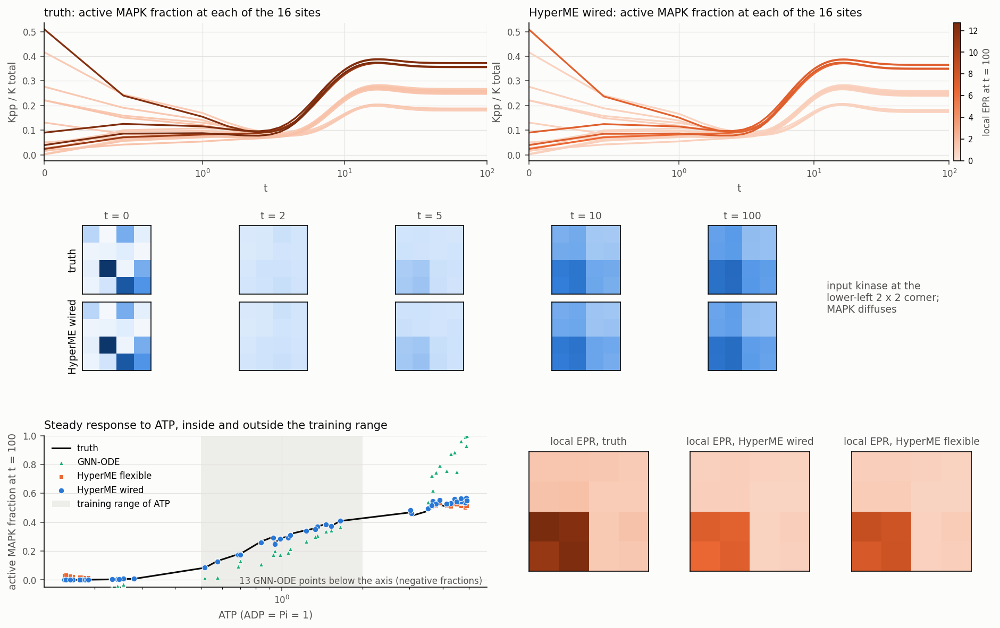

# WS6a: a MAPK cascade with the Huang–Ferrell structure

Code `hyperme/mapk.py`. CPU on machine 49, except the GNN-ODE training (GPU 0 shared with one colleague, at most 10 GB).

**This is a cascade with the Huang–Ferrell structure. Its parameters are dimensionless example values, not those of BIOMD0000000009.** Three things led to this choice. Downloading the SBML file needs the user's approval, which we did not have. The published rate constants make the system stiff by a factor of about 1e4, with binding about 1e3 per second against signalling on the scale of minutes. And the input kinase would have about 0.006 molecules at system size 200.

## System

Three tiers, MAPKKK → MAPKK (two phosphorylations) → MAPK (two phosphorylations). Every enzymatic step is a binding E + S ⇌ ES followed by a catalysis ES (+ ATP) ⇌ E + P (+ ADP or Pi), with mass action throughout. That gives 22 species per site (12 free forms, 10 enzyme–substrate complexes) and 20 reactions. ATP, ADP and Pi are chemostats, and the drive is log ATP with ADP = Pi = 1. Rate constants: binding 10, unbinding 2, kinase catalysis 2, phosphatase catalysis 1, every reverse catalysis 1e-3 of the forward one. The fastest and slowest processes are within a factor of about 1e2. Totals: 1 for each tier, 0.2 to 0.3 for the phosphatases. The input kinase is present (0.15 to 0.45) only at the 2 × 2 corner of a 4 × 4 grid. MAPK in its three forms diffuses with rate 0.5 per edge, so the signal spreads. The hypergraph has 352 state components and 416 hyperedges, a cycle space of dimension 161 and 97 conserved moieties.

The rate constants are equal within each reaction class, so they satisfy the Wegscheider conditions of the 130 closed cycles that include the chemostats. The truth is therefore a thermodynamically consistent mass-action network: species standard potentials, chemostat potentials and symmetric prefactors reproduce it exactly.

Data: ODE truth (LSODA, rtol 1e-8). Training: 48 trajectories × 20 steps of 0.5 (10 time units), ATP log-uniform in [0.5, 2], mostly unphosphorylated starts. Tests, 16 trajectories × 200 steps (100 time units) each: ID; ATP in [3, 5]; ATP in [0.15, 0.3]; starts mostly phosphorylated.

## Models

All rate models use the positive explicit substeps. Binding consumes two species, so the Patankar scheme does not apply.

- **HyperME wired.** μ = log c + μ⁰ (22 learned standard potentials), A = the exact chemostat force plus 3 learned chemostat standard potentials, and k = a learned log-rate table per hyperedge type times the exact chemostat mass-action factor. No knob is a network input. 49 parameters.
- **HyperME flexible.** Free-energy MLP with log ATP as a node input, kinetics MLP and a drive MLP fed the chemostat force as a feature (no exact channel), projected onto ker S.
- **CRNN-chem (oracle class).** Mass action, free kf and kb per hyperedge type, chemostat concentrations as exact mass-action factors.
- **CRNN.** Mass action, kf and kb from an MLP that takes the chemostat force as an input.
- **GNN-ODE.** Bipartite message passing with log ATP as a node input. Trained for 1500 steps instead of 2000 (4 s per step), with 10 Heun substeps per step.

Protocol: rollout loss over 4 to 8 steps, batch 8, Adam with cosine schedule, 2000 steps (4000 for the table models). For each model we tried the learning rates 1e-3, 1e-2 and 2e-2 and kept the run with the lowest final training loss. No choice used test data.

## Results

| model | params | 10T ID | 10T ATP high (3-5) | 10T ATP low (0.15-0.3) | 10T initial state OOD | T ID | Kpp error at t = 100, ID / high / low | moiety drift (max) | min c | sigma rel. err ID / high | ATP turnover rel. err at t = 100, ID / high / low | substeps per DT | train s |
|---|---|---|---|---|---|---|---|---|---|---|---|---|---|
| HyperME wired (lr 0.01) | 49 | 0.0381 | 0.0597 | 0.0273 | 0.0388 | 0.0286 | 0.00436 / 0.0272 / 0.00103 | 7.7e-15 | 6.4e-06 | 0.355 / 0.331 | 0.069 / 0.0955 / 0.0796 | 14.0 | 759 |
| HyperME flexible (lr 0.02) | 17497 | 0.012 | 0.0221 | 0.0755 | 0.0119 | 0.00974 | 0.00188 / 0.0121 / 0.0153 | 5.3e-15 | 6.2e-06 | 0.31 / 0.254 | 0.0179 / 0.0761 / 0.132 | 14.4 | 959 |
| CRNN-chem (oracle class) (lr 0.01) | 46 | 0.0316 | 0.0205 | 0.0337 | 0.0315 | 0.0245 | 0.00826 / 0.00538 / 0.00159 | 7.1e-15 | 3.7e-06 | 0.376 / 0.368 | 0.0344 / 0.0249 / 0.0838 | 19.1 | 658 |
| CRNN (ATP as input feature) (lr 0.02) | 5954 | 0.0261 | 0.0968 | 0.221 | 0.0232 | 0.0474 | 0.0162 / 0.0708 / 0.0338 | 7.3e-15 | 2.6e-06 | 1.51 / 1.53 | 0.0742 / 0.0296 / 1.44 | 8.0 | 173 |
| GNN-ODE (lr 0.001) | 153345 | 0.679 | 0.76 | 0.763 | 0.631 | 0.0377 | 0.0752 / 0.258 / 1.31 | 1.2e+00 | -5.2e-01 | – / – | – / – / – | 10.0 | 5725 |

| one site, Omega = 200 | active MAPK (molecules), mean | Fano | ATP turnover per unit time, mean | Var(N_ATP)/t |
|---|---|---|---|---|
| truth | 162.8 | 0.20 | 100.1 | 33.8 |
| HyperME wired | 159.1 | 0.25 | 100.1 | 90.4 |
| CRNN-chem (oracle class) | 157.9 | 0.24 | 98.4 | 49.9 |
| CRNN (ATP as input feature) | 162.4 | 0.20 | 101.4 | 51.0 |

## Reading

- **The wired model class is exact, and the first wired design missed one factor.** With the true parameters, the wired model reproduces the truth to 4e-11 on every test set, ATP outside the training range included. Getting there needed one fix. A chemostat is a mass-action species with known activity, so it enters the symmetric prefactor as exp(<ν⁺ + ν⁻, log c_Y>/2), for example sqrt(ATP ADP), and not only the force log(ATP/ADP). The first wired design omitted this factor and was off by 5 percent with the true parameters. The library now includes it.
- **Training the exact class is the hard part.** From a generic start (μ⁰ = 0, k = 1), the wired model with an MLP for log k drifts into stiff regions (up to 270 substeps per interval) and stops at a loss of about 1e-2. The same happened with a learning rate of 2e-2, with a one-step derivative warm start (the derivative loss stuck at 1.0) and with a local-equilibrium initialisation of μ⁰. Started from the true parameters plus noise of 0.3, it returns to a loss of 6e-6 in 400 steps, so the basin is fine near the truth. A log-rate table instead of the MLP (the same function of a one-hot type) removes the problem: loss 6e-5 after 4000 steps, without stiffness. The oracle-class CRNN-chem shows the same effect (MLP rates: plateau at 8e-4 for both learning rates; table: 1.6e-4).
- **In distribution, the flexible model is best.** Its 10T error is 1.2 percent, against 3.2 to 3.8 percent for the two exact-class models. Over the 10 time units of training, wired fits as well as flexible (training loss 6e-5 for both), and CRNN-chem slightly worse (1.6e-4). The difference appears in the 100-unit steady state, where small errors in the slow rates accumulate.
- **Extrapolation in ATP: the exact chemostat channel helps at low ATP, where the response is switch-like.** At ATP 0.15 to 0.3, the wired model reaches 2.7 percent and CRNN-chem 3.4 percent. The flexible model, which sees ATP only as a feature, reaches 7.6 percent, and the CRNN with ATP as an input 22 percent. At ATP 3 to 5, CRNN-chem (2.1) and flexible (2.2) beat wired (6.0). There, the saturated steady state is set by the slow rates, which wired has slightly wrong.
- **Structure.** All 97 moieties (kinase totals per tier and site, enzymes, the diffusing MAPK total) are conserved to 8e-15 by every model with the stoichiometry. No such model produces a negative concentration. GNN-ODE breaks conservation (drift up to 120 percent), produces negative fractions on all 64 test trajectories, and reaches 63 to 76 percent at 10T, although its loss inside the training window is low (T error 3.8 percent).
- **Thermodynamic readouts.** The relative error of σ(t) is 0.18 to 0.38 for the two models with the exact chemostat channel (wired, CRNN-chem) on all three ATP ranges. It is 0.25 to 0.31 for flexible near the training range and 0.71 at low ATP, and about 1.5 for the CRNN with ATP as a feature. The ATP turnover at steady state, the cycle observable, is within 2 to 10 percent for wired and CRNN-chem on all ranges and 2 to 13 percent for flexible. The feature CRNN is off by 144 percent at low ATP. Wired and flexible both underestimate the dissipation at the input corner (local EPR map in the figure).
- **Fluctuations (one site, Omega = 200).** Every model gets the mean active MAPK and the mean ATP turnover within 3 percent. None gets the turnover noise. Var(N_ATP)/t is 33.8 in the truth, about 50 for both CRNNs, and 90 for wired. The wired kinetics fits the mean currents with different one-way rates, the same blind spot as in C1 and WS3.
- Limits: one seed per model; GNN-ODE had a shorter training budget; the learning-rate selection used the training loss only.
